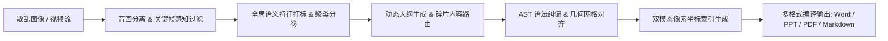

# 图片与视频转文档群及AI重组织知识网络系统 (DocReconstruct System)

## 1. 系统定义与工程目标

本系统是一套面向非结构化视觉素材（散乱图片集合、连续操作录屏、会议研讨白板）的自动化逆向重构软件体系。通过多模态特征感知、局部几何校正、确定性语法分析与行业模板约束，将低质量、无序的图像序列解析并编译为符合企业规范的多格式结构化文档（Word、PPT、PDF、Markdown）及双向关联知识网络。

---

## 2. 规范化工程与战略文档导航 (Documentation Architecture)

文档体系基于严格的工程推演、技术可行性边界与财务测算构建，划分为五个核心模块：

```text
docs/
├── 01_市场调研与真实需求/
│   ├── 01_全球市场规模与TAM_SAM_SOM测算报告.md     # 行业宏观数据测算与标杆企业财务量化
│   ├── 02_竞品全景对比与商业可行性分析.md           # SOP工具与传统OCR技术断层及合规准入分析
│   ├── 03_社区一线用户真实痛点与地表声音.md         # 开发者及行业一线手动整理成本与技术难点调研
│   └── 04_目标客群画像与付费意愿分析.md             # 3大核心客群分级（政企离线一体机/商业上云SaaS/个人客户端）深度画像与商业变现模型
│
├── 02_战略愿景与核心目标/
│   ├── 01_项目战略愿景与核心定位.md                # 软件工程本质定位与差异化技术边界
│   ├── 02_核心目标分级与成功验收指标.md            # G1~G6 逐级工程目标与量化验收指标 (KPIs)
│   ├── 03_确定性技术壁垒与合规准入条件分析.md        # 算法边界、双模态坐标映射与内网离线准入条件
│   ├── 04_早期阶段排除模型训练的技术与财务依据.md    # 算力资本支出(CapEx)约束与基座折旧周期分析
│   └── 05_模型演进与独立软件生命周期分析.md         # 窗口期假说、36个月演进路线与资本回收约束
│
├── 03_产品需求规格说明/
│   ├── 01_PRD_全景需求规格说明书.md               # 数据摄入、重组织、纠偏与知识网功能矩阵
│   ├── 02_多格式输出规范设计_Word_PPT_PDF_Markdown.md # 微软 OpenXML 原生排版与多格式渲染技术规范
│   ├── 03_双模架构设计_1比1完全还原与目标导向重组.md  # 确定性物理还原与模板约束重构双模实现方案
│   ├── 04_迭代研发全景规划与里程碑总览.md          # 8个独立可验证迭代演进路线图与准入准出基线
│   ├── 05_核心迭代PRD_Iter1_单图基础识别与结构化Markdown流水线.md # 【前期核心】单图预处理、版面分析与DocAST-v1
│   ├── 06_核心迭代PRD_Iter2_复杂元素深度自愈与原生Word文档生成.md # 【前期核心】表格网格还原、公式LaTeX、代码AST与Word生成
│   ├── 07_核心迭代PRD_Iter3_无序素材聚类_动态大纲推导与重组织.md  # 【前期核心】无序图片聚类、大纲树推导、碎片去重与双链
│   ├── 08_核心迭代PRD_Iter4_像素级双模态坐标映射与免责溯源系统.md  # 【前期核心】Click-to-Source像素BBox映射与证据卡片
│   ├── 09_扩展迭代PRD_Iter5_视频录屏切帧与音画对齐文档化.md      # 【后期扩展】FFmpeg场景切片、Whisper语音转录与SOP归纳
│   ├── 10_扩展迭代PRD_Iter6_多格式原生兼容_PPT_PDF与模板系统.md  # 【后期扩展】OpenXML PPTX编译器、矢量PDF与企业模板
│   ├── 11_扩展迭代PRD_Iter7_软件安全防逆向与离线授权保护.md      # 【后期扩展】机器码固化、Ed25519硬件指纹与DoD数据销毁
│   └── 12_扩展迭代PRD_Iter8_多模态知识库混合检索与自愈反哺飞轮.md  # 【后期扩展】四路混合检索、证据溯源问答与Delta Patch自愈
│
├── 04_架构设计与技术实现/
│   ├── 01_系统总体架构与技术方案.md               # 六阶段微流水线拓扑图与技术选型矩阵
│   ├── 02_核心算法设计_文档重组织与智能纠偏.md      # 主题聚类、大纲推演、AST语法纠偏与链接消歧
│   ├── 03_跨模态视频处理与音画对齐技术方案.md       # FFmpeg场景切分、SSIM感知去重与Whisper时空绑定
│   ├── 04_软件安全防逆向与离线授权保护方案.md       # Cython二进制机器码固化、硬件指纹防篡改与离线License验签
│   └── 05_知识库多模态混合检索与问答反哺架构方案.md   # 词法向量双模态混合检索、证据溯源问答与级联反哺飞轮
│
└── 05_DevOps与敏捷迭代/
    └── 01_DevOps敏捷迭代路线图与演进规划.md        # 渐进式交付路线图与各版本发布里程碑
```

---

## 3. 系统流水线技术拓扑


