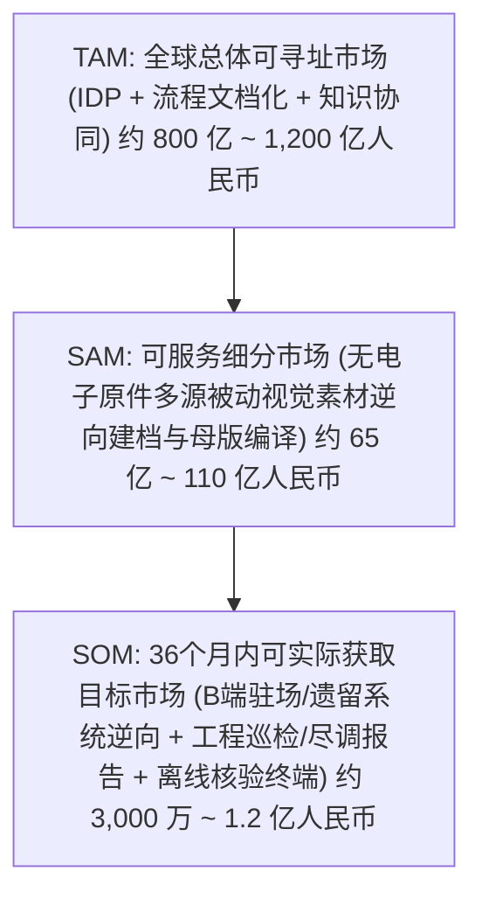

# 全球市场规模与 TAM / SAM / SOM 测算报告

## 1. 行业宏观数据与标杆企业财务验证 (Executive Data Highlights)

基于 Gartner、IDC、Grand View Research 行业测算及国内外代表性企业的公开财务与融资数据，智能文档处理（IDP）、流程视觉文档化与可溯源审计工作台赛道具备明确的商业体量，但内部各细分方向的竞争饱和度与商业变现效率存在显著分化：

1. **宏观赛道规模**：
   - **全球智能文档处理（IDP）市场**：2026 年市场规模约为 **30 亿 ~ 39 亿美元**，复合年增长率（CAGR）维持在 **15% ~ 28%** 区间，预计 2030 年达到 **150 亿 ~ 250 亿美元（折合人民币约 1,000 亿 ~ 1,800 亿元）**。
2. **标杆企业公开财务与融资基准（2024—2026 实证数据）**：
   - **Scribe（流程捕捉转操作指南 SaaS）**：2025 年 11 月完成由 StepStone Group 领投的 7,500 万美元 C 轮融资，投后估值 **13 亿美元**；2026 年第二季度公开年度经常性收入（ARR）突破 **1 亿美元**。
   - **Guidde（AI 视频操作文档平台）**：2026 年 2 月完成由 PSG Equity 领投的 5,000 万美元 B 轮融资，累计融资约 8,000 万美元，服务企业客户超 4,500 家。
   - **DataSnipper（审计底稿 OCR 与像素级溯源工作台）**：完成 Index Ventures 领投的 1 亿美元 B 轮融资，估值达 **10 亿美元**，ARR 超 **4,500 万美元**，验证了严肃合规场景对“非结构化凭证识别 + 单元格像素框一键溯源（Click-to-Source）”的高付费意愿。
   - **合合信息（扫描全能王 / TextIn，688615.SH）**：2024 年 9 月于科创板上市；2026 年半年度报告披露主营业务收入 **10.31 亿元人民币**（同比增长 22.28%），归母净利润 **2.47 亿元人民币**，验证了图像预处理与文档解析底座的商业现金流能力。

---

## 2. 去泡沫化三层市场规模测算模型 (TAM / SAM / SOM)

> [!IMPORTANT]
> **测算口径修正说明**：存量规整 PDF 解析与企业通用 RAG 知识库赛道（国内由合合信息、庖丁科技、达观数据等占据，海外由 LandingAI、Reducto 等覆盖）已进入红海竞争；纯 C 端通用截图转 Markdown 笔记受免费开源插件与大模型工作台挤压，独立变现空间有限。因此，本报告在 SAM 与 SOM 测算中**主动剥离“规整存量 PDF 解析”与“泛 C 端轻量笔记”规模**，严格锁定**“无电子原件场景下，多源乱序被动视觉素材（屏摄/巡检照片/受控环境录屏）向强格式工程交付件（`.docx`/`.pptx`）编译与免责溯源”**的真实可触达市场。

### 2.1 TAM（Total Addressable Market，全球总体可寻址市场）：约 800 亿 ~ 1,200 亿人民币
- 涵盖全球企业在智能文档解析（Document AI）、标准作业程序（SOP）自动化生成、审计底稿自动化及企业结构化文档管理上的软硬件总支出。

### 2.2 SAM（Serviceable Available Market，真实可服务细分市场）：约 65 亿 ~ 110 亿人民币
- **严格边界定义**：输入端不存在现成有序电子文档（PDF/Word），仅能通过非侵入式拍照、外部屏幕录制、口头录音采集散乱有损视觉素材，且输出端强制要求符合行业母版规范、零参数幻觉与像素级溯源审计的垂直市场。
- **细分结构测算**：
  1. **传统政企、工业与医疗遗留系统“无源码/无文档”逆向建档与信创迁移评估**：约 30 亿 ~ 45 亿元；
  2. **工程现场巡检、安全评估与财务/法务尽职调查多图凭证编译为标准报告/底稿**：约 20 亿 ~ 35 亿元；
  3. **IT 外包驻场受限环境（Citrix / VDI / 物理隔离机房）合规交接资产化**：约 15 亿 ~ 30 亿元。

### 2.3 SOM（Serviceable Obtainable Market，36 个月实际可获取市场）：约 3,000 万 ~ 1.2 亿人民币
- 基于初创工程团队的资源约束与招投标准入周期，分阶段切入以下高转化细分客群所能获取的合同总额：
  1. **第一优先级（0~12 个月 PMF 突破口，预计贡献 1,000 万 ~ 3,500 万元）**：中大型 IT 实施与外包团队、工程检测/安全评估机构、会计师与律师事务所现场尽调团队的部门级采购（决策周期 2~4 周，聚焦解决“百张现场照片/录屏一键编译甲方标准 `.docx` 报告 + 低置信度参数核验”）；
  2. **第二优先级（12~36 个月利润放大器，预计贡献 2,000 万 ~ 8,000 万元）**：信创老旧系统替代专项工程与涉密单位物理隔离离线核验一体机（或作为专业视觉逆向引擎嵌入大型总集成商交付方案）；
  3. **第三优先级（辅助转化，预计直接营收 < 500 万元）**：专业科研人员与独立顾问的单机桌面授权（核心考核指标为低成本获客漏斗与极端退化样本反馈，不作为核心营收支柱）。
