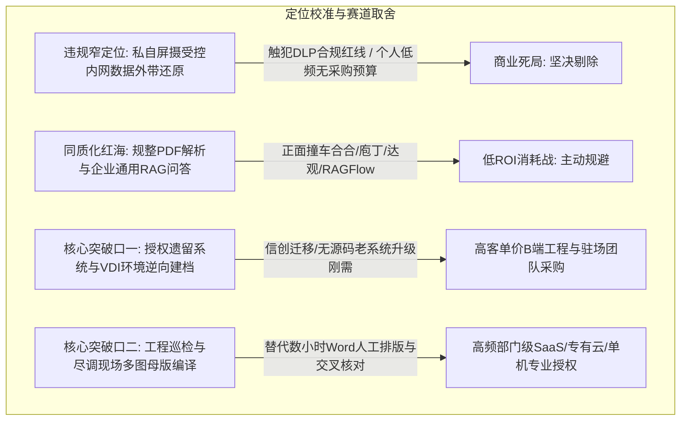

# 竞品全景对比与商业可行性深度剖析

## 1. 2025—2026 细分竞品与替代工作流全景矩阵

经对国内外商业产品与开源生态的交叉核验，单点技术环节（如免插件视频转线性 SOP、有序 PDF 跨页解析、常规文档划词溯源）均已出现成熟产品。本系统必须建立在客观认知现有竞品真实能力边界的基础上，规避同质化正面消耗，精准切入现有工具链的结构性断层：

| 竞品/替代方案阵营 | 典型代表产品 (2025—2026) | 核心实现机制与已解决能力 | 真实能力边界（无法覆盖本系统核心场景的原因） |
| :--- | :--- | :--- | :--- |
| **1. 客户端插件型 SOP 工具** | Scribe, Tango, Guidde | 在宿主机浏览器或桌面安装插件/Hook，监听鼠标点击事件与 DOM 树生成步骤卡片。 | 1. Citrix / VMware Horizon 等 VDI 桌面仅传输像素流，插件无法感知内部控件； 2. 受控内网与客户生产终端严禁安装未授权监控插件； 3. 仅能生成线性 UI 点击指南，无法提取数据库表结构、网络拓扑与系统架构文档。 |
| **2. 免插件视频上传型 SOP 工具** | Trupeer AI, Clueso, Kommodo, Hinto AI, Docsie | 支持直接上传外部录制的 `.mp4`/`.mov` 视频，通过视觉帧切换检测与语音转录生成图文步骤手册。 | 1. **仅限单视频转单篇线性操作规程**，面对“多段录屏 + 百张乱序屏摄照片 + 白板图”混杂输入无全局聚类分卷能力； 2. 缺乏跨时序配置修改/回退状态消歧与代码 AST 语法级纠偏； 3. 均为海外公有云 SaaS，无法满足国内涉密断网私有化与信创准入要求。 |
| **3. 新一代版面与文档解析引擎** | **开源**：MinerU 2.5/Pro, PaddleOCR-VL-1.5, DeepSeek-OCR 2, Docling **商业**：TextIn xParse, Doc2X | 采用“版面检测粗筛 + 局部高分辨率 VLM 识别”，已在多栏阅读序、公式还原、规整跨页表格拼接及屏摄去摩尔纹上达到工业级水准。 | 1. **强假设输入为“单份已按页码排好序的连续文档/PDF”**； 2. 面对顺序颠倒、多主题穿插、含局部滚动重叠截图的现场照片集，仅能输出孤立单页文本，无法执行跨图去重拼接与行业大纲重构； 3. *工程策略：底层单页版面分割应积极集成开源引擎，不重复造轮子*。 |
| **4. 规整文档溯源与政企一体机厂商** | **海外**：DataSnipper, LandingAI (ADE), Reducto **国内**：庖丁科技 (ChatDOC TapSource™), 合合信息, 达观数据 | 将规整 PDF/扫描件解析后绑定 Bounding Box 坐标实现点击高亮溯源，并提供适配昇腾/麒麟的政企私有化一体机。 | 1. 核心面向**已成册的金融财报、审计凭证、招投标书与法律合同 PDF** 的静态审查与 RAG 问答； 2. 不支持“无电子原件、从 0 到 1 多源有损照片/视频采集 -> 跨时序冲突消解 -> 甲方复杂 `.docx` 母版编译”的逆向建档工作流。 |
| **5. 通用 AI 知识工作台组合流** | NotebookLM, 腾讯 ima, 飞书妙记+知识库, Claude/Gemini Projects | 多模态长上下文检索问答与摘要生成（如飞书妙记转音视频 + 多模态模型识图总结）。 | 1. **产品定位为“问答与摘要工具”而非“确定性排版编译器”**，生成文本普遍存在技术参数概括省略； 2. 视频、批量劣质屏摄图、母版排版需跨 3~4 个工具手工串联； 3. 无法一键输出兼容旧版 Office/WPS 且严守固定表格/图注规范的 `.docx` 交付件。 |
| **6. 低代码现场巡检表单平台** | 简道云, 伙伴云, 宜搭, 垂直巡检小程序 | 预先配置移动端结构化表单，现场逐项点选拍照后套用 `docxtpl` 模板导出 Word。 | 依赖采集人员在现场具备充足时间与网络逐项填表；无法处理**地下室/机房无网、戴手套作业或紧急驻场交接时“先盲拍百张图/录屏、事后集中逆向整理”**的非结构化场景。 |
| **★ 本系统错位定位 (DocReconstruct)** | **多源有损视觉逆向重构与受控母版编译工作台** | **非侵入被动采集 + 退化屏摄逆变换坐标守恒 + 跨时序/滚动碎片消歧重组 + 导出前像素溯源核验 + 原生 OpenXML 母版编译** | **精准填补交叉空白**：不与通用 PDF 知识库或 C 端免费笔记正面拼消耗，专攻“无存量电子原件”场景下从杂乱视觉素材到严肃 `.docx`/`.pptx` 正式交付件的确定性闭环。 |

---

## 2. 商业定位合规红线与红海规避准则

### 2.1 合规准入铁律：严禁触碰违规数据外带场景
- **企业信息安全采购红线**：任何正规企业与机构均不会采购协助员工绕过数据防泄漏（DLP）机制私自外带受控屏幕数据的工具。
- **合法授权场景锁定**：产品商业化叙述与功能设计严格限定于**经合法授权的会议架构研讨沉淀、无源码老旧系统升级逆向建档、现场工程巡检记录编译、以及审计/法务合规尽职调查底稿生成**。

### 2.2 竞争策略铁律：严禁在早期陷入“通用知识库”同质化泥潭
- 国内政企通用知识库与规整 PDF 智能审阅市场已高度成熟，头部厂商握有完备的招投标资质与总集商生态。
- 本系统早期核心研发资源必须 **100% 聚焦于“前向逆向编译与核验工作台”（输入散乱有损视觉流 -> 消歧重组 -> 像素级免责校对 -> 零排版错乱 `.docx` 交付）**；多模态检索问答仅作为后期围绕已重构工程资产的增值扩展，绝不单独作为通用 RAG 产品推向市场。
