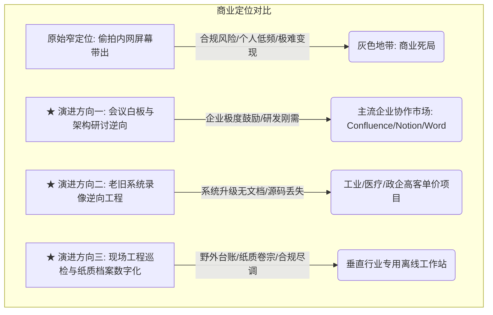

# 竞品全景对比与商业可行性深度剖析

## 1. 细分竞品全景图与“生态盲区”对比

| 产品阵营 | 代表产品 | 核心原理 | 致命局限（为什么满足不了该场景） |
| :--- | :--- | :--- | :--- |
| **SOP 录屏生成类** | Scribe, Tango, Guidde, Dubble | 在本机安装插件/Hook，监听鼠标点击与 DOM 树生成操作卡片。 | 1. 堡垒机/内网/DLP 环境**严禁安装第三方插件**； 2. 只能做“第1步点这里”的 UI 指南，无法提炼架构图、ER表结构、API定义。 |
| **单页/PDF 结构化解析类** | Docling (IBM), Marker, Nougat, LlamaParse, 合合信息(TextIn) | 多模态 VLM / 目标检测，将单页图片/PDF 转为 Markdown。 | 1. 假设输入是“有序且单篇”的； 2. **无文档重组织能力**：面对 100 张散乱图片，只会输出 100 段混乱文本，不会切分文档群； 3. **无全局实体纠偏与跨文档超链接网络**。 |
| **视频摘要与笔记类** | WayinVideo, HoverNotes, VideoNoteGPT | 提取 YouTube 语音字幕 + 定期抓取 PPT 幻灯片。 | 1. 面向轻量化课程学习，缺乏技术专业度； 2. 无法识别与修复摩尔纹/反光遮挡的代码、SQL、JSON 语法。 |
| **本系统定位 (DocReconstruct)** | **图片/视频转文档群与智能重组知识网** | **外部被动采集 + 全局语义解构 + 文档群聚类 + 代码/实体自愈 + 知识网图谱** | **填补市场空白**：无需侵入主机、跨模态音画对齐、自动重组为成套专业文档群、双链知识网络输出。 |

---

## 2. 商业定位破局研判：警惕合规红线与灰色地带

### 2.1 为什么不能主打“防泄密偷拍工具”？
- **企业 CISO 采购红线**：没有任何正规企业会采购“帮员工把偷偷拍下的机房屏幕还原”的工具，这在法理上属于协助数据泄露（Data Exfiltration）。
- **个人工具付费陷阱**：单纯做给个人用，使用频次极低（一年用一两次），获客成本极高，无法支撑商业运作。

### 2.2 真正的商业破局点
必须将产品的技术本质定义为：**“非结构化视觉资产逆向重构引擎 (Visual-to-Doc Reverse Engineering Engine)”**。
- 服务于合法的会议白板沉淀、老旧系统逆向改造、现场工程巡检台账，以及法务审计调查。
