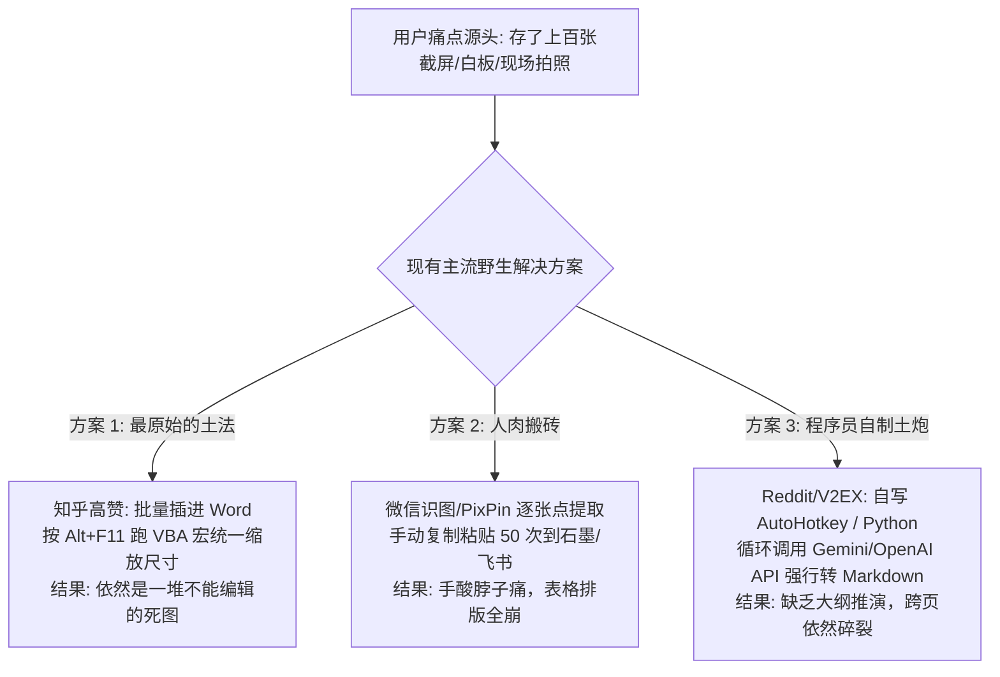

# 社区一线用户真实痛点与地表声音调研

> **数据源**：深入 **V2EX、知乎、Reddit (r/ObsidianMD, r/AutoHotkey, r/productivity)、GitHub Issues** 抓取的真实讨论。

---

## 1. 真实用户都在干什么？一线贴子与行为还原

### 1.1 知乎上的典型求助：“拍了好多照片怎么整理成 Word/文档？”
- **知乎高赞荒诞现状**：排名最高的回答居然是教用户：*“新建一个 Word，批量插入图片，然后按 `Alt + F11` 运行一段 VBA 宏代码，把所有图片统一缩放成相同大小”*。
- **用户真实呼声**：*“我是想把图片里的文字、表格变成能编辑的文档啊，你给我缩放图片有什么用？几十页的表格我还是得人工一行行重新敲！”*
- **结论**：**普通大众面对散乱图片，目前几乎完全处于纯靠肉眼比对、手动在键盘上敲字重录的原始手工业时代**。

---

### 1.2 V2EX 上的热帖趋势：“记录与整理分离”的刚需爆发
在 V2EX 社区，凡是带有**“截图/拍照自动整理成结构化文档”**属性的项目，几乎都会引爆热议：
1. **NoteGen（`codexu/note-gen`）**：针对平时随手截了几百张图、相册成了火葬场的痛点，开发利用 AI 将截图一键整理为结构化 Markdown 的应用，发布即登上 V2EX 热门。
2. **用户吐槽**：
   - *“市面上的微信识图、扫描王只能吐纯文本，格式全碎！标题不像标题、表格错位，我调格式的时间比手打还长！”*
   - *“手机拍屏幕只要有一点反光或摩尔纹，大模型就瞎编，`1` 和 `l` 不分，代码里的括号漏了一堆，根本跑不通！”*

---

### 1.3 Reddit 上的硬核自救：自制 AutoHotkey 与 Python 脚本
在 Reddit 的 `r/ObsidianMD` 和 `r/AutoHotkey` 论坛中，技术用户为了解决这个问题，在用非常丑陋的脚本“自救”：
- **Reddit 原声**：
  > *"I had a folder of thousands of miscellaneous screenshots from client walkthroughs and architecture reviews... I ended up writing an AHK script paired with Python to call Gemini Flash in a loop to turn them into markdown."*
  > （“我存了几千张客户现场走查和架构评审的截图，最后我不得不写了个 AutoHotkey 脚本调用 Python，循环调 Gemini Flash API 把它们硬洗成 Markdown……”）
- **瓶颈**：单张图调用 API 只能得到单页的碎片，没有人帮他分门别类归纳成逻辑大纲；且跨图引用完全断裂。

---

## 2. 现存工具生态的技术断层

1. **开源项目（如 DocStrange、MiniCPM-OCR）全停留在“单图/单PDF -> 单篇 Markdown”**；
2. **没有任何工具做“成套散乱图片 -> 自动聚类分卷 -> 行业大纲推演 -> 语法纠偏自愈 -> 跨图链接网络”**；
3. **格式断层**：技术人员爱看 Markdown，但**现实中握有预算审批权的客户，95% 都只认 Word（.docx）和 PPT（.pptx）**。
