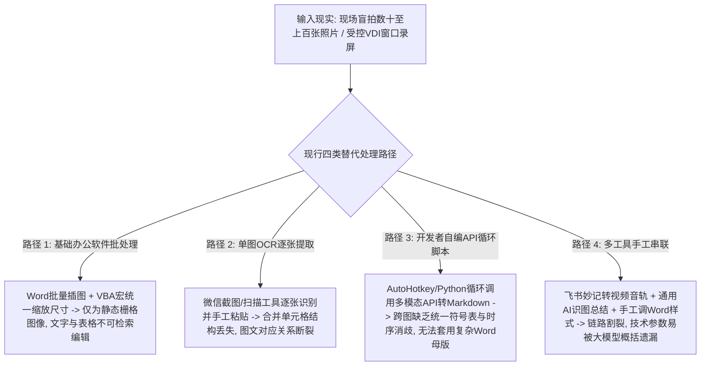

# 社区一线用户真实痛点与需求分层核验调研

> **调研数据源**：交叉检索 **知乎、小红书、V2EX、Reddit (`r/sysadmin`, `r/LocalLLaMA`, `r/ObsidianMD`, `r/indiehackers`)、GitHub Issues** 2024—2026 年真实工程讨论与开源项目演进趋势。

---

## 1. 一线用户现行替代手段与工程瓶颈还原

### 1.1 工程巡检、驻场交付与纸质台账整理（知乎 / 小红书 / V2EX 实证）
- **采集与整理时间严重倒挂**：工程巡检、安全测评及驻场实施人员普遍反映“现场拍照两分钟，回办公室整理两小时”。在地下室、偏远机房或工地等弱网/断网环境下集中拍摄数十张现场照片后，极易丢失“照片—物理部位—设备编号”的映射关系。
- **复杂表格与屏摄退化识别率骤降**：
  - 手机拍摄电脑屏幕普遍伴随像素干涉产生的**频域摩尔纹、室内灯光镜面反光及斜拍透视畸变**；密集代码与配置表中的关键界定符（`{}`、`:`、`;`）及易混字符（`0/O`、`1/l/I`）误识率显著上升；
  - 多级嵌套表头、跨行跨列合并单元格在普通 OCR 转换后频繁退化为错位文本框。
- **甲方严苛 `.docx` 排版返工耗时**：知乎与 V2EX 多篇工程讨论指出，业主与监理单位对正式 Word 报告有严格的固定表格边框、图片宽高比、左图右文布局及页眉页脚规范；直接编写简单 `python-docx` 脚本或从 Markdown 经 Pandoc 转换，在处理几十页高清图集时极易触发图片撑破表格、分页孤行及旧版 Office/WPS 兼容性报错。

### 1.2 受控虚拟桌面（Citrix / VDI）与遗留系统文档化（Reddit 实证）
- 在 `r/sysadmin` 与 `r/indiehackers` 社区中，针对无书面手册的老旧桌面软件及 Citrix / VMware Horizon 虚拟桌面生成标准作业程序（SOP）与接口规格书是高频工程痛点。
- 由于 VDI 会话将远程桌面编码为单一像素流且受安全策略限制无法安装客户端扩展，一线工程师普遍采用在本地物理机录制 VDI 窗口视频并配合口头解说的方式采集素材，亟需支持离线部署、能够结合语音时间戳抽取清晰关键帧并自动消除演示过程中误操作回退帧的专业工具。

### 1.3 开发者与个人知识管理群体（V2EX / `r/ObsidianMD` 实证）
- **高频自救工具涌现**：V2EX 社区围绕“碎片截图结构化”涌现了 `NoteGen`、`Snow Shot`、`ivyNote` 等高关注度开源项目；Reddit `r/ObsidianMD` 用户广泛使用 `obsidian-vision-recall`、`images-to-notes`、`obsidian-ai-image-ocr` 等免费社区插件，或采用 `ShareX + Gemini Flash API` 自动化脚本及 `Eagle` 素材库管理数千张截图。
- **关键商业启示**：C 端技术用户虽然存在真实整理痛点，但其**动手组装免费开源工具链的能力极强、对独立付费桌面软件的价格敏感度极高**。

---

## 2. 子场景需求真实性与付费刚性分层核验矩阵

为避免研发资源投入低回报场景，基于社区实证对各子场景的需求频次、现有替代成熟度与商业付费意愿（WTP）执行严格分层：

| 细分业务场景 | 痛点发生频次 | 现有免费/通用方案替代难度 | 真实付费意愿 (WTP) | 战略优先级判定 |
| :--- | :--- | :--- | :--- | :--- |
| **工程现场巡检 / 安全测评 / 审计尽调多图转标准 `.docx` 报告** | 高频（周度/项目制刚性交付） | **难替代**（通用 AI 无法保证零参数遗漏、像素级凭证溯源与甲方复杂 `.docx` 模板零错乱套版） | **高**（直接节省高薪顾问/工程师数小时排版核对工时） | **P0 核心主航道** |
| **授权遗留系统改造 / VDI 受限环境录屏与屏摄逆向建档** | 中高频（信创迁移与外包驻场交接刚需） | **较难替代**（海外视频 SOP 工具仅支持单篇线性步骤且无法内网离线部署） | **高**（具备明确项目专项预算） | **P0 核心主航道** |
| **日常产研会议 1~5 张白板草图整理纪要** | 中频 | **极易被替代**（直接拍照输入通用多模态对话模型或飞书文档即可满足 80% 需求） | **低**（极少为此单独采购软件） | **P2 顺带支持特性** |
| **C端个人囤积截图转 Obsidian/Markdown 笔记** | 高频 | **已被开源生态充分替代**（`Vision Recall`、`NoteGen` 及各大免费 AI 助手已覆盖） | **极低**（买断转化率受开源工具严重抑制） | **P2 口碑引流漏斗（严禁重投入买量）** |

---

## 3. 核心市场断层结论

综合社区实证与工具链现状，当前市场并非缺乏“把单张清晰图片识别成文字”的 OCR 工具，真正尚未被解决的工程断层集中于以下三点：
1. **输入端断层**：缺乏针对**乱序多图、滚动重叠长图、带反光/摩尔纹屏摄图与连续操作录屏**的跨时序消歧、去重拼接与多文档聚类引擎；
2. **核验端断层**：缺乏在离线安全环境下将识别结果、代码语法修复结果与**原始倾斜底片亚像素坐标**刚性绑定、以低认知负荷工单完成免责人工确认的工作台；
3. **交付端断层**：缺乏将结构化语义树直接编译为**100% 契合政企/甲方复杂版式模板且向下兼容旧版 Office/WPS 的原生 `.docx`/`.pptx` 引擎**。
