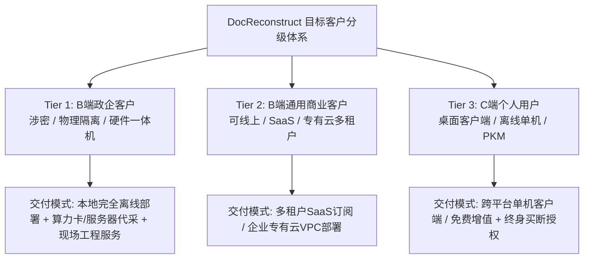

# 目标客群画像与付费意愿分级分析 (WTP & Customer Segmentation)

## 1. 目标客户分级全景架构

基于市场实际准入条件、合规监管要求与部署形态差异，本项目将目标客户划分为三大确定性层级：

---

## 2. 三大核心客户层级深度画像分析

### 2.1 Tier 1: B端政企客户（涉密、强监管、完全离线部署需求）

#### 典型画像与组织类型
- **机构类型**：党政机关、军工科研院所、国有企事业单位、电网/能源集团、涉密金融与政策性银行。
- **决策角色**：信息技术部总经理、信创建设负责人、安全合规委员会总监、总工程师。
- **核心业务场景**：
  - 涉密机房与物理隔离办公区内的屏幕操作、设备参数白板、系统监控面板的拍照记录（无法通过网络导出日志与源码）；
  - 历史纸质案卷、涉密工程图纸与纸质规范的数字化高精重构；
  - 信创老旧工业控制系统或停保软件的“黑盒操作”视频录像逆向文档化。

#### 核心诉求与技术准入约束
1. **100% 物理隔离离线运行**：系统全生命周期严禁任何公网心跳探测与外联网络请求，数据 100% 驻留在客户内网；
2. **软硬件全流程交付**：政企客户通常不具备针对多模态大模型的硬件选型能力，需要一站式交付；
3. **现场工程部署与维保**：需要专业工程师提供现场内网环境勘测、驱动与推理加速库适配、操作系统安全基线配置及验收交付。

#### 交付形态与商业变现模型
- **交付形态**：**软硬件一体机（Turnkey Appliance）+ 现场交钥匙工程**。
- **算力硬件集采/代采服务**：
  - 针对不同数据吞吐并发需求，集成并代采标准推理算力卡（如国产化信创算力卡昇腾、沐曦，或标准专业卡 RTX 4090 / L40S 单卡或多卡工控机/服务器）；
  - 硬件采购按市场公允价 + 10%~15% 的供应链集采与质量集成服务费。
- **商业收费结构**：
  - **软件授权许可费**：按物理节点收取离线 License 授权费（¥80,000 ~ ¥250,000 / 节点）；
  - **现场工程部署服务费**：按项目定制与实施难度收取（¥30,000 ~ ¥100,000 / 场地）；
  - **年度运维维保费**：首年免费质保，次年起按软件合同额 15% ~ 20% / 年续费收取。

---

### 2.2 Tier 2: B端通用商业客户（可线上、敏捷交付、多端协同需求）

#### 典型画像与组织类型
- **机构类型**：大中型 IT 软件开发与外包企业（如软通动力、中软国际、神州数码）、管理与技术咨询机构（如埃森哲、普华永道、麦肯锡）、互联网与高科技制造业研发中心、律师事务所与会计师事务所。
- **决策角色**：研发效能总监、项目交付委员会 PMO、数字化转型部门主管、项目合伙人。
- **核心业务场景**：
  - 外包驻场交付团队在甲方现场受限环境下记录的白板架构草图、流程截图与交接资料，需在周末快速生成正式 Word/PPT 交付件；
  - 咨询顾问与律所审计人员现场尽职调查拍照素材的高效整理与合规底稿生成；
  - 跨职能团队头脑风暴白板与产研架构评审的自动化 PRD 沉淀。

#### 核心诉求与技术准入约束
1. **云端协同与高周转效率**：支持多项目、多团队协同工作区，支持云端异步任务排队处理；
2. **敏捷部署与开箱即用**：支持公有云 SaaS 直接登录使用，或提供支持标准 Kubernetes / Docker Compose 的企业专有云（VPC）一键镜像包；
3. **企业级权限与安全控制**：支持企业 SSO（SAML / OAuth2 / LDAP）、精细化 RBAC 角色权限与操作审计日志。

#### 交付形态与商业变现模型
- **交付形态**：**SaaS 云端订阅服务 / 企业专有云（VPC）集群授权**。
- **商业收费结构**：
  - **SaaS 席位年费模式**：¥3,000 ~ ¥8,000 / 席位 / 年（针对咨询团队与核心工程师）；
  - **企业团队专有云年费**：¥50,000 ~ ¥150,000 / 年（包含专属算力并发通道、无限次重构与专属私有知识库）；
  - **算力用量充值包**：对于高吞吐处理需求，提供按页/按分钟的算力调用阶梯充值。

---

### 2.3 Tier 3: C端个人用户（普通知识工作者、学术科研与效率极客）

#### 典型画像与组织类型
- **人群画像**：高校研究生与博士生、学术科研人员、考研考公备考群体、Obsidian / Logseq / Notion 深度个人知识管理（PKM）爱好者、自由职业开发者。
- **核心业务场景**：
  - 线下学术研讨会、行业大会现场拍摄的演讲 PPT 与公式论文拍照整理；
  - 纸质教材习题、错题本与读书手写笔记的数字化转换与双链网状沉淀；
  - 个人网课板书截图快速转为结构化 Markdown / Word 笔记。

#### 核心诉求与技术准入约束
1. **客户端免繁琐配置**：开箱即用，提供 Windows 与 macOS 原生单机客户端安装包；
2. **算力灵活适配**：
   - 具备消费级显卡（RTX 3060/4060 等）的用户可选择本地全离线量化模型运行；
   - 无显卡或轻薄本用户支持配置个人 API Key（如 OpenAI / DeepSeek / 通义千问）或购买轻量算力点卡；
3. **隐私安全无感沉淀**：不强制要求注册手机号，文档完全保存在用户本地磁盘目录，天然适配个人双链知识库。

#### 交付形态与商业变现模型
- **交付形态**：**跨平台单机客户端（Windows / macOS）**。
- **商业收费结构**：
  - **Freemium 基础免费版**：支持小批量单图处理（如 ≤3 张/天），核心用于产品口碑建立与自发传播裂变；
  - **Pro 个人专业版买断授权**：¥199 ~ ¥399 / 终身买断（包含大纲自动生成、双链知识网络与本地高级纠偏功能）；
  - **个人年度订阅版**：¥99 ~ ¥168 / 年（包含软件功能持续更新与云端轻量加速算力赠送）。

---

## 3. 客群商业模型与经营财务对比矩阵

| 评估维度 | Tier 1: B端政企离线部署 | Tier 2: B端通用商业上云 | Tier 3: C端个人用户 |
| :--- | :--- | :--- | :--- |
| **客群定位** | 涉密党政军企、能源工控 | 咨询机构、IT外包、企业产研 | 极客学者、高校科研、备考学生 |
| **部署模式** | 100% 物理隔离离线一体机 | 多租户 SaaS / 企业专有云 VPC | 本地跨平台单机客户端 |
| **算力与硬件策略** | 平台提供显卡/服务器代采与集成 | 集中式云端 GPU 集群资源池 | 用户本地消费级显卡 / 自备 Key |
| **现场服务需求** | 必须上门实施、适配加固与验收 | 线上远程支持或无需人工介入 | 纯自助使用，社区与文档支持 |
| **典型客单价** | ¥150,000 ~ ¥500,000+ / 笔（含硬件） | ¥3,000 ~ ¥8,000 / 席位 / 年 | ¥199 ~ ¥399 买断 / ¥99~168 年订 |
| **采购决策周期** | 3 ~ 6 个月（招投标/立项审批） | 2 ~ 4 周（部门立项或报销） | 即时决策（个人冲动与刚需支付） |
| **续费与粘性** | 极高（软硬件一体化，15% 维保） | 高（组织流程与资产沉淀锁定） | 中（工具型买断，靠新版本驱动） |
| **商业战略定位** | **现金流与单笔利润支柱** | **规模化高毛利 ARR 引擎** | **品牌影响力与用户生态漏斗** |
