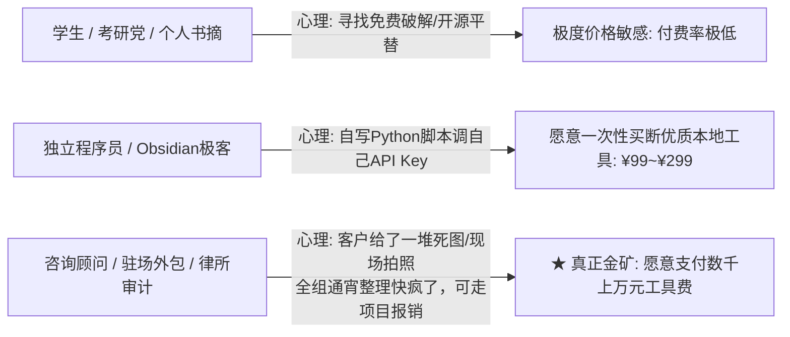

# 目标客群画像与付费意愿分级分析 (WTP & Customer Personas)

## 1. 客户群体分级全景图

从社区发帖者的身份切入，我们可以清晰看清**“谁在白嫖，谁真掏钱”**：

---

## 2. 细分画像深度分析

| 客群分类 | 典型画像 | 典型痛点场景 | 支付意愿 (WTP) | 商业变现模型 |
| :--- | :--- | :--- | :--- | :--- |
| **Tier 1: 企业交付与咨询顾问 (核心金矿)** | 软通动力/中软驻场工程师、普华永道/麦肯锡咨询师、红圈律所律师 | 客户在封闭机房或保密数据室只给看不给拷，拍了几百张照片，周一要交 100 页可编辑的 Word 方案，全组通宵整理。 | **极高**（时间成本远高于工具费，直接走项目/企业报销） | **¥3,000 ~ ¥8,000 / 席位 / 年** 或企业包套 ¥50,000 / 年 |
| **Tier 2: 老旧系统逆向重构团队 (高客单价专项)** | 传统政企、医疗 HIS、老工控数字化升级系统集成商 | 15 年前老系统无源码无文档，靠录屏记录全量菜单与流程，需反向生成全套需求说明书与数据字典。 | **极高**（单项目预算充裕，转嫁给甲方实施费） | **¥50,000 ~ ¥200,000 / 专项项目买断** |
| **Tier 3: 研发架构与产品团队 (主流协作)** | 互联网/高科技制造企业的产品经理、架构师 | 架构评审白板画满架构图与时序图，开完会相册成火葬场，无人整理成正式 PRD/Confluence 文档。 | **中等偏高**（部门研发效能预算） | **$15 ~ $35 / 用户 / 月** (SaaS订阅) |
| **Tier 4: 独立极客与知识工作者 (长尾流量)** | Obsidian / Notion 深度玩家、科研人员 | 读书/学术会议拍了大量 PPT 与公式，想整理进自己的本地双链知识库。 | **中等**（极度在意隐私，拒绝私有云上传） | **¥99 ~ ¥299 离线版买断** |
| **Tier 5: 考研/考公/学生党 (免费漏斗)** | 大学生、考研考公学生 | 拍网课 PPT 和教材习题，整理错题本。 | **极低**（追求免费开源） | 仅作为免费引流与品牌口碑漏斗 |
