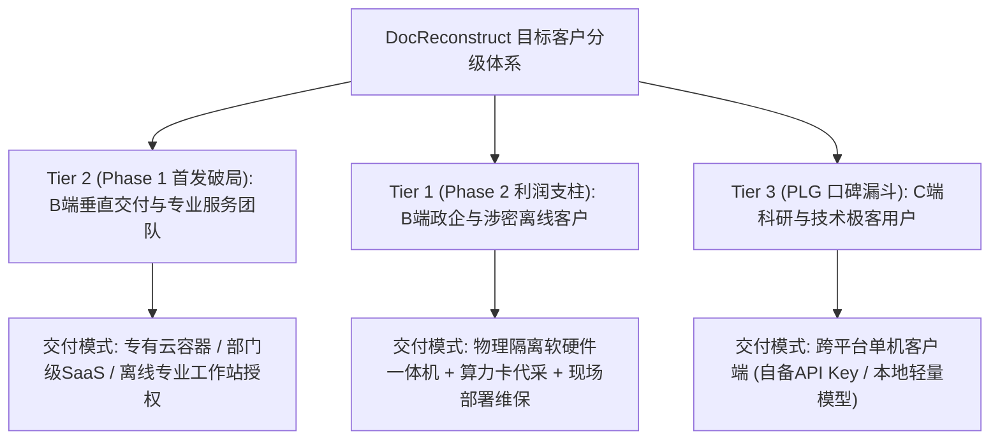

# 目标客群画像、付费意愿分级与商业切入时序分析 (WTP, Segmentation & GTM Sequencing)

## 1. 目标客户分级全景架构

基于市场准入条件、数据安全合规边界、采购决策链路与付费刚性差异，本项目将目标客户划分为三大层级，但**严格区分商业切入先后时序与营收权重预期**：

---

## 2. 三大核心客户层级深度画像分析

### 2.1 Tier 1: B端政企客户（涉密、强监管、完全离线部署需求）

#### 典型画像与组织类型
- **机构类型**：党政机关、军工科研院所、大型国有企事业单位、电网/能源集团、涉密金融机构。
- **决策角色**：信息技术部负责人、信创建设负责人、安全合规审计总监、项目总工程师。
- **核心业务场景**：
  - 经授权的信创老旧工业控制系统、停保无源码遗留软件的“黑盒操作录屏 + 界面拍照”逆向建档；
  - 物理隔离机房设备参数巡检、系统监控面板与应急演练记录的结构化归档；
  - 历史纸质工程台账、复杂技术规范的离线高保真重构与原图坐标溯源核验。

#### 核心诉求与技术准入约束
1. **100% 物理隔离离线运行**：系统全生命周期严禁任何公网心跳探测与外联请求，数据 100% 驻留客户内网；
2. **软硬件全流程交钥匙交付**：需提供适配国产信创（鲲鹏/飞腾/龙芯 + 银河麒麟/统信 UOS + 昇腾 NPU）或专业推理卡（RTX 4090 / L40S）的一站式集成方案；
3. **招投标合规门槛**：直接投标通常需满足等保 2.0 三级、国产化兼容性互认证及商业密码应用安全性评估（密评）要求。

#### 交付形态与商业变现模型
- **交付形态**：**软硬件一体机（Turnkey Appliance）+ 现场交钥匙工程**（或作为专业视觉逆向软件模块嵌入大型总集成商方案）。
- **商业收费结构**：
  - **硬件集采/代采服务**：按硬件公允成本加收 10%~15% 供应链集成与烤机测试服务费；
  - **离线软件节点授权费**：¥80,000 ~ ¥250,000 / 物理节点；
  - **现场工程部署与母版定制费**：¥30,000 ~ ¥100,000 / 场地；
  - **年度离线运维维保费**：首年含质保，次年起按软件合同额 15% ~ 20% / 年收取。

---

### 2.2 Tier 2: B端通用商业与垂直专业服务客户（敏捷采购、强交付件驱动）

#### 典型画像与组织类型
- **机构类型**：大中型 IT 实施与软件外包企业（如软通动力、中软国际、神州数码驻场交付部）、工程检测与安全评估机构、会计师事务所与律师事务所（现场尽调/审计团队）、管理与数字化咨询机构。
- **决策角色**：交付部门总监、项目经理（PMO）、工程技术主管、审计/咨询业务合伙人。
- **核心业务场景**：
  - 驻场工程师在客户 Citrix/VDI 或受限终端环境下授权采集的系统配置照片与操作录像，快速编译为符合甲方验收模板的《系统架构说明》《数据字典》《运维 SOP》；
  - 工程巡检与安全评估人员现场盲拍上百张隐患照片与语音备注，回办公室一键套用固定样式的 `.docx` 报告模板并完成图文对位；
  - 审计与法务尽调人员将现场翻拍的散乱合同表册结构化提取至底稿，保留像素级 Bounding Box 溯源链供合伙人复核签字。

#### 核心诉求与技术准入约束
1. **母版排版零返工**：导出的 `.docx` / `.pptx` 必须严格贴合企业/甲方自有 Word 模板，消除人工调表与缩图工时；
2. **灵活部署形态**：既支持多租户 SaaS 与企业专有云（Docker Compose / K8s）一键部署，也支持为驻场顾问配备绑定硬件指纹的离线便携单机专业版；
3. **企业级管理**：支持企业 SSO（SAML / OAuth2 / LDAP）、项目级数据隔离与复核审计日志。

#### 交付形态与商业变现模型
- **商业收费结构**：
  - **专业团队席位订阅**：¥3,000 ~ ¥8,000 / 席位 / 年；
  - **企业专有云（VPC）授权包**：¥50,000 ~ ¥150,000 / 年（含企业专属 `.docx` 交付母版定制与私有算力调度）；
  - **高吞吐用量阶梯包**：面向集中式大批量历史资料重构按页/按分钟计费。

---

### 2.3 Tier 3: C端个人用户（学术科研、独立顾问与技术极客）

#### 典型画像与现实付费约束
- **人群画像**：高校硕博科研人员、独立开发顾问、Obsidian / Notion 深度个人知识管理（PKM）用户。
- **核心业务场景**：学术会议现场拍摄的演示幻灯片与公式图表整理、技术视频教程转本地结构化笔记。
- **客观付费意愿评估**：
  - 社区调研表明，C 端极客普遍习惯使用免费开源插件（如 `obsidian-vision-recall`、`NoteGen`）配合个人低价大模型 API Key 自行搭建工作流；
  - 因此，C 端个人市场**严禁作为早期核心营收依赖，亦严禁投入付费广告买量（避免 CAC > LTV 倒挂）**，其核心战略价值在于：**低成本产品驱动增长（PLG）口碑传播、收集长尾极端退化图像测试反馈、以及通过一线工程师个人使用反向促成所在 B 端团队（Tier 2）立项采购**。

#### 交付形态与商业变现模型
- **交付形态**：Windows / macOS 跨平台单机客户端（支持用户自备云端 API Key 或调用本地消费级显卡运行量化模型，平台零算力补贴成本）。
- **商业收费结构**：
  - **基础社区版（免费）**：支持自定义 API Key 完成基础单图解析与 Markdown 导出，最大化装机基数；
  - **Pro 个人增强版**：¥99 ~ ¥199 / 买断，或 ¥68 ~ ¥128 / 年（解锁多图跨时序消歧分卷、复杂 `.docx` 母版编译与 Click-to-Source 核验工作台）。

---

## 3. 客群商业模型与经营财务对比矩阵

| 评估维度 | Tier 2: B端垂直交付与专业服务 | Tier 1: B端政企涉密离线部署 | Tier 3: C端个人技术用户 |
| :--- | :--- | :--- | :--- |
| **切入时序优先级** | **第一阶段首发突破（0~12m PMF）** | **第二阶段利润放大（12~36m）** | **全周期被动自然增长漏斗** |
| **部署形态** | 专有云容器 / SaaS / 驻场单机专业版 | 100% 物理隔离软硬件一体机 | 本地跨平台桌面客户端 |
| **算力供给方式** | 云端 GPU 池或企业自有 API/算力卡 | 平台代采集成国产 NPU / RTX 4090 / L40S | 用户自备 API Key 或本地消费级显卡 |
| **典型客单价** | ¥3,000~8,000/席/年；专有云 ¥5万~15万/年 | ¥150,000 ~ ¥500,000+ / 单（含硬件与服务） | ¥99~199 买断 / ¥68~128 年订 |
| **采购决策周期** | **短（2 ~ 4 周，部门主管/合伙人审批）** | **长（3 ~ 6 个月，立项/招投标/信创验收）** | 即时自助决策 |
| **市场竞争烈度** | 低（精准切入非结构化现场交付件空白） | 中高（需与头部 IDP 厂商错位或借力总集商） | 极高（受开源插件与免费 AI 工具挤压） |
| **商业战略角色** | **快速验证 PMF 与规模化 ARR 核心引擎** | **高毛利大单现金流与高壁垒锁客支柱** | **零算力成本品牌传播与 B 端线索入口** |

---

## 4. 商业落地防坑与切入路径约束

1. **先打短周期部门级预算，再攻长周期政企招投标**：早期若直接重兵投入 Tier 1 政企招投标，极易被长达半年的资质审查与账期拖垮现金流；优先通过 Tier 2（IT 驻场、工程检测、尽调审计）在 1 个月内跑通“试用 -> 节省数十小时排版工时 -> 部门采购”的正向现金流闭环。
2. **严控免费算力穿底**：无论是 Tier 3 个人版还是 Tier 2 试用版，凡未付费账户一律采用本地算力或自备 API Key，平台端严格执行前置 Token 预算限额，杜绝免费用户消耗公有云多模态 API 导致毛利转负。
