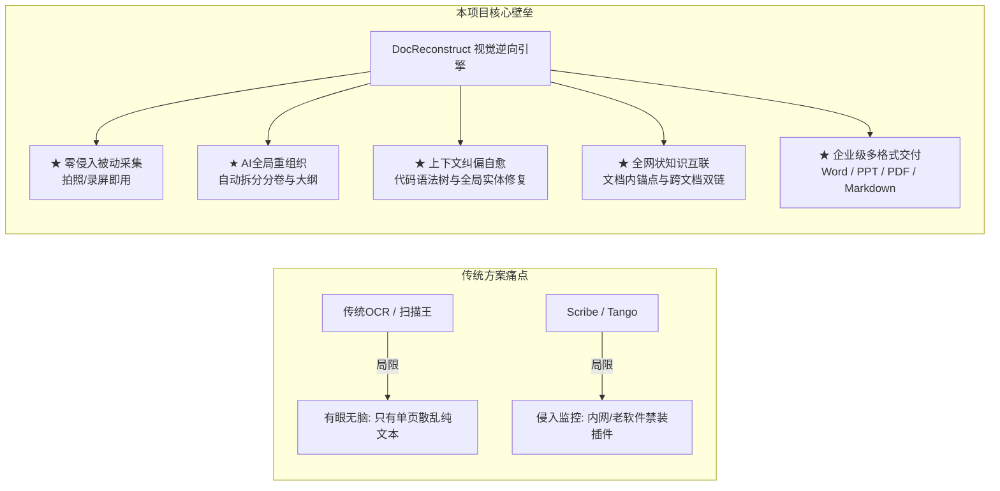

# 项目战略愿景与核心定位 (Vision & Strategic Positioning)

## 1. 行业本质认知：我们到底在做什么？

在传统的工具思维中，很多人把这个需求窄化为“OCR 工具”或“防泄密环境偷拍照还原器”。这是极其危险且局限的视角。

**本项目的真正战略本质是：**
> **“非结构化视觉资产的逆向工程与重构引擎 (Unstructured Visual-to-Doc Reverse Engineering Engine)”**

我们不做一个机械的文字搬运工，而是借助多模态大模型与计算机视觉，扮演资深的**“技术文档主编与架构师”**：
1. **输入端**：接受最原始、最散乱、甚至带有人为缺陷的被动视觉素材（手机拍照、屏幕录像、会议白板、操作演示）。
2. **处理端**：通过“全局语义通读 -> 主题分卷聚类 -> 动态大纲推演 -> 碎片路由填充 -> 语法树/代码实体纠偏自愈”。
3. **输出端**：交付排版专业、逻辑严谨、互为超链接的多格式企业级文档群（Word、PPT、PDF、Markdown / Obsidian）。

---

## 2. 差异化护城河矩阵 (Value Proposition & Moat)

---

## 3. 三大战略边界原则 (Strategic Boundaries)

1. **守住合规底线**：
   - 商业化对外宣传坚决避开“窃取机房数据”、“绕过DLP防泄密”等违规用语；
   - 官方主打**“白板研讨数字化”、“无源码老旧系统逆向工程”、“野外巡检台账重构”与“纸质历史档案智能化”**。
2. **坚持离线与隐私优先 (Privacy-First)**：
   - 核心付费客户（金融外包、政企、律所）最在意的就是数据泄露风险；
   - 架构设计必须原生支持**纯本地私有模型（Ollama / vLLM + Qwen2-VL）离线运行**，绝不把涉密数据上传公有云。
3. **交付物驱动（Output-Centric）**：
   - 不搞花哨的纯概念，技术人员给 Markdown/Obsidian，管理层与客户给精美的 Word/PPT。
