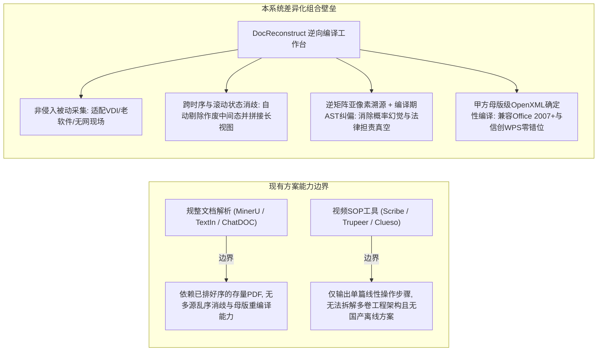

# 项目战略愿景与核心定位 (Vision & Strategic Positioning)

## 1. 系统工程本质定位

若将本系统窄化为“单页 OCR 识别工具”或“违规屏摄数据外带工具”，将分别陷入成熟开源/商业 OCR 的同质化红海与企业信息安全合规禁区。

**本系统的严格工程定义为：**
> **面向无电子原件场景的“多源有损视觉资产逆向重构与受控母版编译系统 (Multi-Source Visual Reverse Engineering & Deterministic Document Compilation System)”**

系统不与通用存量 PDF 解析引擎或泛企业 RAG 知识库正面重叠，而是专攻**“连原始电子文档都不存在，仅能通过现场拍照、受控窗口录屏与口头解说获取杂乱视觉流”**的从 0 到 1 建档闭环：
1. **输入层**：接收非侵入式被动采集的散乱有损视觉素材（带反光/摩尔纹的屏幕翻拍、工程现场盲拍图集、Citrix/VDI 或遗留系统操作录屏、伴随语音音轨）。
2. **中间编译层**：执行“几何校正与逆变换坐标保留 -> 局部重叠拼接与跨时序状态消歧 -> 多主题分卷与大纲重构 -> 代码/结构化语法树（AST）编译校验 -> 低置信度工单人机仲裁”。
3. **交付层**：输出严格绑定原始底片亚像素证据框、100% 符合政企/甲方版式母版规范的企业级交付文档群（Word `.docx`、PPT `.pptx`、矢量 PDF、Markdown）。

---

## 2. 差异化竞争边界矩阵 (Competitive Differentiation)

---

## 3. 四大战略边界铁律 (Strategic Boundaries)

1. **合规准入边界**：
   - 严禁涉足任何绕过企业 DLP 策略私自外带受控数据的违规场景；
   - 商业落地严格锚定**授权遗留系统升级逆向建档、工程巡检与安全测评报告编译、财务/法务合规尽调底稿生成、驻场正规交接资产化**。
2. **开源复用与自研聚焦边界**：
   - 对单页常规版面分割、基础 OCR 等已被开源界（如 MinerU、Docling、PP-Structure）解决的通用环节，采取标准接口集成复用策略，禁止重复造轮子消耗研发周期；
   - 自研算力与工程资源 100% 集中投向**退化屏摄逆变换坐标守恒、跨时序多源冲突消歧、Click-to-Source 复核工作台及复杂 OpenXML 布局求解器**。
3. **离线隐私与异构适配优先（Offline & Air-Gapped Ready）**：
   - 核心高客单价客户（政企、能源工控、审计律所）对数据不出域有刚性要求；
   - 内核原生支持纯本地量化视觉模型（Ollama / vLLM / ONNX Runtime + Qwen-VL 系列）与国产信创硬件解耦运行，全流程零外网依赖。
4. **交付物确定性驱动（Deterministic Output First）**：
   - 严控研发重心偏移至重型通用聊天问答；系统首要考核指标是**“用 5 分钟人机核验产出可直接签字提交甲方的零排版错误 `.docx`/`.pptx` 正式交付件”**。
