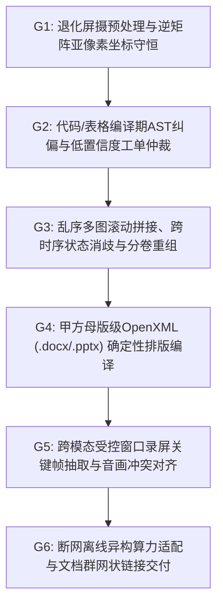

# 核心目标分级与成功验收指标 (Goals & Success Metrics)

## 1. 目标分层演进模型 (Hierarchical Goals)

系统按技术依赖与商业交付优先级设立六大层级工程目标，确保每一层级均产生可独立量化的工程净增益：

---

## 2. 细分目标与量化验收指标 (Quantified KPIs)

| 目标层级 | 核心解决工程问题 | 量化验收指标 (KPIs) |
| :--- | :--- | :--- |
| **G1: 退化视觉解析与坐标守恒** | 斜拍透视畸变、屏幕频域摩尔纹、局部反光下的高精度解析及原图坐标反投 | - 标准光照下字符错误率（CER）$< 1.5\%$；带中度摩尔纹/15°~35°斜拍屏摄图 CER 较裸调基座 VLM 降低 $\ge 35\%$ - 逆单应性矩阵（$H^{-1}$）反投回原始倾斜照片的 Bounding Box 交并比（IoU）$\ge 0.90$ - 架构图/拓扑图高清切片提取完整率 $100\%$ |
| **G2: 编译期纠偏与免责核验** | 消除易混字符（`0/O`、`1/l/I`）导致的代码/SQL 语法损坏，阻断低置信度模型幻觉 | - 常见结构化语言（SQL / Python / JSON / YAML）经静态解析器校验后的语法合法率 $\ge 92\%$ - 置信度 $< 0.85$ 的歧义字段自动转入非阻塞待复核工单（Review Queue）拦截率 $\ge 98\%$，零静默篡改 - 跨图全局专有标识符拼写一致性对齐率 $\ge 95\%$ |
| **G3: 跨时序消歧与分卷重组** | 解决乱序盲拍、长页面多次滚动重叠截图及前后操作状态冲突 | - 连续滚动重叠截图（Scroll-Stitching）冗余行去重准确率 $\ge 90\%$ - 混合多主题素材（30~100 张）业务分卷聚类纯净度（Purity）$\ge 90\%$ - 时序回退/配置覆盖场景下最终有效状态识别准确率 $\ge 88\%$ |
| **G4: 母版级多格式确定性编译** | 消除通用 AI 导出 Word 表格越界、图片变形及旧版 Office 损坏报错 | - 支持 Word（`.docx`）、PPT（`.pptx`）、矢量 PDF、Markdown 四类格式无头编译 - 套用企业定制 `.docx` 母版后，Microsoft Office 2010/2016/365 及政企版 WPS 打开零报错率 $100\%$，跨页表格自动重复表头与版心等比缩图合规率 $100\%$ |
| **G5: 跨模态长视频融合** | 10~60 分钟 Citrix/VDI 或遗留软件操作录屏转结构化规程 | - 过渡模糊帧与纯鼠标移动冗余帧剔除率 $\ge 90\%$，静态关键操作帧召回率 $\ge 96\%$ - 语音时间戳与画面状态绑定偏差 $< 1.5\text{ s}$；口述参数与屏幕显示参数不一致时显式告警触发率 $\ge 90\%$ |
| **G6: 离线异构准入与链接网格** | 满足物理隔离内网、低显存终端及跨文档引用跳转需求 | - 断网环境下基于单卡 16GB 显存（4-bit/8-bit 量化模型）端到端处理吞吐量 $\ge 15\text{ tokens/s}$，零公网请求 - 文档内书签与跨文档相对路径超链接有效解析跳转率 $\ge 95\%$ |

---

## 3. 强制性竞品端到端基准对标门槛 (Competitive Benchmark Gate)

为防止自研复杂流水线陷入“工程复杂但实际增益不显著”的误区，在每一阶段里程碑验收时，必须构建包含 **100 组真实退化样本**（涵盖：40 张带摩尔纹/反光斜拍代码与配置屏摄图、40 张现场乱序设备巡检与跨页无线表照片、20 段 VDI 窗口操作录屏）的黄金评测集（Golden Benchmark），并与以下两组外部基线执行盲测对比：
- **基线 A（开源解析 + 前沿大模型脚本流）**：`MinerU 2.5 + Gemini Flash / Qwen3-VL 长上下文 Prompt + Pandoc 导出 docx`；
- **基线 B（垂直商业工具流）**：`合合信息 TextIn API`（图片集）与 `Trupeer AI`（录屏集）。

**准出硬约束**：本系统必须在**关键工程参数零幻觉率、跨图重复/冲突消解准确率、甲方 `.docx` 母版免人工返工可用率、以及人工复核总耗时节省比例（目标节省 $\ge 60\%$）**四项核心指标上取得统计显著的量化净优势；若某自研算子相对于成熟开源组件净增益 $< 3\%$，立即降级为直接集成开源组件。
