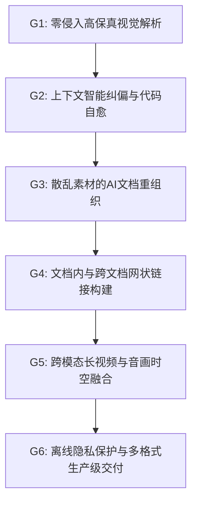

# 核心目标分级与成功验收指标 (Goals & Success Metrics)

## 1. 目标分层模型 (Hierarchical Goals)

系统设立六大层级目标，形成从基础能力到商业落地的完整链路：

---

## 2. 细分目标与量化验收指标 (Quantified KPIs)

| 目标层级 | 核心解决问题 | 关键验收指标 (KPIs) |
| :--- | :--- | :--- |
| **G1: 高保真解析** | 复杂版面、表格合并单元格、公式与架构图无损还原 | - 字符识别准确率（CER）> 98%（正常光照与清晰度） - 表格行列还原无错位率 > 92% - 架构/流程图附件自动切片完整度 100% |
| **G2: 智能纠偏自愈** | 反光、摩尔纹、拍摄抖动导致的代码、SQL、专有名词错乱 | - 常见编程语言（SQL/Python/JSON）语法树自愈成功率 > 90% - 集群级专有实体拼写对齐准确率 > 95% - 关键操作断层警示探测率 > 85% |
| **G3: 文档重组织** | 摆脱物理拍摄顺序束缚，多主题素材自动聚类分卷并推演专业大纲 | - 混合多主题素材文档群聚类准确率 > 90% - 生成的技术大纲逻辑通顺度专业评审通过率 > 92% - 跨截图重复信息去重综合率 > 85% |
| **G4: 知识网超链接** | 正文引用自动对齐为有效超链接，打破信息孤岛 | - 文档内锚点跳转有效率 > 95% - 跨文档显式引用解析与相对路径生成对齐率 > 90% - 支持标准 Obsidian `[[双链]]` 与关系拓扑图谱输出 |
| **G5: 跨模态视频** | 10~30 分钟连续操作录屏/PPT演示视频提取有效图文指南 | - 视频静态清晰关键帧提取率 100%，过渡模糊废帧过滤率 > 95% - 音频字幕与关键画面时空对齐偏差 < 2 秒 |
| **G6: 多格式交付** | 满足不同受众对格式的苛刻要求，保障数据绝对离线 | - 必须支持 Word (.docx)、PPT (.pptx)、PDF、Markdown 四大核心格式输出 - 支持纯内网单机运行（对接本地 Ollama/vLLM），零外网数据传输 |
