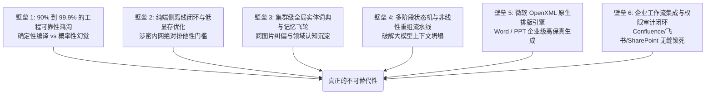

# 核心竞争力与不可模仿护城河分析 (Defensibility & The AI Moat)

> **核心拷问**：在如今 AI 编程（Cursor / Claude Code）极速发展的时代，如果两三个开发者用 AI 几天就能抄出一个能用的原型，**我们凭什么让客户掏真金白银买单？我们的不可模仿性（Moat）到底在哪里？**

---

## 1. 行业残酷现实：为什么 99% 的“AI 套壳（AI Wrapper）”必死？

```mermaid
flowchart LR
    subgraph 致命的 AI 套壳 (脆弱且无护城河)
        A[散乱图片/录像] --> B[单一 Prompt 丢给云端 GPT-4o/Gemini API]
        B --> C[吐出一段粗糙 Markdown]
    end
```

如果产品的技术底层仅仅是：
1. 写一段通用的 Prompt：“请阅读这 10 张图片，提取文字并整理成 Markdown”；
2. 调一下云端大模型 API（OpenAI / Gemini / DeepSeek）；
3. 做个简单的前端界面展示。

**这种产品在商业上必死无疑**：
- **可替代性极强**：任何稍微懂点技术的工程师，甚至普通用户自己打开 ChatGPT 网页端，花一个下午就能实现 70% 的效果。
- **大模型升级即碾压**：通用大模型只要更新一个版本，这种简单套壳的价值就会被瞬间抹平。

---

## 2. 我们的 6 重不可模仿核心护城河 (The 6-Layer Defensibility Moat)

我们必须构建**“围绕非确定性 AI 建立起的确定性工程与场景黑盒”**，形成对手在短期内靠几个 Prompt 根本无法复制的壁垒：



---

### 壁垒一：从 70% Demo 到 99.9% 生产级可用的“工程黑盒”（The Last 10% Reliability）
- **AI 的陷阱**：用大模型写个 Demo，达到 70% 效果只需要半天；但要做到企业能直接交付客户的 99.9% 可用性，需要填平无数工程泥潭。
- **不可模仿的细节**：
  - **跨页合并单元格（Rowspan/Colspan）的拓扑重建**：大模型单看图片极易把跨页表格的行列对齐搞崩。我们研发的局部几何投影与确定性表格解析算法，是纯 Prompt 无法企及的。
  - **代码与公式的 AST 语法树纠偏**：通过确定性的编译器语法检查（Python AST、SQL Parser），在代码层面拦截反光引起的误识，杜绝大模型在代码中的“胡说八道”。
  - **任何一个抄袭者在面对企业 200 页复杂文档时，Demo 级别的代码会在 10 分钟内全面崩溃报错。**

---

### 壁垒二：纯端侧单机离线运行与算力优化（离线化绝杀门槛）
- **绝杀逻辑**：**愿意出高客单价买这个软件的客户（金融银行、军工涉密、律所审计），100% 严禁将图片/视频上传至公有云 API！**
- **对手的困境**：
  - 业余开发者与抄袭者只会写 Python 代码去调 OpenAI / Gemini 的云端 API。一旦客户要求“必须拔掉网线在内网笔记本上跑”，他们就彻底束手无策。
- **我们的核心壁垒**：
  - **端侧一体化轻量引擎**：深度集成开源端侧多模态模型（如 Qwen2-VL 7B 量化版 + Whisper 本地轻量版 + 本地 OCR），通过 GGUF / AWQ 显存压缩与 ONNX Runtime 加速。
  - 做到**“无网络依赖、插上加密狗即用、在普通笔记本显卡（RTX 4060/3060 甚至 M系列芯片 Mac）上极速并发运行”**。这一套端侧系统级工程，普通开发者没有几个月的基础架构积累根本搭不出来。

---

### 壁垒三：集群级全局实体记忆飞轮（Cluster-wide Entity Memory）
- **单图 vs 全局集群**：
  - 抄袭者的工具是一张一张图片读，图与图之间是割裂的孤岛。
  - 我们建立的是**“全局文档群实体注册表（Global Entity Registry）”**。在通读 100 张图片的过程中，系统自动提取专有名词、业务代码、数据表名，建立局部知识拓扑。
  - **自愈飞轮**：第 5 张清晰图识别到的实体，可以反向纠正第 80 张反光模糊图的识别错误；随着用户在特定行业（如银行业务、医疗HIS）处理的文档越多，系统沉淀的专有术语库越准，形成越用越准的**数据飞轮**。

---

### 壁垒四：多阶段 DAG 状态机流水线（破解长上下文坍塌）
- 很多开发者以为：把 50 张图片打包进一个 200 万 Token 的大模型 Prompt 里，让大模型“自由发挥”就行了。
- **事实证明**：大模型在处理超长多图混合输入时，必然会出现**“迷失在中间（Lost in the middle）”**、关键章节遗漏、逻辑顺序颠倒和格式坍塌。
- **我们的算法流水线壁垒**：
  - 采用 **6 阶段微流水线（状态机架构）**：特征指纹提取 -> 聚类分卷 -> 行业标准大纲推演 -> 碎片路由归并 -> 语法纠偏 -> 超链接消歧。
  - 这种严密的工程架构，保证了即使输入 100 张完全乱序的照片，也能像精密的齿轮一样稳定输出结构严谨的成套文档。

---

### 壁垒五：原生 OpenXML 微软生态排版引擎（企业只认 Word/PPT）
- **最难啃的骨头**：大模型懂 Markdown，但**大模型根本不会直接写原生、合规、企业级的 Word（.docx）与 PPT（.pptx）二进制 XML 代码**！
- 抄袭者用现成的 Pandoc 转换工具，转出来的 Word 样式极度丑陋，表格没有边框、代码没有底色、图片无法对齐、目录无法点击。
- **我们的工程护城河**：
  - 我们自研了 **AST 抽象语法树到 OpenXML 的原生编译引擎**；
  - 能够自动化生成带公司母版、自动封面、自动三级目录书签、斑马纹原生表格、等宽语法高亮代码块、图文并茂左右排版的企业级交付物。这种精细的工业级排版渲染能力，没有深厚的排版引擎研发根本做不到。

---

### 壁垒六：企业工作流与系统集成黏性（System of Record）
- 参考 Scribe 的 13 亿美元估值神话：**截图软件人人都会写，但 Scribe 把自己做成了企业的“流程知识中枢”**。
- 我们最终交付的不仅是一个转换器，而是能够**一键推送至 Confluence 空间、导出为标准 Notion 数据库、同步进飞书企业知识库、或者导出为 Obsidian 完整 Vault** 的知识工程枢纽。
- 一旦企业的知识沉淀与超链接网络扎根在系统中，迁移成本极高。

---

## 3. 最终研判：如何一句话说清我们的不可替代性？

> **“别人只能在联网环境下，用一段 Prompt 把一两张图片转成简陋的散碎文字；**
> **而我们能在完全断网的涉密内网中，把上百张散乱的照片和操作录屏，全自动重构为带有全局纠偏、知识超链接、排版精美的成套企业级 Word/PPT 交付文档群。”**
