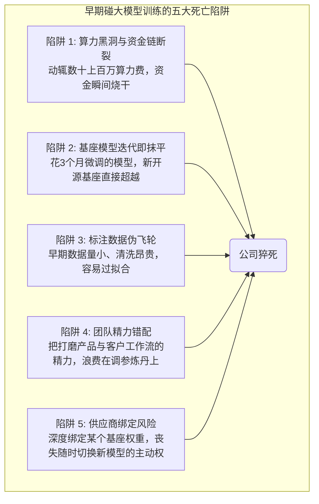
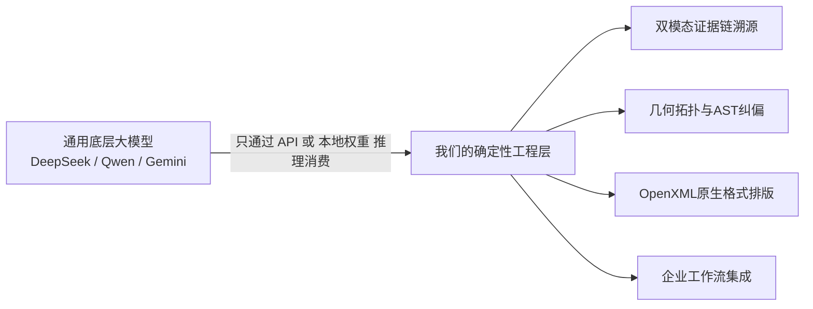

# 战略红线与铁律准则：早期绝对不碰大模型训练 (The Zero-Training Iron Rule)

> **核心原则**：
> **在项目的早期乃至成长期，团队绝对不要碰任何大模型的预训练（Pre-training）与全量微调（Full Fine-Tuning）！**
> **早期去碰大模型训练，必死无疑！**

---

## 1. 为什么早期碰大模型训练“碰了必死”？（五大毁灭性陷阱）

### 1.1 算力黑洞陷阱 (Compute Capital Drain)
- 租用 8 卡 A100/H800 服务器进行训练，单月算力成本数万至数十万元。
- 早期团队在未实现正向现金流、未验证 PMF（产品市场匹配度）前，把宝贵资金烧在 GPU 训练上，会导致现金流在 6 个月内枯竭。

### 1.2 基座模型迭代即抹平 (The Deprecation Trap)
- **行业残酷规律**：开源基座大模型（Qwen、Llama、DeepSeek）每 3~6 个月就进行一次大版本跃迁。
- 团队历经千辛万苦，基于 Qwen-VL-1.0 微调出的“所谓专有模型”，可能不仅在泛化能力上出现负迁移（灾难性遗忘），而且新发布的 Qwen2-VL 原生零样本（Zero-shot）能力直接碾压你微调了几个月的所有成果。

### 1.3 团队精力错配 (Misplaced Engineering Priorities)
- 初创产品的生死取决于：**产品交互好不好用、客户的工作流咬合深不深、Word/PPT 导出样式规不规整、离线安装部署顺不顺畅**。
- 如果工程师整天在排查 Loss 不收敛、梯度爆炸、CUDA 驱动版本不匹配，就完全丧失了打磨终端用户体验的时间。

---

## 2. 我们的生存法则：模型无关、纯推理驱动 (Model-Agnostic & Pure Inference)

### 2.1 把大模型当成“廉价且不断进化的电力”
- 我们坚决不造发电机（不训练大模型），我们只做**“工业级用电设备（生产力软件）”**。
- **模型抽象隔离层（Model-Agnostic Abstraction）**：
  - 架构设计保持纯粹的解耦：底层无论是接入云端商业模型（Gemini 2.0、Claude 3.5 Sonnet），还是接入本地量化开源模型（Qwen2-VL、DeepSeek-VL），全部通过标准的 OpenAI 兼容推理协议调度。
  - **谁便宜用谁，谁最新用谁，随时无缝热拔插切换**。

### 2.2 真正的护城河建立在“非训练”的工程黑盒上
1. **Prompt 管道与多阶段状态机**（控制复杂流程）；
2. **确定性编译器与 AST 规则引擎**（纠偏代码与表格几何）；
3. **双模态坐标映射索引**（证据链溯源）；
4. **企业私有上下文的 RAG 与 Memory 缓存**（基于向量与图数据库，而非修改模型权重）。
