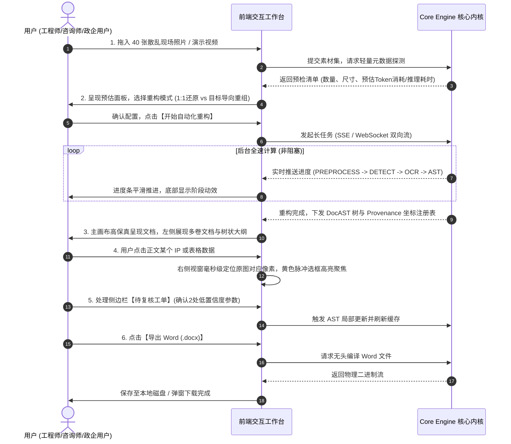
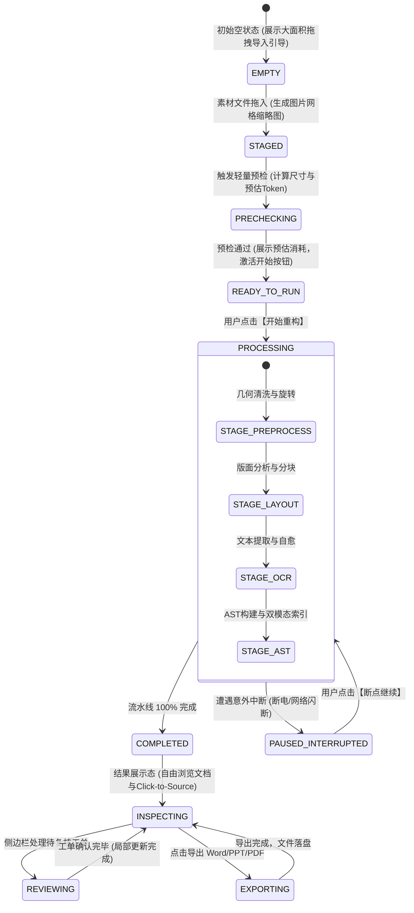

# 产品主交互逻辑、界面架构与用户旅程规格说明书 (UI/UX Architecture & Interaction Specifications)

> [!IMPORTANT]
> **产品交互顶层基石**：
> 本系统不是一个冷冰冰的“命令行脚本”或“黑盒后端”，而是一款面向专业工程师、政企干部、咨询顾问及科研极客的**工业级生产力工作台**。
> 本文档定义系统的主视窗信息架构（IA）、三栏式工作区拓扑、六步闭环用户旅程、核心特色交互微机制（Click-to-Source 视窗、大纲拖拽、待复核工单队列、问答反哺）以及多端（桌面/Web/一体机）适配规则。开发前端与交互层必须 100% 遵守本规范。

---

## 1. 产品交互设计哲学与核心原则

1. **“所见即所源”（See What You Source）**：
   - 杜绝传统 AI 工具“只吐文字、不知出处”的黑盒悬浮感；
   - 界面上生成的任何一段文字、表格、参数，必须始终与原始视觉底片保持**毫秒级物理视觉镜像联动**，给用户绝对的确定性与踏实感。
2. **“非阻塞全速推进”（Non-blocking Automation）**：
   - 机器能自动完成的计算（旋转、校平、去反光、分块、OCR），绝不在中途弹窗打断用户；
   - 所有的低置信度疑难项自动归集到侧边栏“工单待办”，计算完成后由用户集中高效过目。
3. **“确定性排版先行，大模型语义润色在后”**：
   - 用户最先看到的是高保真的版面还原（标题、表格、代码、插图）；
   - 目标导向重组提供直观的树状大纲预览，支持像思维导图或 Obsidian 一样自由拖拽调整，人机协同完全在用户掌控之中。

---

## 2. 全局信息架构 (IA) 与工作台三栏式拓扑

系统主界面采用经过严谨工效学论证的 **“三栏式全息工作台（Three-Column Holographic Workspace）”** 布局：

```text
+----------------------------------------------------------------------------------------------------------------------+
| [Logo] DocReconstruct Pro | 工作区: 某省能源局调度系统逆向 | 模式: [1:1物理还原 | ▼目标导向重组] | 算力: 本地RTX4090 [就绪]   | [设置] [?] |
+----------------------------------------------------------------------------------------------------------------------+
| 左栏: 素材与大纲导航 (20%)      | 中栏: 实时重构文档主画布 (50%)                      | 右栏: Click-to-Source 证据与复核视窗 (30%)     |
|                                |                                                    |                                              |
| [ + 导入素材 / 拖拽文件 ]        | [ 导出: Word(.docx) ▼ | PPT | PDF | Markdown ]      | 【原始底片核验视窗】 [原图: DSC_0942.JPG 2K]   |
| ------------------------------ | -------------------------------------------------- | +------------------------------------------+ |
| 📁 文档群分卷 (3 篇)            | # 01_系统总体架构与网络拓扑说明书                     | | [缩放 100% 200% 自适应] [⛶ 全屏对比]       | |
|  ├─ 📄 01_系统架构与拓扑 (18张)  |                                                    | |                                          | |
|  ├─ 📄 02_数据字典规范 (12张)    | ## 1. 核心网络接入拓扑                               | |        [原始底片高清晰截面渲染区]           | |
|  └─ 📄 03_巡检SOP指南 (10张)    | 系统采用双核心路由主备架构，现场物理交换机划分如下：   | |          +---------------------+         | |
|                                |                                                    | |          |  [黄色脉冲高亮选框]   |         | |
| 📑 树状逻辑大纲 (可拖拽升降级)   | | 交换机端口 | 映射VLAN | 业务归属 |                   | |          |  Port: 9092         |         | |
|  ▼ 1. 核心网络接入拓扑          | | :--- | :--- | :--- |                              | |          +---------------------+         | |
|     ├─ 1.1 交换机VLAN划分       | | eth0/1   | VLAN 100 | 生产调度网 |                   | |                                          | |
|     └─ 1.2 网关映射表          | | eth0/2   | VLAN 200 | 监控采集网 |                   +------------------------------------------+ |
|  ▶ 2. 数据库高可用设计          |                                                    | ------------------------------------------ |
|                                | ```python                                          | 📋 待复核工单队列 (Review Queue) [2 项待办]   |
| [素材相册瀑布流预览 (40张)]     | def check_gateway_health(ip: str):                 | [!] 端口号置信度较低 (0.72)                   |
| [图1] [图2] [图3] [图4]...     |     return ping(ip, timeout=5)                     |     正文: "Port 9092" vs 原图疑似 "Port 9090"|
|                                | ```                                                |     [ 采纳9092 ] [ 改为9090 ] [ 自定义编辑 ]   |
|                                |                                                    | [?] 表格第三列跨行合并待确认                  |
|                                |         |     [ 确认合并 ] [ 拆分为独立单元格 ]         |
+----------------------------------------------------------------------------------------------------------------------+
| [底栏任务调度状态机] 状态: 处理完成 (40/40) | 耗时: 38.2s | 本地GPU占用: 18% | 存储: 只读引用 (零磁盘残留) | [ 立即导出全部成果 ]    |
+----------------------------------------------------------------------------------------------------------------------+
```

### 2.1 左栏：素材管理与动态大纲导航区 (Width: 20% ~ 25%)
- **顶部操作**：大面积拖拽导入区，支持多选图片或长录屏视频文件拖入；
- **中部文档分卷树（Doc Cluster Selector）**：展示聚类分卷后的多篇独立文档；
- **下部逻辑大纲树（Interactive Outline Tree）**：呈现当前选中文档的动态标题树；支持类似思维导图的**鼠标拖拽升降级**（拖拽 H2 变成 H1，或调整章节先后次序），主画布内容实时响应联动重排；
- **底端素材缩略图托盘**：以横向瀑布流平铺当前文档关联的所有原始底片，点击某张图片缩略图，中间画布瞬间滚动至该图片贡献的段落。

### 2.2 中栏：重构文档实时渲染主画布 (Width: 45% ~ 55%)
- **顶部工具条**：
  - 模式切换按钮组：`[1:1 物理还原]` 与 `[目标导向重组]` 双模一键切换；
  - 导出格式选择器：Word (`.docx`)、PowerPoint (`.pptx`)、PDF、Markdown 一键导出；
  - 视图切换：`[富文本排版预览]`、`[Word 原生分页视图]`、`[Markdown 源码视图]`；
- **文档渲染主体**：
  - 高保真呈现排版效果（标准标题样式、三线表格、语法高亮代码块、等比缩放高清插图）；
  - **交互感知**：鼠标在正文滑过时，当前文本行背景呈现极淡蓝色底纹；**点击任何字词、表格单元格或代码行，右栏原图视窗瞬间响应！**

### 2.3 右栏：Click-to-Source 证据核验与工单视窗 (Width: 25% ~ 30%)
- **上半区：高清底片物理核验视窗 (Evidence Viewer)**：
  - 渲染高分辨率原图 Canvas，支持无级滚轮缩放与鼠标拖拽平移；
  - 具有**黄色脉冲高亮选框（Pulsing Highlight Bounding Box）**，精准框选出正文光标所对应的物理底片区域；
  - 提供 `[1:1原图像素]`、`[适屏居中]`、`[全屏双模态并排对比]` 按钮；
- **下半区：非阻塞待复核工单队列 (Review Queue)**：
  - 列出当前文档中所有置信度 $< 0.85$ 的数据项、模糊文字或跨行歧义；
  - 提供极简卡片，用户无需打字，通过快捷按钮 `[采纳推荐]`、`[快速切换候选]` 或双击就地修改。

---

## 3. 六步闭环用户旅程 (End-to-End User Journey)



---

## 4. 核心特色功能的深度交互微动效规范

### 4.1 Click-to-Source 像素级溯源视窗交互规约
- **触发机制**：
  - **悬停态（Hover Preview）**：鼠标光标悬停在任意文本/表格/代码上方超过 `300ms`，鼠标旁淡入半透明浮窗（Popover），展示原图局部 $200 \times 100\text{ px}$ 缩略切片；
  - **点击态（Click Lock）**：单击文本，右侧主核验视窗立即响应：
    1. 画布摄像机通过平滑缓动函数（Cubic-Bezier Easing）在 `120ms` 内平移至目标 BBox 中心；
    2. 自动调整缩放比例至原始像素的 $150\% \sim 250\%$（保证文字肉眼绝对清晰）；
    3. 在原图对应区域绘制明黄色发光框（`#FFD700`，外发光半径 8px），高亮边框执行一次双跳脉冲动效（Double Pulse），提示用户“这就是原始证据”。

### 4.2 树状大纲与内容块拖拽重组交互规约
- **拖拽行为规范**：
  - 用户按住左栏大纲树的任意节点，节点呈现轻微半透明浮起阴影；
  - **水平拖拽**：向右拖拽缩进，自动降级（如 H1 $\to$ H2）；向左拖拽凸出，自动升级（如 H2 $\to$ H1）；
  - **垂直拖拽**：在两节点之间显示蓝色吸附指示线（Drop Indicator）；释放鼠标后，不仅大纲树节点重新排序，**中栏主文档画布对应的内容块也瞬间无缝完成重排**；
  - **撤销支持**：任何拖拽重排支持 `Ctrl + Z` 一键无损撤销。

### 4.3 非阻塞待复核工单（Review Queue）极速闭环规约
- **工单卡片交互设计**：
  - 每张工单卡片严格限制在 3 行以内：
    `[警告类型标签] [字段名称]`
    `正文提取值: [9092 (置信度 72%)] vs 算法候选值: [9090]`
    `操作按钮: [ 采用 9092 ]  [ 改为 9090 ]  [ 手动输入 ]`
  - **键盘快捷流（Pro Flow）**：
    - 支持全键盘盲操：按 `J` 下一个待办，按 `K` 上一个待办，按 `Enter` 采纳推荐候选项，按 `Space` 呼出编辑框；
    - 所有工单处理完毕后，右侧卡片折叠，弹出轻量绿色徽标提示：“全文档已完成 100% 审计级人工复核”。

### 4.4 具身问答助手与闭环反哺自愈交互规约
- **交互流程**：
  1. 点击中栏右上角 `[问答助手]` 按钮，工作台平滑向左收缩，右侧滑出问答面板；
  2. 用户在输入框键入提问（例如：“这套系统的主备交换机心跳检测超时时间是多少？”）；
  3. AI 助手基于检索召回的证据流式打字输出回答，在回答核心参数后自动附带可点击的小药丸徽章：`[来源: 01_架构设计.docx #第1.2节 (原图: DSC_0942.JPG)]`；
  4. 点击该药丸，主画布与右侧底片视窗同时滚动跳转并高亮该证据段落；
  5. **行内反哺纠偏**：回答下方提供一个极浅的按钮 `[纠正此回答]`；用户点击并输入“实际配置已改为 10 秒”，系统弹出轻量级确认框：“是否将此修正同步更新至《01_架构设计.docx》源文件？”，用户点击确认后，主画布文字瞬间被自动修正，右下角弹出微通知：“已生成增量补丁，底层 Word 文档与知识库图谱已级联自愈完成”。

---

## 5. 前端界面全局状态机 (UI State Machine)



---

## 6. 三大端形态的专属交互与响应式适配准则

| 维度 | 形态 A: 跨平台单机客户端 (Desktop - Tauri) | 形态 B: 商业云端 Web 门户 (SaaS) | 形态 C: 涉密一体机工控端 (Appliance) |
| :--- | :--- | :--- | :--- |
| **主要操作媒介** | 鼠标滚轮、触控板、全键盘快捷键 | 鼠标点击、浏览器标准交互 | 触摸屏触控操作 + 外接键鼠 |
| **文件导入交互** | • 支持从 Windows 资源管理器直接拖拽文件夹；<br>• 支持系统全局截屏快捷键直接粘贴剪贴板图片；<br>• 自动记忆最近打开的项目目录。 | • 标准浏览器文件选择对话框；<br>• 拖拽文件上传（带分片上传进度条）；<br>• 支持从企业云盘/OSS 直接选择。 | • 插入涉密 U 盘自动弹窗提示“发现新素材”；<br>• 触摸屏大图标文件勾选器；<br>• 强制安全审计确认弹窗。 |
| **文档导出交互** | • **“一键用本机 Word 打开”**：生成后无需保存到下载文件夹，直接调用系统默认 Microsoft Office 打开；<br>• 自动在本地项目目录生成 `output/`。 | • 浏览器标准下载对话框；<br>• 提供云端预览分享只读链接；<br>• 支持团队成员协同在线批注。 | • “导出至涉密 U 盘”物理向导；<br>• 导出前强制执行物理安全销毁日志提示；<br>• 弹出拔出 U 盘安全断开指引。 |
| **视窗空间适配** | 支持自适应窗口缩放，全屏模式下三栏完全平铺；双显示器支持“原图独立窗口浮动”。 | 响应式自适应：当浏览器宽度 $< 1280\text{px}$ 时，右侧核验视窗自动收缩为抽屉式侧边栏（Drawer）。 | 针对标准 1080P / 4K 触摸工控屏优化，按钮触控热区放大至 $\ge 48 \times 48\text{px}$，高对比度主题。 |

---

## 7. 专业级键盘快捷键矩阵 (Productivity Shortcuts)

为了让资深工程师、外包整理团队与咨询顾问实现极致的生产力周转，系统支持全套工业级快捷键：

| 快捷键 (Windows / macOS) | 对应功能动作 | 交互效果 |
| :--- | :--- | :--- |
| **Ctrl + O / Cmd + O** | 快速导入素材 | 弹出本地素材选择器 |
| **Ctrl + Enter / Cmd + Enter** | 开始重构流水线 | 触发当前选定素材的任务提交 |
| **Ctrl + S / Cmd + S** | 快速导出 Word 文档 | 直接触发默认配置的 `.docx` 生成落盘 |
| **Tab / Shift + Tab** | 待复核工单顺向/逆向切换 | 焦点在右侧待核对卡片间切换，原图视窗同步联动跳动 |
| **1 ~ 4** | 快速采纳工单候选词 | 直接将数字对应的推荐候选项填入当前存疑位置 |
| **Space (空格键)** | 暂停/继续底片全屏缩放对比 | 瞬时切入“原图与生成排版 1:1 双屏透视对比”视窗 |
| **Ctrl + Z / Cmd + Z** | 撤销上一步操作 | 撤销大纲拖拽或手动文本修改 |
| **Ctrl + F / Cmd + F** | 双模态全景混合检索 | 呼出检索框，输入关键词正文与原图 BBox 同时高亮 |
