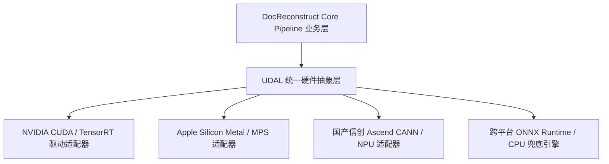
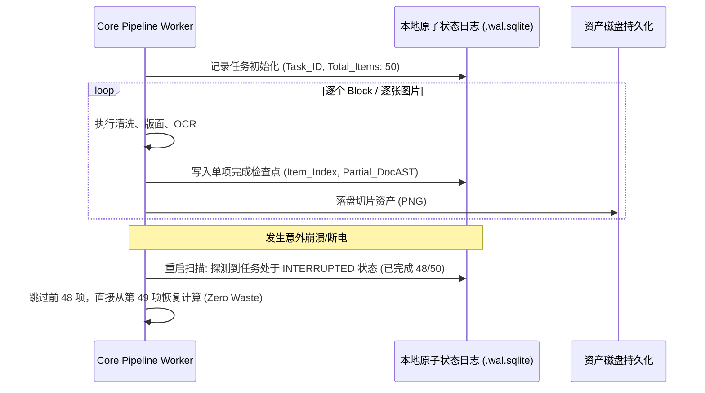

# 系统前置架构盲区分析与八大顶层设计决议 (Architectural Blindspots & Pre-implementation Decisions)

> [!IMPORTANT]
> **开发启动前的关键共识**：
> 在严肃工程中，80% 的系统性重构与商业失败，并非源于“代码写得有 Bug”，而是源于“核心顶层盲区在开工前未被推演，导致底层基石与业务真实场景发生灾难性冲突”。
> 排除登录鉴权、基础权限等通用基础设施，本文档对本项目特有的 **八大前置技术与商业深水区盲点** 做出彻底的架构推演与刚性决议。

---

## 1. 异构计算硬件与模型运行时抽象层 (Heterogeneous Hardware & Runtime Abstraction)

### 1.1 致命盲区
如果代码在早期直接硬编码 `import torch; tensor.cuda()`，将直接导致软件丧失在真实客户环境中交付的能力：
- **Tier 1 政企涉密环境**：大量采用信创硬件（华为昇腾 Ascend CANN、摩尔线程 MUSA、寒武纪 MLU、海光 DCU），操作系统为统信 UOS / 银河麒麟（ARM64 / x86-64 / 龙芯 LoongArch）；
- **Tier 2 云端环境**：标准 NVIDIA GPU 集群（CUDA 12.x / TensorRT-LLM / vLLM）；
- **Tier 3 个人环境**：包含 Apple Silicon（Metal / MPS / MLX）、Windows 消费级独显（CUDA / DirectML），以及大量仅有核显的轻薄办公本（纯 CPU / OpenVINO / ONNX Runtime）。

### 1.2 顶层架构决议：计算运行时驱动解耦接口 (Unified Device Abstraction Layer, UDAL)
系统核心必须构建**统一硬件计算抽象适配层**，严格禁止核心业务流水线直接调用底层具体硬件 SDK：



- **权重格式标准化**：模型权重统一维护 **ONNX / GGUF / SafeTensors** 三种标准化工业格式，杜绝使用特定厂商的私有二进制 Dump 权重；
- **动态后端探测与热回退 (Dynamic Fallback)**：
  - 启动时自动探测可用硬件优先级：`Ascend/CUDA > Metal > DirectML > ONNX-CPU`；
  - 若 GPU 运行中出现显存不足（OOM），计算框架必须具备**算子级自动回退至系统内存（Host RAM）与 CPU 串行推理**的能力，确保系统“降速但不崩溃”。

---

## 2. 算力成本经济学与 Token 预算熔断机制 (Token Economics & Cost Safeguards)

### 2.1 致命盲区
多模态 VLM（如 Gemini 2.0 Flash / Qwen2-VL）处理高分辨率图像时，单张 4K 照片切片后消耗的 Token 高达 **1,500 ~ 3,000 Tokens**。
一次导入 50 张照片进行全量重构，单次任务消耗将达到 **10万 ~ 15万 Tokens**。
- **商业崩盘风险**：在 SaaS 订阅或免费试用模式下，若无前置预算限制，恶意用户或死循环并发调用可在数小时内消耗数千美元云端 API 账单，造成恶性穿底；
- **本地算力过载**：在单机消费级显卡上，一次性并发推入 50 张 4K 图像将瞬间触发驱动级显存死锁（GPU TDR Reset）。

### 2.2 顶层架构决议：前置预算估算器与感知哈希语义缓存
1. **任务前置预算估算契约 (Pre-flight Cost Estimator)**：
   - 用户拖入素材包后，系统在 **0 耗费** 状态下先执行本地轻量级尺寸与分块探测；
   - 在 UI 明确弹出消耗声明：“本次处理包含 36 张高精素材，预计消耗 120,000 算力点 / 预计本地推理耗时 85 秒”，必须经由用户显式确认后方可触发推理队列；
2. **感知哈希语义特征缓存 (Perceptual Hash Semantic Cache)**：
   - 提取每张图像的 dHash 与关键特征指纹：`Cache_Key = SHA256(Image_dHash + Model_Version)`；
   - 若用户仅调整了大纲标题层级或排版字体，重新生成时**100% 命中前序视觉感知特征缓存**，绝对禁止对相同图片重复调用昂贵的多模态视觉大模型，将二次重构成本压缩至接近 0。

---

## 3. 本地存储暴食症与零残留涉密物理拓扑 (Storage Bloat & Zero-Data Retention)

### 3.1 致命盲区
- **存储暴食症（Storage Bloat）**：手机拍摄的高清照片普遍在 5MB ~ 20MB / 张，视频素材动辄数 GB。如果系统采取粗暴的“把输入素材拷贝进软件缓存目录”的设计，重度用户使用两周即可占满 50GB 系统 C 盘，引发系统级卡死；
- **涉密机房合规阻断**：在国家机关与军工机房，处理涉密纸质案卷翻拍后，一旦物理硬盘中残留了未脱敏的原图或切片缓存，使用普通文件恢复软件能够扫出原图，将构成严重泄密责任事故。

### 3.2 顶层架构决议：就地引用与物理零残留双模存储拓扑
1. **就地引用与轻量虚拟缩略图 (In-place Reference with Lazy Thumbnails)**：
   - 系统对待输入图像一律采取**“只读就地引用（Read-only In-place Reference）”**原则，仅记录原始绝对路径与 SHA-256 指纹，严禁向应用目录复制原图全量副本；
   - 仅生成尺寸小于 $400 \times 400$、大小小于 50KB 的 WebP 临时轻量缩略图用于 UI 交互展示；
2. **涉密物理零残留模式 (Air-Gapped Zero-Retention Mode)**：
   - 提供配置开关 `SECURITY_EPHEMERAL_MODE = true`；
   - 开启时，所有版面切片、OCR 临时索引全部在操作系统**加密虚拟内存盘（RAM Disk）**中流转，绝对不产生任何物理磁盘 I/O 写入；
   - 任务交付完成后，内存直接调用 `SecureZeroMemory()` 物理覆写归零，物理层面不留任何取证恢复的可能性。

---

## 4. 长时异步流水线中断与断点检查点自愈 (Stateful Checkpoint & Resumption)

### 4.1 致命盲区
处理 50 张散乱照片或 30 分钟连续操作录屏是一项耗时 **2 ~ 10 分钟** 的重型长计算任务。
若系统采用简单的无状态内存管道：
- 用户误触关闭窗口、误按刷新、笔记本电量耗尽；
- 处理到第 48 张图片时，第 49 张图片突然损坏触发未捕获异常；
- 整个任务将全量崩溃退出，用户此前等待数分钟的全部计算成果瞬间归零，必须重头开始！

### 4.2 顶层架构决议：基于 WAL 的微任务事务检查点机制
系统流水线强制采用 **预写日志（Write-Ahead Logging, WAL）与原子化检查点（Checkpoint）** 架构：



- **断点秒级续跑**：意外崩溃重启后，客户端自动提示“检测到未完成的文档重构任务（进度 96%），是否继续完成？”，用户点击后在 2 秒内恢复未完成部分；
- **异常隔离跳过**：单个图片遭遇坏死（如损坏文件），系统自动将该项标记为 `FAILED_SKIPPED`，并在最终报告中生成黄色警告，绝对不阻断其余 49 张图片的正常生成。

---

## 5. 人机协同（HITL）非阻塞待复核队列机制 (Non-blocking HITL Review Queue)

### 5.1 致命盲区
我们在设计准则中确立了“遇到低置信度（$< 0.85$）歧义素材，坚决禁止无依据脑补，必须提示警告或请求人工仲裁”。
但如果交互机制设计粗糙：
- **致命交互设计 A（实时弹窗打断）**：系统在处理 50 张图片过程中，每遇到一个模糊字符或反光表格就弹窗阻断任务：“请确认此处的字符是 O 还是 0”，用户必须守在电脑前点 20 次弹窗，整个长流程自动化体验荡然无存；
- **致命交互设计 B（完全不提示）**：直接在文档中留下空白或硬塞进去，用户最终交付时漏看了错别字。

### 5.2 顶层架构决议：非阻塞式“待复核工单队列 (Review Queue)”
系统必须采取**“后台计算不阻断、前台集中轻量核对”**的工业级设计：
1. **后台全速推进与瑕疵染色**：
   - 遇到置信度低于 0.85 的区块或模糊字词，系统不停止流水线，继续向下执行；
   - 在 DocAST 中将该节点打上 `audit_status = "PENDING_REVIEW"` 标记；
2. **文档完成后的集中审核工作台**：
   - 文档重构完成后，主视窗正常展示结果，右侧侧边栏弹出**“待核对数据项（例如：共 3 处需人工确认）”**；
   - 用户点击任意一条待复核项，左侧原图视窗毫秒级定位放大高亮，提供备选候选项或允许直接键盘输入修改；
   - 用户确认后，实时触发 AST 局部修正，零阻断、零被打扰。

---

## 6. 跨平台 OpenXML 文档引擎向下兼容性基线 (OpenXML Backward Compatibility)

### 6.1 致命盲区
研发人员通常使用最新的 Microsoft Office 365 或最新版 WPS 开发测试，导出的 Word (`.docx`) 与 PPT (`.pptx`) 在本地测试完美。
但在真实商业落地中：
- 政企机关的大量涉密终端依然运行着 **Windows 7 / Windows 10 LTSC**，办公软件版本普遍为 **Office 2010 / 2013 / 2016** 或 **旧版信创版 WPS**；
- 若使用了较新的 OpenXML ISO/IEC 29500 Strict 标签或特定的 DrawingML 特性，在旧版 Office 中打开将直接触发破坏性红叉弹窗：“Word 无法打开此文件，因为部分内容损坏”；
- **跨平台字体缺失灾难**：在 Linux 信创服务器上一体机生成的 Word，在没有预装对应中文字体的 Windows 客户端打开时，版面发生灾难性字符重叠与换行错位。

### 6.2 顶层架构决议：严格 Transitional 规范与自包含字体回退映射
1. **严格限制使用 OpenXML Transitional 命名空间**：
   - 严禁使用特定 Office 版本的私有扩展（如 `w14:`, `w15:` 专属特性）；
   - 所有表格、分节符、段落样式严格遵循向下兼容至 **Office 2007** 的最通用 XML Schema 标准；
2. **跨平台安全字体包与 Fallback 映射矩阵**：
   - 在生成 Word/PPT 样式时，强制配置三级字体回退链：
     `font-family: [企业指定商用字体], "思源黑体", "Microsoft YaHei", "PingFang SC", sans-serif;`
   - 对于 PDF 矢量导出，强制执行**字体全子集嵌入（Font Subsetting Embedding）**，把文档所用到的字符矢量轮廓打入 PDF 容器内部，杜绝任何平台字体缺失风险。

---

## 7. 知识库反哺并发冲突与版本时光机 (Knowledge Base Versioning & AST Commits)

### 7.1 致命盲区
我们在架构中引入了“闭环自愈反哺飞轮：用户在问答中对错误参数的纠偏，生成 Delta Patch 反向级联修改物理底层 Word/Markdown 文档”。
在多人协同（Tier 2）或频繁问答中存在严重并发风险：
- 顾问 A 在问答中纠正了端口为 `9092`；
- 顾问 B 在 1 秒后纠正端口为 `9095`；
- 或者项目经理正在离线本地手动打开 Word 文件修改了第 2 章文字；
- 若缺乏并发与版本控制，自动反哺的 Delta Patch 将直接冲毁人工修改，造成灾难性的**“写覆盖丢失（Lost Update）”**。

### 7.2 顶层架构决议：类 Git 式 AST 增量版本树 (AST Version Commits)
文档的底层反哺自愈绝不能直接盲目覆盖物理文件，必须引入版本管理机制：
1. **DocAST 变更版本哈希链（Commit Chain）**：
   - 每次用户问答触发纠偏，生成一个带有变更作者、时间戳、变更原因的 `AST_Commit`：
     `Commit_ID = SHA256(Parent_Commit_ID + Patch_Content)`；
2. **乐观并发锁 (Optimistic Concurrency Control)**：
   - 应用补丁时必须校验目标节点的基线版本号；若目标段落已被其他修改更新，系统阻断静默覆写，进入冲突合并提示；
3. **安全回滚时光机（Undo / Rollback）**：
   - 底层 Word/Markdown 文件物理更新前，自动保留上一版本的快照；
   - 用户在系统审计面板中可一键点击“撤销问答反哺修改”，瞬时回滚至历史版本，确保企业知识资产安全可控。

---

## 8. 信创生态与国产化全栈适配准入 (China Domestic Innovation / Xinchuang Readiness)

### 8.1 致命盲区
既然明确将“Tier 1 B端政企客户”作为核心营收支柱，系统在技术选型时就必须直面严苛的**信创目录准入与国产化验收测试**：
- 很多主流 Python 机器学习依赖包（如部分版本的 ONNX Runtime、特定版 OpenCV、以及某些闭源底层 C 扩展）仅发布了面向 x86-64 的 Windows/Ubuntu 预编译二进制 Wheel 包；
- 当把工程搬到政企机房的 **飞腾 / 鲲鹏 (ARM64)** 或 **龙芯 (LoongArch)** 架构的银河麒麟/统信 UOS 物理机上时，直接在 `pip install` 阶段报缺少环境编译工具，无法构建安装，导致现场部署全面瘫痪！

### 8.2 顶层架构决议：信创纯源码级可构建性与静态隔离容器
1. **依赖库纯源码编译能力与信创基线**：
   - 严格审查工程引入的第三方 Python / C++ 库，**严禁引入仅提供 x86 闭源二进制编译产物的组件**；
   - 确保核心依赖（OpenCV、Pillow、PySide/Tauri 依赖）在 ARM64 和 LoongArch 上均具备完整的纯源码编译支持；
2. **离线交钥匙一体机部署包（Self-Contained Appliance Image）**：
   - 针对政企一体机，提供经安全加固的无网络依赖 Docker 镜像或基于 AppImage 的免安装自包含二进制包；
   - 所有运行时 Python 解释器、C++ 动态库、推理算子库、字体包、模型权重 100% 打包在单个不可变容器中，现场开箱即用，零动态公网拉取依赖。

---

## 9. 八大前置决策技术规约落地清单

为确保上述八大决议在后续开发中 100% 贯彻，系统技术规范新增以下前置契约约束：

```text
docs/
├── 03_产品需求规格说明/
│   ├── 00_软件终端形态_客群映射与架构兼容演进方案.md  # 顶层形态与多端适配设计
│   └── 00_系统前置架构盲区分析与八大顶层设计决议.md      # 【本文档】硬件解耦/成本/存储/容灾/HITL/兼容/信创八大决议
```

| 维度 | 顶层决议核心关键词 | 执行机制与强制约束 |
| :--- | :--- | :--- |
| **1. 异构硬件适配** | 统一设备抽象层 (UDAL) | 模型统一 ONNX/GGUF，支持国产 NPU 与 CPU 降级回退 |
| **2. 成本经济学** | Token 预算估算器 & dHash 语义缓存 | 任务前置提示消耗，二次重构 100% 命中缓存零成本 |
| **3. 存储拓扑** | 只读就地引用 & 加密 RAM 零残留 | 严禁全量拷图，涉密模式内存自毁物理零取证 |
| **4. 长任务容灾** | WAL 事务检查点 (Checkpoint) | 逐图落盘日志，意外断电/中断支持一键断点续跑 |
| **5. HITL 交互** | 非阻塞待复核工单队列 | 后台计算全速推进不打扰，完成后集中侧边栏高亮核对 |
| **6. 文档兼容性** | OpenXML Transitional & 字体嵌入 | 兼容低至 Office 2007，PDF 字体全子集嵌入零乱码 |
| **7. 知识库版本** | 类 Git 式 AST Commit 链 | 乐观并发锁，反哺纠错可审计、可追溯、可一键撤销 |
| **8. 信创合规准入** | 纯源码构建能力 & 自包含镜像 | 杜绝 x86 闭源黑盒二进制，全架构 (ARM/LoongArch) 容器化交付 |
