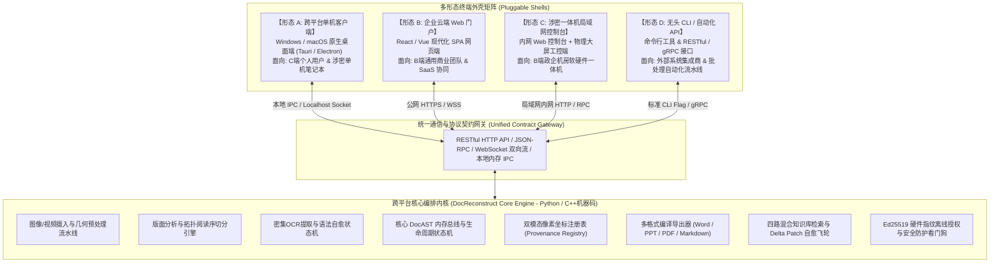
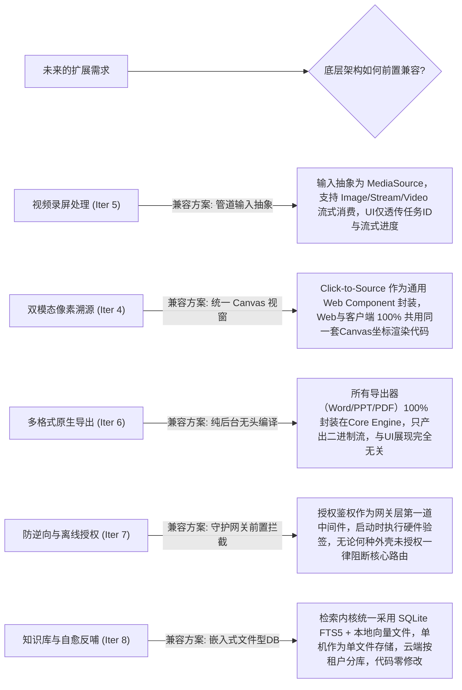

# 软件终端形态决策、客群映射与架构全生命周期兼容方案

## 1. 软件终端形态决策背景与战略推导

### 1.1 核心问题：为什么不能是“单一的 Web”或“单一的客户端”？
在系统顶层设计阶段，若仓促决定“只做 Web 端”或“只做客户端”，将在工程实施与商业交付中遭遇致命阻断：

| 评估维度 | 纯 Web 端 (Pure Web SaaS) | 纯本地客户端 (Pure Desktop Client) | 结论与致命矛盾 |
| :--- | :--- | :--- | :--- |
| **涉密内网机房 (Tier 1)** | **无法准入**。涉密环境物理断网，严禁将数据上传至公网 Web；客户若在内网自建 Web 服务器，需繁琐的 IT 审批与服务器资源。 | **天然适配**。单机双击运行，数据 100% 驻留在本地磁盘，天然符合断网机房审计。 | 纯 Web 无法进入政企高客单价市场；必须提供离线单机能力。 |
| **商业协同与SaaS (Tier 2)** | **天然适配**。多成员协同、统一账号 SSO、集中式 GPU 算力资源池调度、零安装成本。 | **协同极差**。各成员各自为政，无法实现企业知识库集中沉淀与 API 自动化调用。 | 纯客户端无法支撑高估值 SaaS ARR 商业模式；必须具备云端多租户 Web 能力。 |
| **C端极客与个人 (Tier 3)** | **体验存在门槛**。用户需要注册、登录、担心隐私泄露，且处理 4800 万像素照片受浏览器上传带宽与内存限制。 | **极致体验**。拖拽本地文件夹即刻处理，直接与本地 Obsidian / 本地磁盘无缝同步。 | C端个人用户偏好本地单机隐私与轻量开箱即用。 |
| **硬件与加速能力调用** | 依赖服务器 GPU；客户端本地浏览器无法直接调用宿主机私有算力卡（如国产昇腾卡）。 | 可直接通过操作系统底层驱动调用本地硬件（NVIDIA CUDA / Apple Metal / 国产 NPU）。 | 离线一体机必须依赖本地底层驱动调用能力。 |

### 1.2 架构终局定位：“分层无头内核 + 多形态外壳适配器 (Headless Core Engine + Multi-Shell)”
基于上述商业与运行环境矛盾，系统**底层绝不能与任何特定的 UI 框架绑定**，必须采用**“分层无头内核（Headless Core Engine）+ 标准协议接口（Unified IPC/HTTP Contract）+ 多形态外壳适配器（Pluggable Shells）”**的工业级解耦架构：

---

## 2. 软件形态与三大客户场景的一对一映射矩阵

| 客户分类 | 交付的软件物理形态 | 运行环境与拓扑结构 | 算力与硬件执行主体 | 数据存储位置 |
| :--- | :--- | :--- | :--- | :--- |
| **Tier 1: B端政企客户** (涉密/强监管) | **软硬件一体机 (Appliance)** + 局域网 Web 控制台 + 可选单机便携客户端 | **物理隔离内网集群**。 工控机/服务器预装 Linux/信创系统，Core Engine 作为守护进程常驻。 | 平台代采的专用硬件卡（昇腾/RTX 4090/L40S），本地 100% 离线计算。 | 100% 保存在客户内网服务器或一体机加密磁盘，严禁外联。 |
| **Tier 2: B端通用商业客户** (云端/SaaS/VPC) | **多租户云端 Web 端 (SaaS)** + 团队管理后台 + 开放 OpenAPI | **公有云 / 企业自建专有云 (VPC)**。 前端为标准浏览器 SPA，后端部署在 Kubernetes 容器集群。 | 集中式云端 GPU 算力资源池（按租户分配配额与优先级队列）。 | 云端多租户对象存储（OSS/S3）与隔离的专有云数据库。 |
| **Tier 3: C端个人用户** (学生/科研/极客) | **跨平台单机客户端 (Desktop)** (Windows `.exe` / macOS `.dmg`) | **用户个人单台 PC / Mac**。 双击启动，前端为精简轻量视窗，后台隐式拉起本地单机 Core Engine。 | 优先调用用户本地独显（RTX 30/40系 / Apple M系列）；无独显支持配置个人 API Key。 | 100% 存放在用户本地指定目录（如用户本地的 Obsidian 知识库）。 |

---

## 3. 全规划功能点在底层架构中的前置兼容性设计

系统底层必须对目前想到的所有核心能力及未来演进特性提供**前置架构兼容（Architectural Pre-compatibility）**，坚决杜绝“写完单图发现改不了视频”、“写完本地发现上不了云”的推倒重来：

### 3.1 兼容点一：输入源多模态流式抽象（单图 $\to$ 多图 $\to$ 连续视频）
- **架构兼容设计**：
  - 定义统一输入抽象 `MediaJobContext`；
  - 核心引擎不直接接收具体的“物理文件句柄”，而是接收规范的事件流（Event Stream）；
  - 单图对应 `SingleImageTask`，批量图对应 `BatchImageTask`，视频对应 `VideoChunkStreamTask`；
  - 前端 UI（无论是 Web 还是桌面客户端）只负责向核心网关提交任务，并通过 **Server-Sent Events (SSE)** 或 **WebSocket** 监听全局处理阶段：
    `PREPROCESSING (20%) -> LAYOUT_PARSING (50%) -> OCR_HEALING (70%) -> AST_COMPILED (100%)`。

### 3.2 兼容点二：Click-to-Source 视窗的前端全平台统一（Web 与桌面同构）
- **架构兼容设计**：
  - Click-to-Source 涉及双栏对照、光标定位、Canvas 原图高亮缩放；
  - 该组件必须封装为**与环境无关的 Web 标准前端组件（Web Component / React SPA Module）**；
  - **在 Web 端**：直接在浏览器中渲染；
  - **在桌面客户端**：桌面壳（Tauri / Electron）内嵌微内核浏览器渲染视窗，直接 100% 复用同一套组件，绝不维护两套不同的 UI 代码；
  - 坐标契约 `provenance_index` 通过 HTTP API 或本地 Socket 毫秒级下发，两端完全一致。

### 3.3 兼容点三：导出编译引擎的“纯无头”隔离（Headless Compilers）
- **架构兼容设计**：
  - 微软 OpenXML（Word `.docx`、PPT `.pptx`）、WeasyPrint（PDF）及 Markdown 编译器，**全部作为无头计算模块（Headless Modules）常驻于 Core Engine**；
  - 任何 UI 层绝对不允许包含文档生成逻辑；
  - UI 端仅触发指令 `POST /api/v1/export?format=docx`，Core Engine 编译完成后返回二进制流或写入本地目标路径。无论是单机保存还是网页下载，底层通道完全一致。

### 3.4 兼容点四：安全防御与离线 License 的统一看门狗（Unified Gatekeeper）
- **架构兼容设计**：
  - 安全防护与授权校验必须作为 **Core Engine 内部的底层前置网关中间件（Middleware）**；
  - 无论是客户端启动、网页端服务拉起、还是 CLI 工具调用，主进程初始化阶段首先触发 `LicenseValidator.verify_environment()`；
  - 若硬件指纹不匹配或检测到逆向调试进程，直接在内核层熔断退出，任何上层 UI 无法绕过内核直接执行推理与重构。

### 3.5 兼容点五：知识库单机与云端的“文件级/租户级”无缝切换
- **架构兼容设计**：
  - 知识库四路混合检索依赖底层存储引擎。为避免“单机用一套、云端换一套”的工程割裂，统一采用 **SQLite (集成 FTS5 全文扩展) + 紧凑型向量存储 (HNSWlib)**：
    - **在 C 端单机桌面与政企离线机房中**：知识库表现为一个本地物理文件（如 `./knowledge_base.db`），单机无配置即开即用；
    - **在 B 端多租户云端环境中**：采用按租户分库（Database-per-Tenant）模式，每个租户在对象存储中映射专属的 SQLite 实例，完全实现“单机与云端代码 100% 统一”。

---

## 4. 终端外壳（Shells）的技术选型决议

为了以最小的研发代价实现上述多端兼容，技术选型执行以下刚性规约：

| 终端形态 | 推荐技术栈 (Tech Stack) | 选型技术依据与边界 |
| :--- | :--- | :--- |
| **形态 A: 桌面客户端 (Desktop Shell)** | **Tauri (Rust + Web前端)** *(或备选 PySide6 / Electron)* | • **极致轻量**：Tauri 打包体积仅约 10~15MB（Electron 动辄 100MB+），内存占用极低； • **原生安全性**：Rust 后端与底层操作系统原生交互，天然抵御反编译与内存篡改； • **UI 完全同构**：前端使用 React/Vue，与云端 Web 共享 100% 的 UI 与 Click-to-Source 交互代码。 |
| **形态 B: 云端与内网 Web 门户** | **React / TypeScript + Tailwind CSS** | • 工业级生态最健全，天然支持组件化与复杂 Canvas 渲染； • 可直接嵌入 Tauri 作为桌面客户端视图。 |
| **形态 C: 核心通信网关** | **FastAPI + Uvicorn (HTTP / SSE / WebSocket)** | • 兼具极高吞吐量与自动化 OpenAPI 文档生成； • 本地单机时监听 `127.0.0.1:{random_port}` 作为 IPC 通信，云端部署时直接接入 Nginx / Kubernetes Ingress。 |

---

## 5. 本方案实施演进路线 (Phased Implementation)

1. **第一阶段（当前聚焦）**：
   - 100% 聚焦于 **Core Engine（核心流水线内核）** 的打通；
   - 对外仅暴露标准 API 与本地 CLI 调用契约；
   - 保证 Core Engine 在 Windows 与 Linux（信创服务器）上具备一致的确定性输出；
2. **第二阶段**：
   - 构建标准的 React 前端交互视窗（包含文档树大纲与 Click-to-Source 双栏画布）；
   - 通过 FastAPI 本地服务进行联调；
3. **第三阶段**：
   - 使用 Tauri 将上述 React 前端与编译固化的 Core Engine 打包为 **Windows/macOS 原生单机客户端**（覆盖 C 端与涉密单机）；
   - 同时将该 React 前端部署至云端容器，打通 **多租户 Web SaaS 端**（覆盖商业客户）。
