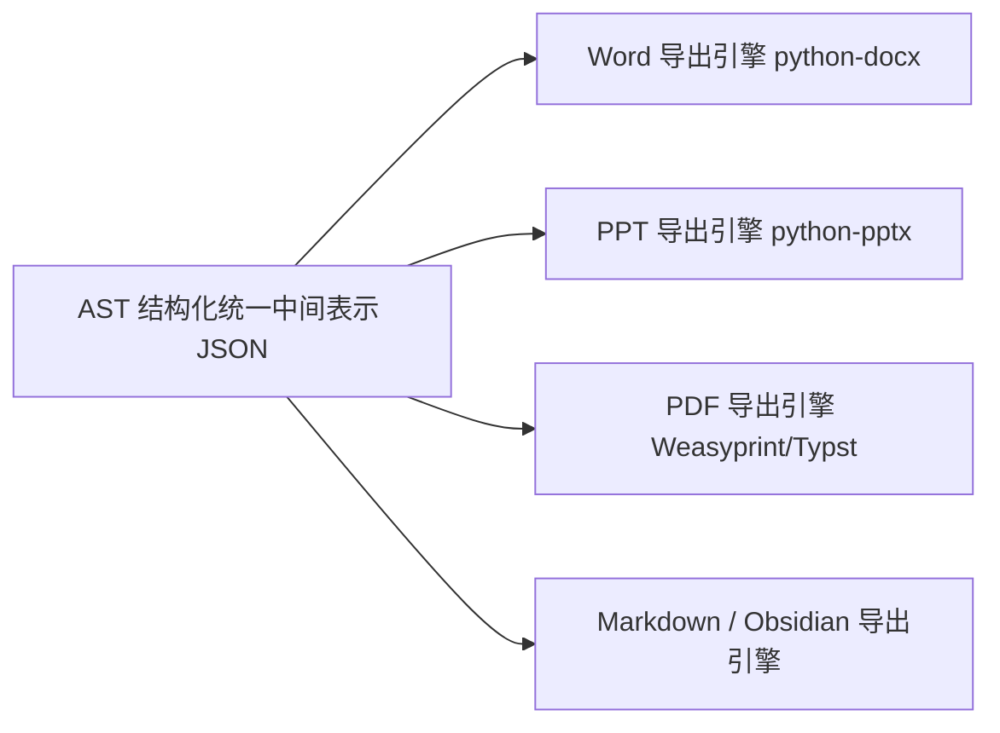

# 多格式输出规范设计说明书 (Word / PPT / PDF / Markdown)

## 1. 为什么多格式输出是商业变现的生命线？

在用户调研中我们发现了一个关键分水岭：
- **技术人员与极客**：偏爱 **Markdown / Obsidian**，讲究纯文本、双链与版本控制；
- **企业高管、甲方客户、咨询顾问与审计机构**：**100% 只认 Word（.docx）与 PPT（.pptx）**。
如果系统只支持 Markdown 导出，商业价值将被压缩在极客小圈子里；一旦具备高保真导出 Word/PPT 的能力，客单价将直接飙升 5~10 倍。



---

## 2. 各格式输出详细规范与实现标准

### 2.1 格式一：Microsoft Word (.docx) —— 面向正式工程与交付报告
- **排版引擎选型**：基于 `python-docx` 配合定制的企业级样式模板（Template-driven）。
- **样式规范**：
  - **标题层级**：统一应用标准大纲级别（Heading 1: 微软雅黑小二加粗，Heading 2: 四号加粗，Heading 3: 小四加粗）。
  - **表格渲染**：原生 Word 表格对象，支持表头置顶、跨页断行重复表头、交替行斑马纹背景、单元格垂直水平居中对齐。
  - **代码块渲染**：使用灰度背景单格表格包装代码，字体采用 Consolas / JetBrains Mono 等宽字体，保持语法缩进。
  - **插图与图表**：自动按正文版心宽度等比例缩放居中，下方附带标准题注（如“图 2-1 系统拓扑结构图”）。
  - **超链接与书签**：将正文中的锚点映射为 Word 的原生 Bookmark 与 Hyperlink，按住 Ctrl 即可点击跳转。

---

### 2.2 格式二：Microsoft PowerPoint (.pptx) —— 面向汇报与方案宣讲
- **排版引擎选型**：基于 `python-pptx` 结合自适应母版排版。
- **重构逻辑**：
  - **场景适配**：当输入素材是会议演讲录像、翻拍的 PPT 屏幕或架构评审白板时，自动选择 PPT 输出模式。
  - **幻灯片自动分页**：大模型根据 H1/H2 逻辑章节，自动划分为独立的 Slide。
  - **版式自适应**：
    - `版式A (图文对比)`：左侧为架构图高清原图，右侧为 AI 提炼的 3~5 点核心设计原则；
    - `版式B (流程步骤)`：将操作录屏步骤转化为左右横向排列的卡片流程；
    - `版式C (核心数据)`：将关键对比表格转化为 PPT 原生精美图表。

---

### 2.3 格式三：Adobe PDF (.pdf) —— 面向不可篡改的归档与印刷
- **排版引擎选型**：基于 `Typst` 或 `WeasyPrint`（HTML+CSS 转 PDF）。
- **特性**：
  - 自动生成带页码的左侧 PDF 书签导航目录（PDF Outline）；
  - 完美支持矢量公式渲染（KaTeX/MathJax 预编译矢量数学符号，放大不失真）；
  - 自动生成页眉、页脚与动态页码（如“第 3 页，共 12 页”）。

---

### 2.4 格式四：Markdown / Obsidian Vault —— 面向现代知识库与极客
- **目录结构**：
  ```text
  Vault/
  ├── .obsidian/               # 预置 Obsidian 配置与图谱视图参数
  ├── assets/                  # 高清原图插图切片
  ├── 01_系统总体架构设计.md     # 带 FrontMatter 与 [[Wikilinks]] 的正文
  └── index.md                 # 全局知识大纲与思维导图导航
  ```
- **双链语法**：符合 Obsidian 规范的 `[[目标文档#章节锚点]]`。
