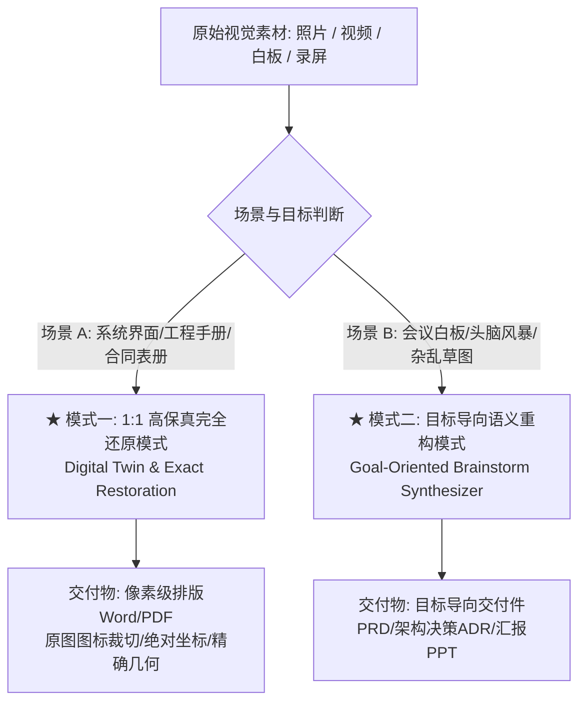
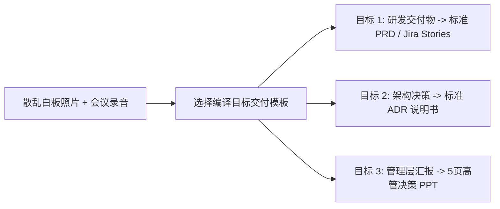

# 双模架构设计：1:1 高保真完全还原 vs 目标导向语义重构

## 1. 为什么必须将产品功能清晰拆分为“两大模式”？

用户的视觉素材往往来自于截然不同的两种场景，两者的期望输出有着本质的鸿沟：

---

## 2. 模式一：1:1 高保真完全还原模式 (High-Fidelity Exact Restoration)

### 2.1 适用场景与用户诉求
- **适用场景**：系统操作界面录屏、硬件设备控制台拍照、数据库字典与系统架构图、技术参数手册、法律合同与审计底稿。
- **用户核心诉求**：**“不要替我发明创作，我只要原汁原味、毫厘不差的完全还原！”**
  - 图标必须是原本的图标；
  - 流程图的方块连线不能变形；
  - 表格的表头、合并单元格不能错位；
  - 代码里的 IP 地址、端口号、参数变量必须原样精准对齐。

### 2.2 为什么“完全还原”是大模型最头疼、也是我们的核心工程壁垒？
- **大模型的天然弱点**：LLM 本质上是“概率生成模型”，它极度擅长“总结大意”，但**极度不擅长“确定性、像素级、坐标级的精准几何还原”**。大模型单看图片，往往会“自作聪明”地修改参数、美化句子或漏掉边缘小图标。
- **我们的工程实现方案**：
  1. **视觉资产原生切片与矢量化 (Asset Extraction)**：
     - 利用 CV 目标检测定位文中的架构图、流程图、操作图标（Icons/Badges）。
     - 从原高清图中以高分辨率切片，存入附件目录，并在正文原位置精准嵌入。
  2. **精确几何网格对齐 (Layout Geometry Grid)**：
     - 不依赖大模型的粗略猜词，结合版面分析（Layout Parser）记录段落、表格、图注的归一化绝对坐标 `[ymin, xmin, ymax, xmax]`。
  3. **确定性数字孪生输出**：
     - 输出的 Word / PDF 中，边距、字号比例、表格边界完全贴合原图。

---

## 3. 模式二：目标导向语义重构模式 (Goal-Oriented Brainstorm Synthesizer)

### 3.1 深度反思与核心警惕：大模型真能轻易替代它吗？
正如我们在产品推演中所警惕的：
> **“单纯把杂乱的脑暴整理成有目的的文档，大模型可能随手就能替代，这个必须重新深思！”**

如果只是让大模型“请帮我总结一下这个白板”，ChatGPT 网页端确实几秒钟就能搞定，**毫无商业门槛**。

### 3.2 破局重构：如何让“脑暴整理”不被通用大模型杀死？
要让模式二具备不可替代性，它绝不能是一个“开放式聊天的总结框”，而必须是**“工程化、模板驱动、多视角导向的交付件编译器”**：

1. **强目标交付模板约束（Template-Driven Constrained Synthesis）**：
   - 用户不仅是丢入图片，而是选择明确的目标交付物规范：
     - *“编译为标准敏捷 PRD（包含用户故事、前置条件、验收标准 AC）”*；
     - *“编译为软件架构决策记录（ADR: Architecture Decision Record）”*；
     - *“编译为高管汇报 PPT（每页 Slide 限 3 点核心支撑）”*。
2. **多视角并行编译（Multi-Perspective Compilation）**：
   - 同样一份凌乱的架构白板草图，系统一键生成**面向不同受众的成套文档**：
     - 交付给开发人员的：详尽技术流程与时序（带 Mermaid 图）；
     - 交付给业务负责人的：业务价值与风险评估（带表格对比）。
3. **模糊意图人机交互式消歧（Disambiguation Loop）**：
   - 白板上画了两个互相矛盾的箭头，或者潦草字迹存在二义性时：
   - 通用大模型会“强行猜一个（产生幻觉）”；
   - 我们的系统会弹出轻量微交互：*“检测到白板节点 A 与 B 存在双向依赖冲突，您当时的决议是：[选项1：同步阻塞] 还是 [选项2：异步解耦]？”*——**通过极简确认，消除大模型臆造，确保决策文档的绝对权威性**。
