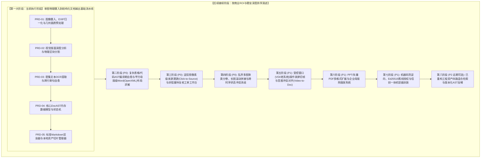

# 系统全景迭代演进与研发拆解总览 (System Engineering Roadmap & PRD Architecture)

## 1. 敏捷研发拆解战略理念

在商业级严肃软件工程中，任何庞大的系统级流水线绝不可能通过单个笼统的需求说明书完成落地。
本项目研发严格坚持**“核心流水线精细拆解、前置模块极度详尽、后续能力阶段性递进演进”**的敏捷工程战略：

> [!NOTE]
> **开源复用与竞品基准门禁原则**：在推进第一至第四阶段期间，对于单页常规版面分割等成熟通用环节，优先通过标准适配器集成开源工业级算子（如 MinerU / Docling / PP-Structure），将自研工时高度集中于**退化屏摄逆矩阵坐标守恒、跨时序冲突消歧、Click-to-Source 复核工作台及原生 OpenXML 母版求解器**，并在每阶段准出时通过 100 组退化样本黄金基准集（Golden Benchmark）验证相对于通用多模态脚本流的净增益。

---

## 2. 第一大阶段：前序核心模块细拆矩阵（立即落地）

第一大阶段旨在彻底打通从“散乱单张输入原图”到“标准结构化文档与本地高精资产”的最小可行确定性流水线。为杜绝“需求过粗、边界不清、实现返工”的技术债务，我们将该阶段细拆为 5 个独立、解耦、自包含的商业级需求规格说明书：

| 需求编号 | 需求名称与核心定位 | 核心业务与技术价值 | 关键输出成果 | 交付物文档路径 |
| :--- | :--- | :--- | :--- | :--- |
| **PRD-01** | **图像摄入、EXIF归一化与几何画质预处理** | 解决物理拍照歪斜、翻转、反光、摩尔纹问题，沉淀逆单应性矩阵 $H^{-1}$，降低下游误识率。 | 归一化正向位图、透视变换及逆矩阵 $H/H^{-1}$、画质质量评分。 | [PRD-01](file:///c:/Users/zhangtengkuan/Desktop/自己的项目/图片转文档/docs/03_产品需求规格说明/PRD-01_图像摄入_EXIF归一化与几何画质预处理规格说明书.md) |
| **PRD-02** | **视觉版面深度分析与物理区块分割** | 将静态栅格图像解构为带拓扑层级的标题、正文、代码、表格、插图多边形区块，确立阅读顺序。 | `VisualLayoutResult` 区块集合、空间 BBox 坐标字典。 | [PRD-02](file:///c:/Users/zhangtengkuan/Desktop/自己的项目/图片转文档/docs/03_产品需求规格说明/PRD-02_视觉版面深度分析与物理区块分割规格说明书.md) |
| **PRD-03** | **密集文本OCR提取与跨行断句自愈** | 高精提取字符，并通过词法分析与标点状态机消除连字符与物理换行带来的碎片断句。 | `TextExtractionResult` 语义段落流、置信度矩阵。 | [PRD-03](file:///c:/Users/zhangtengkuan/Desktop/自己的项目/图片转文档/docs/03_产品需求规格说明/PRD-03_密集文本OCR提取与跨行断句自愈规格说明书.md) |
| **PRD-04** | **核心DocAST内存数据模型与状态机** | 系统核心数据总线，完全解耦感知层与输出层，承载强类型校验与状态流转契约。 | `DocAST` 强类型内存对象、序列化/反序列化器、完整性校验机。 | [PRD-04](file:///c:/Users/zhangtengkuan/Desktop/自己的项目/图片转文档/docs/03_产品需求规格说明/PRD-04_核心DocAST内存数据模型与状态机规格说明书.md) |
| **PRD-05** | **标准Markdown渲染器与本地资产切片管理器** | 交付首个端到端验证闭环，实现符合 GFM 规范的文档输出与 300 DPI 高精插图持久化落盘。 | `.md` 交付文件、`assets/` 物理切片资产目录。 | [PRD-05](file:///c:/Users/zhangtengkuan/Desktop/自己的项目/图片转文档/docs/03_产品需求规格说明/PRD-05_标准Markdown渲染器与本地资产切片管理器规格说明书.md) |

---

## 3. 后续扩展能力概要定义（阶段性接续补充）

随着第一阶段基础流水线的跑通与测试固化，后续高级特性将按照以下节奏逐次展开细化的 PRD 说明书编写：

### 3.1 第二阶段：复杂富文本深度自愈与原生 Word (OpenXML) 生成流水线
- **业务诉求**：攻克政企交付物核心的表格、公式、代码及 Word 原生排版。
- **核心模块概要**：
  1. *表格物理网格重建*：探测无边框与跨行跨列（Colspan/Rowspan）拓扑结构，生成标准表格对象；
  2. *数学公式 LaTeX 化*：提取上下标、矩阵、符号，编译为标准 LaTeX 与 Word 原生 `m:oMath`；
  3. *代码语法树 AST 纠偏*：利用 Tree-sitter / Python AST 自动修复反光遮挡引起的误读（如 `f0r` $\to$ `for`）；
  4. *原生 OpenXML Word 编译器*：基于底层 XML 打包生成原生 `.docx`，包含标准样式与大纲级别。

### 3.2 第三阶段 (P0)：双模态像素级坐标映射与免责级来源溯源 (Click-to-Source)
- **业务诉求**：解决大模型“无法法律担责、易产生概率性幻觉”的制度性障碍，在导出签字前提供高效的人机核验工作台。
- **核心模块概要**：
  1. *时空坐标倒排索引*：正文每个字符、代码 Token 与单元格刚性绑定原始图片物理像素多边形坐标；
  2. *逆单应性矩阵投影（$H^{-1}$）*：将校正切片坐标系下的识别与纠偏结果亚像素级反向映射回未变形的原相机倾斜照片坐标系；
  3. *Click-to-Source 与待复核工单视窗*：双栏联动对照，点击文字 `120ms` 内调出原图局部高亮选框，集中消解置信度 $< 0.85$ 的待仲裁项。

### 3.3 第四阶段 (P0)：多图无序素材聚类、滚动拼接与跨时序状态消歧
- **业务诉求**：解决现场盲拍数十至上百张照片“顺序颠倒、多主题混合、长页面滚动重叠、前后配置版本冲突”的工程整理痛点。
- **核心模块概要**：
  1. *密度自适应业务分卷*：提取全局特征向量与核心实体，自动切分为多篇高内聚业务文档卷；
  2. *长视图滚动重叠缝合（Scroll-Stitching）*：基于局部视觉特征与行哈希滑动窗口，将分多次滚动拍摄的长表格/长配置去重拼接；
  3. *跨时序状态覆盖消歧*：识别前后多次修改的操作面板，保留最终收敛状态进入主流程，将历史报错帧归入异常附录；
  4. *行业母版约束大纲与超链接消歧*：按企业标准交付模板推导章节树，注入文档内原生书签与跨文档相对路径引用。

### 3.4 第五阶段 (P1)：跨模态长视频录屏切帧与音画对齐文档化 (Video-to-Doc)
- **业务诉求**：将 10~60 分钟 Citrix/VDI 受控窗口操作录屏或遗留系统演示录像转化为结构化系统规程。
- **核心模块概要**：FFmpeg 场景切换切片、dHash/SSIM 指针位移去重、Whisper/SenseVoice 离线语音转录、音画时空绑定与口述/屏幕参数不一致冲突告警。

### 3.5 第六阶段 (P1)：多目标格式原生兼容 (PPT/PDF) 与企业级排版模板系统
- **业务诉求**：满足管理汇报幻灯片、归档级矢量 PDF 及甲方千人千面母版样式定制需求。
- **核心模块概要**：OpenXML PPTX 幻灯片自动布局与超长分页、WeasyPrint/Typst 字体全子集嵌入矢量 PDF 渲染、企业 `.docx`/`.pptx` 母版样式热插拔。

### 3.6 第七阶段 (P1)：软件安全防逆向与涉密离线授权防护体系
- **业务诉求**：满足物理隔离机房离线合规准入与离线商业分发防拷贝保护。
- **核心模块概要**：Nuitka / Cython 机器码编译与调试符号剥离、主板/CPU/磁盘多维指纹绑定、Ed25519 纯离线 License 验签、单调递增时钟防回拨、RAM Disk 零残留与 DoD 5220.22-M 临时数据三次覆写销毁。

### 3.7 第八阶段 (P2 远期可选扩展)：已重构工程资产混合检索与版本化反哺
- **定位边界**：严格限定在核心编译与核验交付闭环商业验证通过后按需开启，仅服务于已重构工程资产库的配套核查与纠错回写，不与通用 PDF 知识库同质化竞争。
- **核心模块概要**：SQLite FTS5 + HNSW + 实体三元组 + BBox 坐标四路本地检索、带原图截面证据卡片的受控问答、基于类 Git 乐观并发锁的 RFC 6902 `AST Delta Patch` 安全回写与一键回滚。
