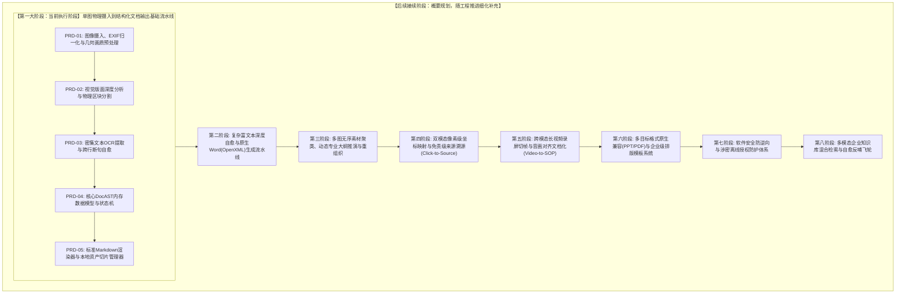

# 系统全景迭代演进与研发拆解总览 (System Engineering Roadmap & PRD Architecture)

## 1. 敏捷研发拆解战略理念

在商业级严肃软件工程中，任何庞大的系统级流水线绝不可能通过单个笼统的需求说明书完成落地。
本项目研发严格坚持**“核心流水线精细拆解、前置模块极度详尽、后续能力阶段性递进演进”**的敏捷工程战略：

---

## 2. 第一大阶段：前序核心模块细拆矩阵（立即落地）

第一大阶段旨在彻底打通从“散乱单张输入原图”到“标准结构化文档与本地高精资产”的最小可行确定性流水线。为杜绝“需求过粗、边界不清、实现返工”的技术债务，我们将该阶段细拆为 5 个独立、解耦、自包含的商业级需求规格说明书：

| 需求编号 | 需求名称与核心定位 | 核心业务与技术价值 | 关键输出成果 | 交付物文档路径 |
| :--- | :--- | :--- | :--- | :--- |
| **PRD-01** | **图像摄入、EXIF归一化与几何画质预处理** | 解决物理拍照歪斜、翻转、反光、摩尔纹问题，将下游 OCR 误识率降低 40% 以上。 | 归一化正向位图、透视变换矩阵 $H$、画质质量评分。 | [PRD-01](file:///c:/Users/zhangtengkuan/Desktop/自己的项目/图片转文档/docs/03_产品需求规格说明/PRD-01_图像摄入_EXIF归一化与几何画质预处理规格说明书.md) |
| **PRD-02** | **视觉版面深度分析与物理区块分割** | 将死图解构为带拓扑层级的标题、正文、代码、表格、插图多边形区块，确立阅读顺序。 | `VisualLayoutResult` 区块集合、空间 BBox 坐标字典。 | [PRD-02](file:///c:/Users/zhangtengkuan/Desktop/自己的项目/图片转文档/docs/03_产品需求规格说明/PRD-02_视觉版面深度分析与物理区块分割规格说明书.md) |
| **PRD-03** | **密集文本OCR提取与跨行断句自愈** | 高精提取字符，并通过词法分析与标点状态机消除连字符与物理换行带来的碎片断句。 | `TextExtractionResult` 语义段落流、置信度矩阵。 | [PRD-03](file:///c:/Users/zhangtengkuan/Desktop/自己的项目/图片转文档/docs/03_产品需求规格说明/PRD-03_密集文本OCR提取与跨行断句自愈规格说明书.md) |
| **PRD-04** | **核心DocAST内存数据模型与状态机** | 系统核心数据总线，完全解耦感知层与输出层，承载强类型校验与状态流转契约。 | `DocAST` 强类型内存对象、序列化/反序列化器、完整性校验机。 | [PRD-04](file:///c:/Users/zhangtengkuan/Desktop/自己的项目/图片转文档/docs/03_产品需求规格说明/PRD-04_核心DocAST内存数据模型与状态机规格说明书.md) |
| **PRD-05** | **标准Markdown渲染器与本地资产切片管理器** | 交付首个端到端验证闭环，实现符合 GFM 规范的文档输出与 300 DPI 高精插图持久化落盘。 | `.md` 交付文件、`assets/` 物理切片资产目录。 | [PRD-05](file:///c:/Users/zhangtengkuan/Desktop/自己的项目/图片转文档/docs/03_产品需求规格说明/PRD-05_标准Markdown渲染器与本地资产切片管理器规格说明书.md) |

---

## 3. 后续扩展能力概要定义（阶段性接续补充）

随着第一阶段基础流水线的跑通与测试固化，后续高级特性将按照以下节奏逐次展开细化的 PRD 说明书编写：

### 3.1 第二阶段：复杂富文本深度自愈与原生 Word (OpenXML) 生成流水线
- **业务诉求**：攻克政企交付物核心的表格、公式、代码及 Word 原生排版。
- **核心模块概要**：
  1. *表格物理网格重建*：探测无边框与跨行跨列（Colspan/Rowspan）拓扑结构，生成标准表格对象；
  2. *数学公式 LaTeX 化*：提取上下标、矩阵、符号，编译为标准 LaTeX 与 Word 原生 `m:oMath`；
  3. *代码语法树 AST 纠偏*：利用 Tree-sitter / Python AST 自动修复反光遮挡引起的误读（如 `f0r` $\to$ `for`）；
  4. *原生 OpenXML Word 编译器*：基于底层 XML 打包生成原生 `.docx`，包含标准样式与大纲级别。

### 3.2 第三阶段：多图无序素材聚类、动态专业大纲推演与重组织
- **业务诉求**：解决用户手机几十张杂乱照片“顺序颠倒、多主题混合、重复草稿”的工业整理痛点。
- **核心模块概要**：
  1. *密度自适应主题聚类*：提取全局特征向量，自动切分为多个独立业务文档卷；
  2. *树状逻辑大纲推导*：按企业金标准模版推导多级章节树，摆脱物理时间戳约束；
  3. *多源碎片去重融合*：重叠界面最新状态合并；
  4. *显式超链接消歧*：文档内锚点跳转与跨文档相对路径引用。

### 3.3 第四阶段：双模态像素级坐标映射与免责级来源溯源 (Click-to-Source)
- **业务诉求**：解决大模型“无法担责、易产生幻觉”的制度性障碍，提供审计级证据核验。
- **核心模块概要**：
  1. *时空坐标倒排索引*：正文每个字符与单元格刚性绑定原始图片物理像素 Bounding Box；
  2. *逆透视变换投影*：反向映射回未变形的原相机照片坐标系；
  3. *Click-to-Source 互动视窗*：双栏对照，点击文字毫秒级调出原图局部高亮选框。

### 3.4 第五阶段：跨模态长视频录屏切帧与音画对齐文档化 (Video-to-SOP)
- **业务诉求**：将 10~60 分钟操作录屏或研讨录像转化为结构化操作手册。
- **核心模块概要**：FFmpeg 场景切换切片、SSIM 指针位移去重（剔除 88% 冗余静止帧）、Whisper 离线语音转录、音画时空对齐与四元组标准化 SOP 规程生成。

### 3.5 第六阶段：多目标格式原生兼容 (PPT/PDF) 与企业级排版模板系统
- **业务诉求**：满足不同角色对汇报幻灯片、归档法律 PDF 及企业品牌专属样式的诉求。
- **核心模块概要**：OpenXML PPTX 幻灯片自动卡片布局与文本自适应超长分页、WeasyPrint 工业级 A4 矢量 PDF 打印排版（零孤行、跨页重复表头）、企业样式模板（Logo、水印、色系）热插拔。

### 3.6 第七阶段：软件安全防逆向与涉密离线授权防护体系
- **业务诉求**：满足涉密机房物理离线合规准入与商业软件知识产权保护。
- **核心模块概要**：Nuitka / Cython 机器码编译与调试符号剥离、主板/CPU/磁盘多维指纹绑定、Ed25519 纯离线 License 验签、单调递增时钟防回拨、DoD 5220.22-M 临时数据军工级覆写销毁。

### 3.7 第八阶段：多模态企业知识库混合检索与自愈反哺飞轮
- **业务诉求**：构建具备持续自演进生命力的企业多模态知识中枢。
- **核心模块概要**：SQLite FTS5 + HNSW + 实体三元组四路混合检索、具身证据卡片可信问答、用户纠错触发 RFC 6902 Delta Patch 级联自愈底层物理文档与图谱。
