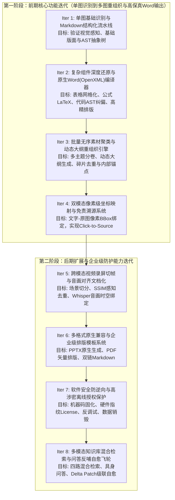

# 迭代研发全景规划与里程碑总览 (Iterative Development Roadmap)

## 1. 敏捷迭代总体演进战略

为确保系统工程落地的确定性，本项目采用**“核心闭环优先、渐进复杂度展开、严格准入准出”**的敏捷迭代演进路线。
研发周期分为两大阶段、共八个独立可验证的迭代版本（Iteration 1 ~ Iteration 8）：

---

## 2. 迭代里程碑演进矩阵与交付物定义

| 迭代阶段 | 迭代代号 | 核心研发目标 | 核心输出成果 / 关键交付物 | 准出验收基线 (Gate Criteria) |
| :--- | :--- | :--- | :--- | :--- |
| **阶段一** | **Iter 1** | 单图基础识别与 Markdown 编译 | 基础图像感知 Pipeline、DocAST 基础定义、Markdown 导出器 | 字符识别准确率 ≥ 96%，单图端到端处理耗时 ≤ 3.5s |
| (核心功能) | **Iter 2** | 复杂元素深度还原与原生 Word 导出 | 表格物理网格对齐器、代码 AST 纠偏引擎、原生 OpenXML Word 渲染器 | 表格无错位解析率 ≥ 92%，代码语法错误自愈率 ≥ 85% |
| | **Iter 3** | 无序素材聚类与动态大纲重构 | 向量特征提取器、密度聚类分卷器、树状大纲推导器、显式锚点路由器 | 20~50 张无序图聚类准确率 ≥ 90%，章节逻辑跃度评分 ≤ 0.15 |
| | **Iter 4** | 像素级双模态坐标映射与溯源 | Bounding Box 坐标归一化索引、Click-to-Source 互动前端组件 | 字符-像素对应率 100%，点击反查原图高亮延迟 ≤ 80ms |
| **阶段二** | **Iter 5** | 跨模态长视频录屏切帧与音画对齐 | FFmpeg 场景检测流、SSIM 冗余帧过滤器、Whisper 音频对齐引擎 | 视频去重过滤比 ≥ 85%，音画时间戳对齐偏差 ≤ 0.5s |
| (扩展能力) | **Iter 6** | 多格式与企业级模板兼容系统 | OpenXML PPTX 幻灯片生成器、WeasyPrint 矢量 PDF 打印器 | 支持企业级 PPT 母版套用，排版分页截断零溢出 |
| | **Iter 7** | 软件安全防逆向与离线授权防护 | Nuitka 二进制固化脚本、Ed25519 硬件指纹授权机、防调试巡检器 | 二进制逆向阻断率 100%，时间回拨穿透防御有效率 100% |
| | **Iter 8** | 多模态知识库混合检索与反哺飞轮 | SQLite FTS5 + HNSW 四路混合检索内核、问答溯源、Delta Patch 自愈器 | 精确检索召回率 100%，问答纠偏反向更新成功率 100% |

---

## 3. 需求说明书目录映射

本规划将各迭代的详细需求规格拆分为针对性的专项文档，提供端到端的架构设计、I/O 契约定义与算法逻辑：
- 前期核心阶段：
  - `05_核心迭代PRD_Iter1_单图基础识别与结构化Markdown流水线.md`
  - `06_核心迭代PRD_Iter2_复杂元素深度自愈与原生Word文档生成.md`
  - `07_核心迭代PRD_Iter3_无序素材聚类_动态大纲推导与重组织.md`
  - `08_核心迭代PRD_Iter4_像素级双模态坐标映射与免责溯源系统.md`
- 后期扩展阶段：
  - `09_扩展迭代PRD_Iter5_视频录屏切帧与音画对齐文档化.md`
  - `10_扩展迭代PRD_Iter6_多格式原生兼容_PPT_PDF与模板系统.md`
  - `11_扩展迭代PRD_Iter7_软件安全防逆向与离线授权保护.md`
  - `12_扩展迭代PRD_Iter8_多模态知识库混合检索与自愈反哺飞轮.md`
