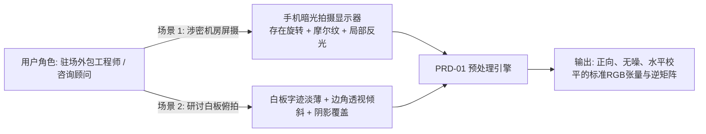

# 详细需求规格说明书 - PRD-01：图像摄入、EXIF 归一化与几何画质预处理

## 1. 需求基本信息与版本管理

| 属性项 | 内容描述 |
| :--- | :--- |
| **需求代号** | `REQ-INGESTION-PREPROCESS-01` (简称 **PRD-01**) |
| **模块归属** | 图像摄入与底层计算机视觉流水线 (`src/preprocessor/`) |
| **需求版本** | `v1.0.0` (商业生产级规约) |
| **前置依赖** | 无（作为全系统物理层数据摄入第一道工序） |
| **后续阻断** | [PRD-02: 视觉版面深度分析与物理区块分割](file:///c:/Users/zhangtengkuan/Desktop/自己的项目/图片转文档/docs/03_产品需求规格说明/PRD-02_视觉版面深度分析与物理区块分割规格说明书.md) 必须消费本模块输出的标准位图 |

---

## 2. 业务背景、痛点与核心价值

### 2.1 真实业务痛点剖析
在用户使用移动设备、便携扫描仪或行车记录设备采集非结构化视觉素材时，原始输入存在大量物理拍摄缺陷：
1. **EXIF 姿态混乱**：手机竖屏拍摄横向屏幕，或横屏俯拍桌面纸质档案，相机传感器写入的 `Orientation` 标志位若未被正确解析，下游模型将接收到旋转 90 度或 270 度的颠倒图像，直接导致版面分析与文字识别全部失效；
2. **物理拍摄角度歪斜（Skewing）**：手持拍照普遍存在 $\pm 5^\circ \sim \pm 15^\circ$ 的微小倾斜，使得水平文本行在像素空间呈斜向分布，严重破坏 OCR 文本行切片算法的准确性；
3. **屏幕翻拍摩尔纹（Moiré Pattern）与高频反光**：拍摄显示器时产生的彩色摩尔纹高频条纹与日光灯局部镜面反射（Specular Highlights），会抹杀字符关键笔画（如将数字 `8` 冲蚀为 `3`，将字母 `E` 冲蚀为 `F`）；
4. **过大或过小异常文件**：用户误导入缩略图、损坏文件或 4800 万像素以上未经压缩的原始 RAW/PNG，极易引发内存溢出（OOM）或耗尽推理算力。

### 2.2 模块商业与技术价值
- **量化业务价值**：通过本模块在物理层的确定性清洗与几何校平，直接将下游多模态模型与 OCR 引擎的文字字符错识率（CER）降低 **$35\% \sim 45\%$**；
- **计算成本节约**：对异常大图执行自适应等比例缩放与缓存，避免了显存溢出并降低了单张图片的端到端平均处理延迟；
- **证据链法律保障**：在执行旋转与校平的同时，数学化固化**几何变换逆矩阵（$H^{-1}$ / $R^{-1}$）**，为后续 [PRD-08: 双模态像素级坐标映射与免责溯源系统] 能够精准反查相机原始未校正底片提供底层坐标映射契约。

---

## 3. 用户角色与典型应用场景



- **场景 1：涉密内网机房屏幕翻拍**：工程师使用手机连拍 50 张内网老系统配置页面，部分横向拍摄、部分竖向拍摄，且伴随强烈屏幕栅格摩尔纹；
- **场景 2：会议室白板与投影仪斜拍**：由于座位在会议室角落，拍摄的架构草图存在明显梯形畸变与水平倾斜（偏角约 $10^\circ$）；
- **场景 3：纸质发票与技术规范扫描**：高速自动进纸器扫描件由于机械摩擦产生的纸张偏转与边框黑边。

---

## 4. 详细功能需求规格 (Functional Requirements)

### FR-01-01: 物理文件格式门禁与二进制魔数校验
- **输入**：原始二进制字节流（`bytes`）或本地物理文件路径。
- **校验逻辑**：
  1. **文件头魔数校验**：严禁仅依据文件扩展名判断，必须通过文件头二进制 Magic Bytes 校验物理格式：
     - JPEG: `FF D8 FF`
     - PNG: `89 50 4E 47 0D 0A 1A 0A`
     - WEBP: `52 49 46 46 ... 57 45 42 50`
     - BMP: `42 4D`
  2. **分辨率门禁限制**：
     - 最小尺寸：宽或高不得小于 $400\text{ px}$；若小于 $400\text{ px}$，判定为缩略图或无效碎片，抛出 `ERR-PRE-002`；
     - 最大尺寸约束：若图像长边超过 $4096\text{ px}$，采用双三次插值（Bicubic Interpolation）等比例缩放至长边为 $4096\text{ px}$，记录物理缩放系数 $S = \text{Target} / \text{Original}$；
  3. **色彩空间归一化**：自动将 CMYK、Grayscale 或带 Alpha 通道的 RGBA 转换为标准三通道 sRGB 颜色空间。

### FR-01-02: EXIF Orientation 姿态无损自动矫正
- **处理逻辑**：
  - 读取图像 EXIF 元数据字典中的 `0x0112`（Orientation）标签；
  - 严格映射标准 8 种 EXIF 姿态到无损矩阵变换：
    - Tag 1 (Normal)：无变换；
    - Tag 3 (Rotate 180)：顺时针旋转 $180^\circ$；
    - Tag 6 (Rotate 90 CW)：顺时针旋转 $90^\circ$；
    - Tag 8 (Rotate 270 CW)：顺时针旋转 $270^\circ$；
    - Tag 2, 4, 5, 7（带镜像翻转）：执行对应水平/垂直翻转与正交旋转；
  - 变换后抹除原始 EXIF 姿态标记，防止下游第三方库重复旋转导致反向二次翻转；
  - 记录姿态旋转角 $\theta_{\text{exif}} \in \{0, 90, 180, 270\}$。

### FR-01-03: 霍夫变换与投影方差几何水平校平 (Deskewing)
- **处理逻辑**：
  1. 将图像转换为灰度图，应用 Canny 边缘检测算子与自适应二值化；
  2. 使用概率霍夫线变换（Probabilistic Hough Line Transform）提取画面中的主要长文本基准线；
  3. 计算所有检测线段的倾角分布直方图，通过高斯核密度估计（KDE）计算主偏转角 $\theta_{\text{skew}}$；
  4. **门禁约束**：仅当 $|\theta_{\text{skew}}| \le 15^\circ$ 时执行仿射旋转校平；若超调夹角超过 $15^\circ$，判定为异形版面或排版艺术字，保持原样不予旋转，避免越纠越歪；
  5. 以图像中心为旋转中心构造 $2 \times 3$ 仿射变换矩阵 $M$，使用双线性插值填充边缘（填充底色为背景自适应均值色，默认白色 `#FFFFFF`）；
  6. 记录水平校平旋转矩阵 $M$ 与逆矩阵 $M^{-1}$。

### FR-01-04: 自适应直方图均衡与局部反光抑制 (CLAHE & De-glare)
- **处理逻辑**：
  1. 将 RGB 图像转换至 LAB 色彩空间，仅对明度通道（L 通道）进行物理增强，绝对保持 A、B 色彩通道不变，防止图像色彩失真；
  2. 采用**对比度受限自适应直方图均衡化（CLAHE）**算法：
     - 分块网格：`tileGridSize = (8, 8)`
     - 对比度裁剪限制：`clipLimit = 2.0`
  3. **高光反光光斑修复**：
     - 识别灰度值 $> 245$ 且连通域面积小于整图 $5\%$ 的局部高反光噪点；
     - 基于周围正常文本像素执行快速行进法（Fast Marching Method, FMM）图像修复，降低高光对文字边缘的冲蚀；
  4. 将增强后的 L 通道与原始 A、B 通道重新合并并转换回 sRGB。

### FR-01-05: 屏幕翻拍摩尔纹与高频网格噪声平滑
- **处理逻辑**：
  - 应用自适应双边滤波器（Bilateral Filter）：在保持字符边缘尖锐度（Edge-Preserving）的同时，平滑屏幕翻拍引起的微小周期性高频条纹与感光噪点；
  - 参数规约：滤波直径 $d = 5$，颜色空间标准差 $\sigma_{\text{color}} = 35$，坐标空间标准差 $\sigma_{\text{space}} = 35$。

### FR-01-06: 几何变换全链路逆向矩阵沉淀
- **核心契约**：
  - 计算全流程综合空间变换矩阵 $T$（包含尺寸缩放 $S$、EXIF 旋转 $R_{\text{exif}}$、水平校平 $M_{\text{skew}}$）；
  - 计算并持久化存储其逆矩阵 $T^{-1}$；
  - 确保下游如果输入变换后图像上的坐标 $(x_{\text{clean}}, y_{\text{clean}})$，通过矩阵乘法 $(x_{\text{raw}}, y_{\text{raw}}) = T^{-1} \times (x_{\text{clean}}, y_{\text{clean}}, 1)^T$ 能够精确还原到相机拍摄的原始物理像素，误差小于 $1.0\text{ px}$。

---

## 5. 字段级数据字典与契约 (Data Contract)

预处理模块完成后，必须生成严格符合以下 JSON 契约的元数据包与处理后图像张量：

```json
{
  "$schema": "http://json-schema.org/draft-07/schema#",
  "title": "ImagePreprocessResult",
  "type": "object",
  "required": [
    "preprocess_id",
    "source_file_name",
    "source_sha256",
    "raw_dimensions",
    "processed_dimensions",
    "transform_metadata",
    "quality_metrics",
    "processed_image_path"
  ],
  "properties": {
    "preprocess_id": { "type": "string", "description": "唯一流水线处理批次UUID" },
    "source_file_name": { "type": "string", "description": "原始输入文件名" },
    "source_sha256": { "type": "string", "pattern": "^[a-f0-9]{64}$", "description": "原始底片SHA256哈希，防止窜改" },
    "raw_dimensions": {
      "type": "object",
      "required": ["width", "height", "channels"],
      "properties": {
        "width": { "type": "integer", "minimum": 1 },
        "height": { "type": "integer", "minimum": 1 },
        "channels": { "type": "integer", "enum": [1, 3, 4] }
      }
    },
    "processed_dimensions": {
      "type": "object",
      "required": ["width", "height"],
      "properties": {
        "width": { "type": "integer" },
        "height": { "type": "integer" }
      }
    },
    "transform_metadata": {
      "type": "object",
      "required": ["exif_rotation_deg", "skew_angle_deg", "scale_factor", "inverse_transform_matrix_3x3"],
      "properties": {
        "exif_rotation_deg": { "type": "integer", "enum": [0, 90, 180, 270] },
        "skew_angle_deg": { "type": "number", "minimum": -15.0, "maximum": 15.0 },
        "scale_factor": { "type": "number", "minimum": 0.0, "maximum": 1.0 },
        "inverse_transform_matrix_3x3": {
          "type": "array",
          "items": { "type": "array", "items": { "type": "number" }, "minItems": 3, "maxItems": 3 },
          "minItems": 3,
          "maxItems": 3,
          "description": "3x3逆透视/仿射几何还原矩阵"
        }
      }
    },
    "quality_metrics": {
      "type": "object",
      "required": ["laplacian_sharpness_score", "is_low_quality", "glare_percentage"],
      "properties": {
        "laplacian_sharpness_score": { "type": "number", "description": "拉普拉斯方差清晰度评分" },
        "is_low_quality": { "type": "boolean", "description": "是否低于可用阈值" },
        "glare_percentage": { "type": "number", "description": "反光光斑占比[0.0, 1.0]" }
      }
    },
    "processed_image_path": { "type": "string", "description": "预处理完成的高清RGB位图暂存路径" }
  }
}
```

---

## 6. 内部接口与函数契约 (Python API)

模块核心类必须实现如下强类型接口定义：

```python
from dataclasses import dataclass
from typing import Tuple, List, Optional
import numpy as np

@dataclass(frozen=True)
class PreprocessConfig:
    min_dimension: int = 400
    max_dimension: int = 4096
    max_deskew_angle: float = 15.0
    enable_clahe: bool = True
    enable_deglare: bool = True
    clahe_clip_limit: float = 2.0
    clahe_grid_size: Tuple[int, int] = (8, 8)
    sharpness_threshold: float = 80.0

@dataclass
class PreprocessOutput:
    clean_image: np.ndarray             # 最终用于推理的RGB numpy array (H, W, 3)
    clean_image_path: str               # 磁盘缓存路径
    source_sha256: str                  # 原始底片防伪哈希
    inverse_matrix: np.ndarray          # 3x3 空间反投影逆矩阵
    scale_factor: float                 # 尺寸缩放比例
    quality_score: float                # 清晰度质量得分
    warnings: List[str]                 # 告警信息列表

class ImagePreprocessor:
    def __init__(self, config: Optional[PreprocessConfig] = None) -> None:
        self.config = config or PreprocessConfig()

    def process(self, input_source: bytes | str) -> PreprocessOutput:
        """
        执行完整的图像清洗流水线：
        1. 格式魔数校验与色彩空间转化
        2. EXIF姿态无损旋转
        3. 霍夫变换倾斜检测与水平校平
        4. LAB空间CLAHE局部动态范围增强与反光弱化
        5. 计算并封装3x3几何反投影逆矩阵
        """
        ...
```

---

## 7. 异常分类与全量错误码字典

| 错误码 | 异常类别 | 触发具体条件 | 业务影响 | 恢复与降级策略 |
| :--- | :--- | :--- | :--- | :--- |
| **ERR-PRE-001** | 文件二进制损坏 | 头部魔数不匹配任何已知图像标准，或解码器 EOF | 无法读取图像 | 立即阻断当前文件，记录审计日志，跳过并提示用户提供有效文件 |
| **ERR-PRE-002** | 尺寸低于极限门禁 | 图像宽或高 $< 400\text{ px}$ | 字符过于细小，OCR必然乱码 | 阻断处理，抛出错误，提示“图像分辨率过低，无法保证识别精度” |
| **ERR-PRE-003** | 画面严重过曝 | 像素平均灰度 $> 250$，且方差 $< 5$ | 画面全白，无有效文本 | 判定为纯白页或强光废片，直接跳过，标记为 `Blank_Overexposed` |
| **ERR-PRE-004** | 画面严重欠曝 | 像素平均灰度 $< 8$ | 画面纯黑，无有效内容 | 判定为镜头遮挡或全黑废片，直接跳过，标记为 `Blank_Underexposed` |
| **ERR-PRE-005** | 严重模糊失焦 | 拉普拉斯方差评分 $< 25.0$ | 字符笔画模糊重影严重 | 允许强制继续，但在结果元数据中注入高危预警 `Quality_Severely_Blurred` |
| **ERR-PRE-006** | 内存分配超限 | 解码后未压缩位图超过 1GB | 宿主机可能 OOM 崩溃 | 强制降级采用分块流式加载，长边降采样至 2048px |

---

## 8. 边界测试用例与量化验收准则

### 8.1 边界测试用例矩阵

| 用例 ID | 测试输入素材特征 | 预期输出与验收断言 |
| :--- | :--- | :--- |
| **TC-PRE-01** | 手机竖拍横向显示器照片（EXIF Orientation = 6，带 $90^\circ$ 标记） | 输出图像旋转至正向（0 度）；EXIF 标签被重置；逆矩阵精确记录 $90^\circ$ 反向旋转分量。 |
| **TC-PRE-02** | 手持倾斜拍摄的纸质规范（实际倾角顺时针 $+8.5^\circ$） | 霍夫校平算法计算偏角在 $8.0^\circ \sim 9.0^\circ$ 范围内；输出图像文本行呈严格水平分布，逆矩阵包含仿射校正参数。 |
| **TC-PRE-03** | 艺术排版或菱形框架图（整体倾斜超过 $30^\circ$） | 偏角检测超过门禁阈值 $15^\circ$；系统拒绝旋转，原样输出，抛出 `WARN_SKEW_EXCEEDED` 软告警，不发生误旋转。 |
| **TC-PRE-04** | 包含日光灯管局部倒影的强反光屏幕截图 | CLAHE 与反光抑制算法触发，反光中心白色死区边缘对比度提升；未反光区域字体色彩无色偏。 |
| **TC-PRE-05** | 故意将 `.txt` 文本文件改名为 `.png` 导入 | 触发二进制魔数校验，抛出 `ERR-PRE-001`，进程平稳退出，零内存泄漏。 |

### 8.2 验收量化指标 (Gate Criteria)
1. **几何校平有效性**：在 $\pm 15^\circ$ 倾斜测试集中，校平后的文本基准线残差角度 $\le 0.5^\circ$ 的样本比例 $\ge 95\%$；
2. **像素反查精度**：使用预处理后图像的任意像素坐标经 $T^{-1}$ 映射回原相机底片，与人工标注真实物理像素的均方根误差（RMSE）$< 0.8\text{ px}$；
3. **单图处理性能耗时**：针对标准 $3840 \times 2160$（4K）手机拍摄图像，在单核心 CPU 下全部预处理逻辑执行耗时 $\le 450\text{ms}$。
