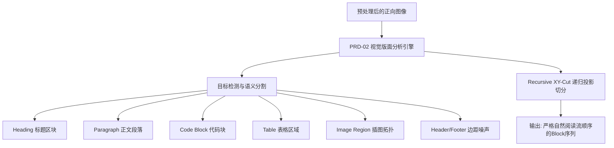

# 详细需求规格说明书 - PRD-02：视觉版面深度分析与物理区块分割

## 1. 需求基本信息与版本管理

| 属性项 | 内容描述 |
| :--- | :--- |
| **需求代号** | `REQ-LAYOUT-SEGMENT-02` (简称 **PRD-02**) |
| **模块归属** | 计算机视觉与版面拓扑解析流水线 (`src/layout/`) |
| **需求版本** | `v1.0.0` (商业生产级规约) |
| **前置依赖** | [PRD-01: 图像摄入、EXIF归一化与几何画质预处理](file:///c:/Users/zhangtengkuan/Desktop/自己的项目/图片转文档/docs/03_产品需求规格说明/PRD-01_图像摄入_EXIF归一化与几何画质预处理规格说明书.md) 提供的高清正向位图 |
| **后续阻断** | [PRD-03: 密集文本OCR提取与跨行断句自愈](file:///c:/Users/zhangtengkuan/Desktop/自己的项目/图片转文档/docs/03_产品需求规格说明/PRD-03_密集文本OCR提取与跨行断句自愈规格说明书.md) 依赖本模块输出的区块区域进行切片识别 |

---

## 2. 业务背景、痛点与核心价值

### 2.1 真实业务痛点剖析
很多简易 OCR 工具直接把全图丢进模型，按像素从上到下从左到右机械吐出文字行。这种做法在真实工业场景中会导致毁灭性灾难：
1. **双栏/多栏排版串行错位**：学术论文、政企技术方案、白皮书广泛采用左右双栏。机械的横向扫描会将左栏第一行与右栏第一行强行拼成同一句话，造成完全无法阅读的语意死结；
2. **标题与正文层级湮灭**：大字号章节标题被降级识别为普通段落文本，无法生成可导航的 Word 大纲目录（TOC）；
3. **表格与代码块被粉碎成散碎短句**：复杂的网格表格被拆解成几十个零散的单字碎片，代码块丢失严格的缩进边界与语言属性；
4. **页眉页脚与装订线黑边污染正文**：纸质扫描件顶部的“内部绝密 第 12 页”或底部的印刷刊号被直接插入到正文段落之间，严重破坏文档连贯性。

### 2.2 模块商业与技术价值
- **构建语义骨架**：将无序的二维像素矩阵，精确解构为具备逻辑语义标签（Semantic Label）与空间几何拓扑（Spatial BBox）的物理区块集合；
- **确立精准阅读序**：通过拓扑排序（Topological Reading Order），重建人眼自然阅读顺序，彻底根绝跨栏混读；
- **计算资源定向分发**：精准识别出代码块由代码纠偏器处理，表格由网格对齐器处理，正文由密集 OCR 处理，实现算力按需精准分配。

---

## 3. 用户角色与典型应用场景



- **场景 1：双栏技术文献与标准规范**：左栏为设计原理，右栏为配置示例，系统必须先读完左栏全部段落，再进入右栏读取；
- **场景 2：带代码呼出框的架构设计文档**：正文中嵌入灰底代码呼出框（Callout），系统需准确定位代码边界并将其从连续自然段落中剥离；
- **场景 3：复杂工控界面翻拍**：顶部为标题栏，中部为数据监控表，底部为告警日志，右侧为系统拓扑，需精准划分为 4 个异构物理区域。

---

## 4. 详细功能需求规格 (Functional Requirements)

### FR-02-01: 深度学习多类版面区域检测与分割 (Multi-Class Layout Detection)
- **处理逻辑**：
  - 基于深度学习视觉目标检测模型（如 YOLOv10-DocLayout 或 LayoutLM 针对文档微调权重）；
  - 针对输入图像输出候选边界框及类别预测概率；
  - **强制支持的 8 大标准语义标签**：
    1. `heading_1`：一级大标题（字号显著大于正文，通常居中或独占行）；
    2. `heading_2`：二级章节标题；
    3. `heading_3`：三级小节标题；
    4. `paragraph`：连续自然文本正文段落；
    5. `code_block`：带有灰底、边框、等宽字体的代码或终端命令行区域；
    6. `table`：具有明显横竖网格线或规律行列对齐的数据表格；
    7. `image_region`：架构图、时序图、照片、截图等非文字矢量或位图图表；
    8. `header_footer`：位于页面顶端或底端的页眉、页脚、页码、期刊信息。

### FR-02-02: 物理边界框空间归一化 (Coordinate Space Normalization)
- **处理逻辑**：
  - 将模型预测的像素绝对坐标 $(x_1, y_1, x_2, y_2)$ 统一归一化为千分比整数坐标系：
    $$\bar{y}_{\min} = \left\lfloor \frac{y_{\min}}{H} \times 1000 \right\rfloor, \quad \bar{x}_{\min} = \left\lfloor \frac{x_{\min}}{W} \times 1000 \right\rfloor$$
    $$\bar{y}_{\max} = \left\lceil \frac{y_{\max}}{H} \times 1000 \right\rceil, \quad \bar{x}_{\max} = \left\lceil \frac{x_{\max}}{W} \times 1000 \right\rceil$$
  - 取值范围严格限制在 $[0, 1000]$，彻底消除因不同分辨率图像引起的坐标计算偏差。

### FR-02-03: 页眉、页脚与装订线黑边物理过滤 (Noise Block Suppression)
- **处理逻辑**：
  - 识别被标记为 `header_footer` 的区块：
    - 若区块中心在垂直方向 $\bar{y} \le 60$（顶部 $6\%$）或 $\bar{y} \ge 940$（底部 $6\%$），判定为页面辅助装饰信息；
    - 将其提取为文档元数据（`page_metadata`），并从主正文阅读流中**彻底剔除**，防止污染正文；
  - 识别扫描边缘的纯黑/纯灰扫描仪压边阴影（长宽比极度失衡且像素饱和度极低的狭长区块），强制丢弃。

### FR-02-04: 多栏复杂排版拓扑阅读序重建 (Reading-Order Reconstruction)
- **处理逻辑**：
  - 采用**递归 XY-Cut（Recursive XY-Cut）**与空间拓扑图相结合的阅读流推导算法：
    1. **水平投影直方图分析**：检测全局水平空白带（Horizontal Separator），将页面从上至下切分为独立水平带（Bands）；
    2. **垂直投影跨度分析**：在每个水平带内部，检测是否存在垂直贯穿的空白槽（Vertical Column Gutters）；
    3. **双栏/多栏判定**：若存在显著的垂直槽，判定该水平带为多栏结构，遵循“先排左栏所有区块自上而下，再排右栏所有区块自上而下”；
    4. **单栏直接排序**：若不存在垂直槽，直接自上而下排序；
  - 为最终排序后的每一个 Block 赋予严格单调递增的阅读序号 `reading_order_index \in [0, N-1]`。

### FR-02-05: 区域重叠与包含关系拓扑消歧 (Containment & NMS Resolution)
- **处理逻辑**：
  - 针对同一物理区域出现多重模型预测（例如一个表格内部的大量文本单元格又被检出为独立的 `paragraph`）：
  - 计算重叠区域交并比（IoU）与包含度（Containment Ratio）：
    $$\text{Containment}(A \subset B) = \frac{\text{Area}(A \cap B)}{\text{Area}(A)}$$
  - **规则判定**：
    - 若 `paragraph` 落在 `table` 或 `image_region` 内部，且包含度 $\ge 0.85$，判定该段落属于该复杂组件的子元素，从一级版面树中下沉或消除，防止产生“外部重复正文”与“表格内部文字”的双重重复解析；
    - 执行非极大值抑制（NMS），阈值设为 $\text{IoU} = 0.45$。

---

## 5. 字段级数据字典与契约 (Data Contract)

版面分析输出的数据结构必须符合以下 JSON Schema：

```json
{
  "$schema": "http://json-schema.org/draft-07/schema#",
  "title": "VisualLayoutResult",
  "type": "object",
  "required": ["layout_id", "source_file_name", "total_blocks", "blocks"],
  "properties": {
    "layout_id": { "type": "string", "description": "版面分析唯一UUID" },
    "source_file_name": { "type": "string" },
    "is_multi_column": { "type": "boolean", "description": "是否为双栏或多栏复杂排版" },
    "column_count": { "type": "integer", "minimum": 1, "maximum": 4 },
    "total_blocks": { "type": "integer", "minimum": 0 },
    "blocks": {
      "type": "array",
      "items": {
        "type": "object",
        "required": ["block_id", "reading_order_index", "category", "bbox_normalized", "bbox_absolute_pixel", "confidence"],
        "properties": {
          "block_id": { "type": "string", "example": "blk_0001" },
          "reading_order_index": { "type": "integer", "minimum": 0 },
          "category": {
            "type": "string",
            "enum": [
              "heading_1",
              "heading_2",
              "heading_3",
              "paragraph",
              "code_block",
              "table",
              "image_region",
              "list_item",
              "header_footer"
            ]
          },
          "bbox_normalized": {
            "type": "array",
            "items": { "type": "integer" },
            "minItems": 4,
            "maxItems": 4,
            "description": "[ymin, xmin, ymax, xmax] 千分比坐标[0, 1000]"
          },
          "bbox_absolute_pixel": {
            "type": "array",
            "items": { "type": "integer" },
            "minItems": 4,
            "maxItems": 4,
            "description": "[ymin, xmin, ymax, xmax] 绝对像素物理坐标"
          },
          "confidence": { "type": "number", "minimum": 0.0, "maximum": 1.0 },
          "is_nested_child": { "type": "boolean" },
          "parent_block_id": { "type": ["string", "null"] }
        }
      }
    }
  }
}
```

---

## 6. 内部接口与函数契约 (Python API)

```python
from enum import Enum
from dataclasses import dataclass
from typing import List, Optional, Tuple
import numpy as np

class BlockCategory(str, Enum):
    HEADING_1 = "heading_1"
    HEADING_2 = "heading_2"
    HEADING_3 = "heading_3"
    PARAGRAPH = "paragraph"
    CODE_BLOCK = "code_block"
    TABLE = "table"
    IMAGE_REGION = "image_region"
    LIST_ITEM = "list_item"
    HEADER_FOOTER = "header_footer"

@dataclass
class LayoutBlock:
    block_id: str
    reading_order_index: int
    category: BlockCategory
    bbox_normalized: Tuple[int, int, int, int]      # (ymin, xmin, ymax, xmax)
    bbox_absolute: Tuple[int, int, int, int]        # (ymin, xmin, ymax, xmax)
    confidence: float
    cropped_patch: Optional[np.ndarray] = None     # 该区块的独立RGB切片

@dataclass
class LayoutResult:
    layout_id: str
    is_multi_column: bool
    blocks: List[LayoutBlock]
    page_header_text: Optional[str] = None
    page_footer_text: Optional[str] = None

class VisualLayoutAnalyzer:
    def __init__(self, model_path: Optional[str] = None, conf_threshold: float = 0.5) -> None:
        self.conf_threshold = conf_threshold
        # 加载本地轻量版面检测引擎权重

    def analyze(self, image: np.ndarray) -> LayoutResult:
        """
        执行版面深度分析：
        1. 运行目标检测与多标签语义分割
        2. 归一化物理坐标系
        3. 过滤页眉页脚与孤行噪声
        4. 执行递归XY-Cut算法生成拓扑阅读序
        5. 裁剪并封装各区块位图Patch
        """
        ...
```

---

## 7. 异常分类与全量错误码字典

| 错误码 | 异常类别 | 触发具体条件 | 业务影响 | 恢复与降级策略 |
| :--- | :--- | :--- | :--- | :--- |
| **ERR-LAY-001** | 版面检测模型推理失败 | ONNX Runtime 或 TensorRT 运行环境崩溃 | 无法检出任何语义块 | 立即切换降级为纯启发式投影切割（Heuristic Projection Splitter） |
| **ERR-LAY-002** | 零区块检出异常 | 整张图片没有检出一个有效 Block | 画面可能为空白纸张或图画 | 触发全图兜底：将整张图片作为一个单一的 `paragraph` 区块输出 |
| **ERR-LAY-003** | 拓扑图存在死循环 | 相互包含关系引起阅读序拓扑排序成环 | 导致排序死循环卡死 | 强行切断回环依赖边，强制按照空间从上到下单调几何中心排序 |
| **ERR-LAY-004** | 超高密度密集文本块超限 | 检出的区块数量 $> 300$ 个 | 后续逐块处理耗时极长 | 触发区块凝聚算法：合并空间距离小于 5px 的同类型相邻段落块 |

---

## 8. 边界测试用例与量化验收准则

### 8.1 边界测试用例矩阵

| 用例 ID | 测试输入素材特征 | 预期输出与验收断言 |
| :--- | :--- | :--- |
| **TC-LAY-01** | 典型双栏排列的 PDF 扫描页（左边正文，右边数据） | 系统判定 `is_multi_column = true`；左栏所有段落的 `reading_order_index` 严格排在右栏段落之前，无交替穿插。 |
| **TC-LAY-02** | 带有明显大字号黑体标题（如“第三章 系统总体架构设计”） | 该标题块被准确标记为 `heading_1`，其 BBox 边界不截断任何字根。 |
| **TC-LAY-03** | 正文中嵌入的无边框数据表格 | 被标记为 `table` 而非拆散的几十个 `paragraph`；表格外接框包含所有文字与列。 |
| **TC-LAY-04** | 顶端带有“Page 15 of 80”的页眉标记 | 识别为 `header_footer`，从主正文 `blocks` 序列中剔除，进入 `page_header_text`。 |

### 8.2 验收量化指标 (Gate Criteria)
1. **版面区块分割准确率 (mAP@0.5)**：在公开文档版面数据集（PubLayNet/DocBank 衍生评测集）上，主流 8 类语义标签检测 mAP $\ge 91.5\%$；
2. **多栏阅读序正确率 (Order Accuracy)**：在双栏/三栏样本集中，人眼阅读顺序列序一致性准确率 $\ge 96\%$；
3. **单图版面推理耗时**：标准 2K 图像，在 CPU（Intel i7 8 核）上推理耗时 $\le 850\text{ms}$，在 GPU（RTX 4060）上 $\le 120\text{ms}$。
