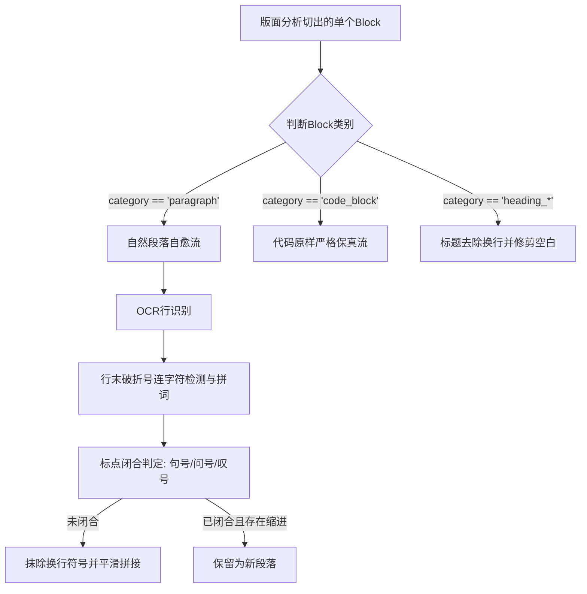

# 详细需求规格说明书 - PRD-03：密集文本 OCR 提取与跨行断句自愈

## 1. 需求基本信息与版本管理

| 属性项 | 内容描述 |
| :--- | :--- |
| **需求代号** | `REQ-TEXT-EXTRACTION-03` (简称 **PRD-03**) |
| **模块归属** | 光学字符识别与自然语言断句自愈流水线 (`src/ocr/`) |
| **需求版本** | `v1.0.0` (商业生产级规约) |
| **前置依赖** | [PRD-02: 视觉版面深度分析与物理区块分割](file:///c:/Users/zhangtengkuan/Desktop/自己的项目/图片转文档/docs/03_产品需求规格说明/PRD-02_视觉版面深度分析与物理区块分割规格说明书.md) 输出的已归类区块 |
| **后续阻断** | [PRD-04: 核心DocAST内存数据模型与状态机](file:///c:/Users/zhangtengkuan/Desktop/自己的项目/图片转文档/docs/03_产品需求规格说明/PRD-04_核心DocAST内存数据模型与状态机规格说明书.md) 依赖本模块输出的语义自然段落构建 AST 节点 |

---

## 2. 业务背景、痛点与核心价值

### 2.1 真实业务痛点剖析
绝大多数开源 OCR 库（如 PaddleOCR、Tesseract）的底层输出仅仅是**“物理单行文本与对应外接框”**。直接将这些原始文本行输出，会产生工业级排版不可接受的缺陷：
1. **中文“短命句”与碎片化断行**：因为排版版心宽度限制，物理上每行显示 25~35 个汉字便强制换行。如果直接拼接换行符 `\n`，输出的 Markdown 或 Word 将呈现惨不忍睹的“诗歌样折行”，完全丧失段落流式排版能力；
2. **英文行末连字符（Hyphenation）割裂单词**：在双端对齐排版中，行末长单词常被破折号斩断（如行末 `imple-`，次行行首 `mentation`）。若机械保留短横线，输出文本将变成 `imple- mentation`，直接破坏全文搜索、代码执行与语义理解；
3. **代码与表格的“误平铺”毁灭**：如果统一执行去换行合并，代码块（Code Block）的换行与缩进将被瞬间压平为一条毫无可读性的超长单行，彻底摧毁代码可执行性；
4. **低置信度字符静默传递**：模糊反光引起的误读字符（如将数字 `0` 误识为字母 `O`）在没有任何标记的情况下直接进入下游，用户肉眼难以快速发现。

### 2.2 模块商业与技术价值
- **重构语义自然流**：通过**“断句自愈状态机”**，精准识别自然语义段落，抹除物理排版硬换行，输出流畅自然的自然段落；
- **词汇完整性还原**：基于词典与词法规则，100% 自动修复英文连字符断词；
- **差异化保留机制**：正文合并、标题独占、代码保真、表格分格，严格保障异构语义元素的排版严肃性；
- **免责证据链准备**：沉淀字符与词元（Token）级的 OCR 识别置信度分数，低于 $0.85$ 的内容自动染色标记，供核对审查。

---

## 3. 用户角色与典型应用场景



- **场景 1：英文技术白皮书翻拍**：行末出现 `archi-` 与 `tecture`，系统自动拼合为 `architecture`，无多余空格与短横线；
- **场景 2：中文政企工作报告扫描**：一段 200 字的正文被切为 6 行物理扫描线，系统自动融合成唯一的自然段落字符串，并在首行注入标准缩进；
- **场景 3：Python/SQL 脚本截图**：包含多行函数定义与循环缩进，系统严格保留行末 `\n` 与开头的 4 空格缩进，杜绝任何格式污染。

---

## 4. 详细功能需求规格 (Functional Requirements)

### FR-03-01: 多语言密集文本行精准识别 (Dense Text Line OCR)
- **处理逻辑**：
  - 针对每个非纯图片 Block，执行文本检测与方向判定，生成细粒度文本行序列（Text Lines）；
  - 调用轻量高精度 OCR 引擎（如基于 SVTR 或 PP-OCRv4 文本识别架构）；
  - 提取行内字符序列，并输出每个字符/词元的空间 Bounding Box 与识别置信度（Confidence $\in [0.0, 1.0]$）；
  - 字符集全面覆盖：GB18030 全部常用中文字符、ASCII 键盘字符、数学符号及常见技术符号。

### FR-03-02: 英文连字符智能去切词与拼合 (De-hyphenation)
- **处理逻辑**：
  - **行末探测**：若文本行末尾以短横线连字符（`-` 或 `\u2010`）结尾；
  - **断词判定**：
    1. 提取短横线前半截单词词根 $W_1$（如 `concur-` $\to$ `concur`）；
    2. 提取次行行首首个连续英文字符串 $W_2$（如 `rently`）；
    3. 组合测试复合词 $W_{\text{comb}} = W_1 + W_2$（如 `concurrently`）；
    4. 检索内置常用英文字典（Hunspell 离线词库）：若 $W_{\text{comb}}$ 命中合法词汇，则认定为物理排版断词，强制删除末尾短横线并将 $W_1$ 与 $W_2$ 缝合为整体；
    5. 若未命中但在标准连字符复合词库中（如 `state-of-the-art`），则保留短横线。

### FR-03-03: 中文自然语义换行自愈与物理折行剥离 (Chinese Line-Merge State Machine)
- **处理逻辑**：
  - 构建**跨行合并状态机（Line Merger State Machine）**，逐行扫描同一 `paragraph` 区块内的多行物理文本：
  - **行尾标点闭合判定**：
    - 若上一行末尾字符为句末终结标点（`。`、`！`、`？`、`；`、`:`、`."`、`!"`），判定为语义自然终结；次行若首行缩进明显，作为新段落分段处理；
    - 若上一行末尾为无标点汉字，或逗号/顿号（`，`、`、`），次行行首为普通汉字：**强制剥离上一行的换行符 `\n`**，直接将两行字符无缝平滑串联；
  - **中英文混排空格自愈**：
    - 汉字与汉字相连时，合并处不插入空格；
    - 英文单词与英文单词跨行相连且非断词时，合并处插入 1 个半角空格；
    - 汉字与英文单词相连时，根据企业排版规范，自动在相连处插入 1 个标准半角空格（如“使用 Docker 容器”）。

### FR-03-04: 代码保留字与等宽排版严格保真机制 (Code Block Preservation)
- **处理逻辑**：
  - 针对被标记为 `code_block` 的区块，强制绕过任何自然语言换行自愈算法；
  - **缩进空间计算**：
    - 提取每行文本的起始水平像素物理位置 $x_{\min}$；
    - 计算区块基准左边界 $X_{\text{base}}$；
    - 按字宽物理比例自动换算为 4 空格（`    `）或 Tab 缩进；
  - 保持每一行的物理换行符 `\n`，绝对防止压平代码。

### FR-03-05: 逐行置信度矩阵与低置信度染色 (Word-level Confidence Profiling)
- **处理逻辑**：
  - 计算整个段落的加权平均置信度：
    $$\text{Conf}_{\text{block}} = \frac{\sum_{i=1}^N \text{Conf}(c_i)}{N}$$
  - 若整个区块的平均置信度 $< 0.85$，或包含多个单字符置信度 $< 0.60$ 的疑难字符；
  - 记录疑难字符位置与置信度字典，为后续 DocAST 注入 `low_confidence_spans` 标记，便于人工快速复核。

---

## 5. 字段级数据字典与契约 (Data Contract)

文本识别提取模块完成后的输出数据结构：

```json
{
  "$schema": "http://json-schema.org/draft-07/schema#",
  "title": "TextExtractionResult",
  "type": "object",
  "required": ["block_id", "category", "full_text", "confidence", "lines"],
  "properties": {
    "block_id": { "type": "string" },
    "category": { "type": "string" },
    "full_text": {
      "type": "string",
      "description": "经过换行自愈、去连字符、中英文空格规范化后的连贯自然段落文本"
    },
    "confidence": { "type": "number", "minimum": 0.0, "maximum": 1.0 },
    "has_hyphen_repaired": { "type": "boolean" },
    "has_newline_merged": { "type": "boolean" },
    "lines": {
      "type": "array",
      "items": {
        "type": "object",
        "required": ["line_index", "raw_text", "line_bbox", "line_confidence"],
        "properties": {
          "line_index": { "type": "integer" },
          "raw_text": { "type": "string" },
          "line_bbox": {
            "type": "array",
            "items": { "type": "integer" },
            "minItems": 4,
            "maxItems": 4
          },
          "line_confidence": { "type": "number" }
        }
      }
    },
    "low_confidence_spans": {
      "type": "array",
      "items": {
        "type": "object",
        "required": ["char_start", "char_end", "suspicious_text", "char_confidence"],
        "properties": {
          "char_start": { "type": "integer" },
          "char_end": { "type": "integer" },
          "suspicious_text": { "type": "string" },
          "char_confidence": { "type": "number" }
        }
      }
    }
  }
}
```

---

## 6. 内部接口与函数契约 (Python API)

```python
from dataclasses import dataclass, field
from typing import List, Tuple, Optional
import numpy as np

@dataclass
class TextLine:
    line_index: int
    raw_text: str
    bbox: Tuple[int, int, int, int]
    confidence: float

@dataclass
class ExtractedBlockText:
    block_id: str
    full_text: str                      # 自愈修复后的完整段落字符串
    confidence: float
    has_hyphen_repaired: bool
    has_newline_merged: bool
    lines: List[TextLine]
    low_confidence_spans: List[dict] = field(default_factory=list)

class TextExtractor:
    def __init__(self, use_gpu: bool = True, lang_list: Optional[List[str]] = None) -> None:
        self.use_gpu = use_gpu
        self.lang_list = lang_list or ["ch_sim", "en"]
        # 初始化OCR多语言模型与Hunspell拼写辅助词典

    def extract_and_heal(self, block_image: np.ndarray, block_id: str, category: str) -> ExtractedBlockText:
        """
        执行单区块文本提取与语义自愈：
        1. 运行底层密集文本行OCR
        2. 若为code_block，计算相对基准缩进并保留换行
        3. 若为paragraph，执行英文连字符缝合与中文折行平滑自愈
        4. 统计置信度分布并定位疑难字符区间
        """
        ...
```

---

## 7. 异常分类与全量错误码字典

| 错误码 | 异常类别 | 触发具体条件 | 业务影响 | 恢复与降级策略 |
| :--- | :--- | :--- | :--- | :--- |
| **ERR-OCR-001** | OCR 引擎崩溃/内存泄漏 | C++ 底层推理动态链接库崩溃 | 导致提取中断 | 捕获硬异常，自动重启轻量 Worker 子进程重新识别 |
| **ERR-OCR-002** | 文本行检测为零 | 版面标记为 `paragraph` 但 OCR 未检出文字行 | 产生空文本段落 | 标记该区块为 `empty_text`，从最终输出正文中移除 |
| **ERR-OCR-003** | 字符集未包含生僻字 | 特殊行业化学公式、偏僻古字无法识别 | 吐出乱码方块 `\uFFFD` | 保持候选字形置信度最低值，并在错误日志记录位置 |
| **ERR-OCR-004** | 连字符误缝合冲突 | 恰好是数学减号 `-` 跨行表达式被误当成连字符 | 改变计算式语义 | 增加前置词法分析：若连字符前后均为纯阿拉伯数字，禁止缝合 |

---

## 8. 边界测试用例与量化验收准则

### 8.1 边界测试用例矩阵

| 用例 ID | 测试输入素材特征 | 预期输出与验收断言 |
| :--- | :--- | :--- |
| **TC-OCR-01** | 跨行长单词：首行末尾为 `distri-`，次行开头为 `buted` | `has_hyphen_repaired = true`；合并后全文包含连贯 `distributed`，中间无短横线与多余空格。 |
| **TC-OCR-02** | 中文段落物理切分为 4 行，行末无标点 | `has_newline_merged = true`；合并后输出包含 0 个多余的 `\n`，中文字符紧密相连无缝隙。 |
| **TC-OCR-03** | Python 函数带 4 空格缩进与多行循环 | `category = "code_block"`；换行符完整保留，`def`、`for` 前的 4 空格物理缩进 100% 精确保留。 |
| **TC-OCR-04** | 中英文密集混排（如“基于 Spring Boot 3.0 框架构建”） | 自动在汉字与英文、数字交界处插入 1 个半角空格，排版符合企业出版级审美。 |

### 8.2 验收量化指标 (Gate Criteria)
1. **中文印刷体识别准确率 (1 - CER)**：标准文档印刷体中文综合字符识别率 $\ge 96.5\%$；
2. **英文单词完整率**：英文常见连字符断词缝合准确率 $\ge 94\%$；
3. **中文去碎片换行有效率**：连续自然段落中无意硬换行剔除率 $\ge 98\%$（段内零非预期折行）。
