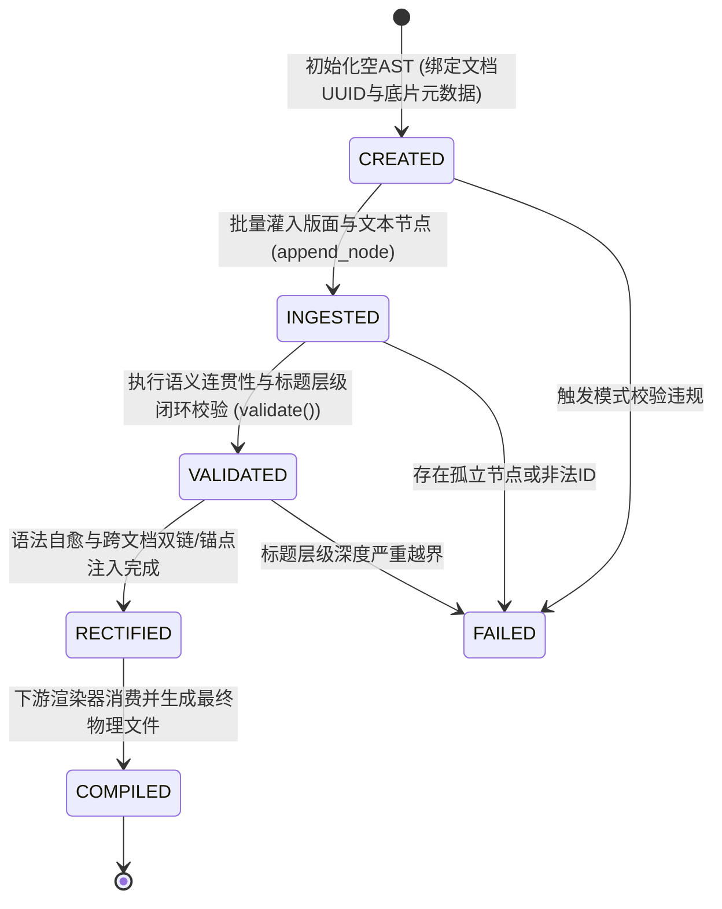

# 详细需求规格说明书 - PRD-04：核心 DocAST 内存数据模型与状态机

## 1. 需求基本信息与版本管理

| 属性项 | 内容描述 |
| :--- | :--- |
| **需求代号** | `REQ-DOCAST-CORE-04` (简称 **PRD-04**) |
| **模块归属** | 文档抽象语法树与数据中枢流水线 (`src/ast/`) |
| **需求版本** | `v1.0.0` (商业生产级规约) |
| **前置依赖** | [PRD-02 版面分析](file:///c:/Users/zhangtengkuan/Desktop/自己的项目/图片转文档/docs/03_产品需求规格说明/PRD-02_视觉版面深度分析与物理区块分割规格说明书.md) 与 [PRD-03 文本提取](file:///c:/Users/zhangtengkuan/Desktop/自己的项目/图片转文档/docs/03_产品需求规格说明/PRD-03_密集文本OCR提取与跨行断句自愈规格说明书.md) 输出的数据流 |
| **后续阻断** | [PRD-05 Markdown 渲染](file:///c:/Users/zhangtengkuan/Desktop/自己的项目/图片转文档/docs/03_产品需求规格说明/PRD-05_标准Markdown渲染器与本地资产切片管理器规格说明书.md) 及后续 Word/PPT 编译必须严格基于本模块提供的强类型 AST 实例执行 |

---

## 2. 业务背景、痛点与核心价值

### 2.1 真实业务痛点剖析
在复杂工业软件系统中，直接让 OCR 识别结果与文件输出（Word/Markdown）进行网状强耦合编码是导致系统彻底失控的根本死穴：
1. **多格式导出的网状爆炸**：若没有统一的中间语义抽象树，开发 Markdown 导出需对接一遍 OCR 数据，开发 Word 导出需再对接一遍，开发 PPT 又需重新对接，代码复杂度呈 $M \times N$ 网状急剧膨胀，且改动一处牵连全局；
2. **缺乏强类型校验导致静默文件破坏**：上游偶尔漏传一个字段或坐标计算出现 `null`，如果直接传入 Word 编译，会导致生成的 `.docx` 成为破坏性损坏文件（Corrupted XML），用户双击提示“Word 发现无法读取的内容”；
3. **溯源元数据断层丢失**：在经过大纲生成、去重合并或排序后，原始图片的来源哈希和物理 BBox 极易在字符串拼接中丢失，彻底丧失后续构建免责证据链的能力。

### 2.2 模块商业与技术价值
- **核心数据总线（System Bus）**：DocAST 作为全系统的核心语义契约，将**“上游感知层（视觉/版面/OCR/视频）”**与**“下游编译器（Word/PPT/PDF/Markdown/知识库）”**彻底物理隔离解耦；
- **强类型自愈与状态看门狗**：在内存中提供严格的 Pydantic 数据模型校验与状态机流转控制，将任何潜在的数据不一致阻断在生成文件之前；
- **全生命周期溯源链（Provenance Invariants）**：强制每个节点必须继承物理坐标与底片指纹，确保数据流动中证据链绝对不丢。

---

## 3. 架构拓扑与状态机流转模型



---

## 4. 详细功能需求规格 (Functional Requirements)

### FR-04-01: 多态强类型 DocAST v1.0 节点体系定义
- **核心逻辑**：基于 Python Pydantic v2 构建完全类型安全的多态节点继承体系：
  - **基类 `DocNode`**：所有节点的公共父类，强制包含：
    - `node_id`: 唯一短 UUID（如 `node_a1b2`）；
    - `node_type`: 节点枚举类型；
    - `bbox_normalized`: 空间千分比外接框 $[ymin, xmin, ymax, xmax]$；
    - `source_evidence`: 包含来源图片文件名、SHA256 哈希及 OCR 平均置信度；
  - **派生多态实体节点**：
    1. `HeadingNode`: 包含 `level`（1~6）、`title_text`、`anchor_id`；
    2. `ParagraphNode`: 包含 `text`、`spans`（粗体、斜体、代码行内标记、低置信度高亮标记）；
    3. `CodeBlockNode`: 包含 `code_content`、`language`（python, sql, bash 等）、`syntax_verified`；
    4. `TableNode`: 包含行数 `rows`、列数 `cols`、以及二维网格单元格对象 `cells`；
    5. `ImageNode`: 包含 `asset_rel_path`（相对磁盘路径）、`caption`、`aspect_ratio`；
    6. `ListNode`: 包含 `is_ordered`（是否有序）、`items` 字符串列表。

### FR-04-02: 内存树状拓扑增删改查 API (Tree Manipulation)
- **核心逻辑**：
  - `DocAST.append_node(node: DocNode) -> None`：在文档尾部追加节点；
  - `DocAST.insert_node(index: int, node: DocNode) -> None`：在指定阅读序位置插入节点；
  - `DocAST.get_node_by_id(node_id: str) -> Optional[DocNode]`：基于唯一 ID 毫秒级直接哈希索引命中节点；
  - `DocAST.traverse(visitor_fn: Callable[[DocNode], None]) -> None`：支持访问者模式按阅读序深度优先遍历整棵树；
  - `DocAST.filter_by_type(node_type: NodeType) -> List[DocNode]`：快速提取特定类型的所有节点。

### FR-04-03: 树状拓扑结构完整性与合法性校验机 (Integrity Validator)
- **校验逻辑**：
  - 在 AST 状态流转至 `VALIDATED` 前，强制调用完整性校验器：
  1. **标题深度越级校验 (Heading Gap Check)**：
     - 规则：一级标题后允许直接跟二级标题，但严禁出现一级标题（`level: 1`）紧接着跳到四级标题（`level: 4`）的断层；若检测到越级跳跃，系统自动插入虚拟的二级、三级父容器；
  2. **唯一性校验 (Uniqueness Invariant)**：
     - 全文档所有 `node_id` 必须全量唯一，严禁碰撞；
  3. **空内容节点过滤 (Pruning)**：
     - 自动检测并剪除没有任何可见字符且无关联资产的死节点。

### FR-04-04: 双向无损 JSON 序列化与反序列化引擎 (Lossless Serialization)
- **核心逻辑**：
  - `DocAST.to_json(indent: int = 2) -> str`：序列化为紧凑或带缩进的标准 JSON 字符串；
  - `DocAST.from_json(json_str: str) -> DocAST`：从 JSON 字符串无损重建内存对象；
  - **Roundtrip 零损耗保证**：确保 $A = \text{DocAST.from\_json}(\text{DocAST.to\_json}(A))$，所有属性类型与精度绝对一致。

---

## 5. 字段级数据字典与契约 (Data Contract)

完整的 DocAST 根数据结构：

```json
{
  "$schema": "http://json-schema.org/draft-07/schema#",
  "title": "DocASTRoot",
  "type": "object",
  "required": ["doc_id", "schema_version", "metadata", "status", "nodes"],
  "properties": {
    "doc_id": { "type": "string", "description": "文档唯一UUID" },
    "schema_version": { "type": "string", "enum": ["1.0.0"] },
    "status": {
      "type": "string",
      "enum": ["CREATED", "INGESTED", "VALIDATED", "RECTIFIED", "COMPILED", "FAILED"]
    },
    "metadata": {
      "type": "object",
      "required": ["title", "source_images", "created_at"],
      "properties": {
        "title": { "type": "string" },
        "source_images": {
          "type": "array",
          "items": {
            "type": "object",
            "required": ["file_name", "sha256", "width", "height"],
            "properties": {
              "file_name": { "type": "string" },
              "sha256": { "type": "string" },
              "width": { "type": "integer" },
              "height": { "type": "integer" }
            }
          }
        },
        "created_at": { "type": "string", "format": "date-time" }
      }
    },
    "nodes": {
      "type": "array",
      "items": {
        "type": "object",
        "required": ["node_id", "node_type", "bbox_normalized", "source_evidence"],
        "properties": {
          "node_id": { "type": "string" },
          "node_type": {
            "type": "string",
            "enum": ["heading", "paragraph", "code_block", "table", "image", "list"]
          },
          "bbox_normalized": {
            "type": "array",
            "items": { "type": "integer" },
            "minItems": 4,
            "maxItems": 4
          },
          "source_evidence": {
            "type": "object",
            "required": ["source_file_name", "source_sha256", "confidence"],
            "properties": {
              "source_file_name": { "type": "string" },
              "source_sha256": { "type": "string" },
              "confidence": { "type": "number" }
            }
          }
        }
      }
    }
  }
}
```

---

## 6. 内部接口与函数契约 (Python API)

```python
from enum import Enum
from typing import List, Optional, Dict, Any, Callable
from pydantic import BaseModel, Field

class ASTState(str, Enum):
    CREATED = "CREATED"
    INGESTED = "INGESTED"
    VALIDATED = "VALIDATED"
    RECTIFIED = "RECTIFIED"
    COMPILED = "COMPILED"
    FAILED = "FAILED"

class NodeType(str, Enum):
    HEADING = "heading"
    PARAGRAPH = "paragraph"
    CODE_BLOCK = "code_block"
    TABLE = "table"
    IMAGE = "image"
    LIST = "list"

class SourceEvidence(BaseModel):
    source_file_name: str
    source_sha256: str
    confidence: float

class DocNode(BaseModel):
    node_id: str
    node_type: NodeType
    bbox_normalized: List[int] = Field(min_length=4, max_length=4)
    source_evidence: SourceEvidence

class HeadingNode(DocNode):
    level: int = Field(ge=1, le=6)
    title_text: str
    anchor_id: str

class ParagraphNode(DocNode):
    text: str
    has_low_confidence: bool = False

class CodeBlockNode(DocNode):
    code_content: str
    language: str = "text"
    syntax_verified: bool = False

class DocAST(BaseModel):
    doc_id: str
    schema_version: str = "1.0.0"
    status: ASTState = ASTState.CREATED
    metadata: Dict[str, Any]
    nodes: List[DocNode] = Field(default_factory=list)

    def append_node(self, node: DocNode) -> None:
        ...

    def validate_invariants(self) -> bool:
        """执行标题层级、ID唯一性与节点有效性校验，通过则状态跃迁至 VALIDATED"""
        ...

    def to_json(self, indent: int = 2) -> str:
        ...

    @classmethod
    def from_json(cls, json_str: str) -> "DocAST":
        ...
```

---

## 7. 异常分类与全量错误码字典

| 错误码 | 异常类别 | 触发具体条件 | 业务影响 | 恢复与降级策略 |
| :--- | :--- | :--- | :--- | :--- |
| **ERR-AST-001** | 节点字段校验违规 | 灌入节点的必填字段为空或类型不匹配 | 威胁数据一致性 | 阻断灌入操作，抛出具体参数违规字段定位 |
| **ERR-AST-002** | 节点 ID 碰撞 | 试图追加已存在相同 `node_id` 的节点 | 树索引混乱 | 自动追加纳秒级自增哈希后缀，消除碰撞 |
| **ERR-AST-003** | 非法状态跃迁 | 在 `CREATED` 状态直接调用 `compile()` | 流程未就绪 | 强制拦截，返回状态非法错误，提示前置调用 `validate()` |
| **ERR-AST-004** | 标题深度超界 | 标题 `level > 6` 或 `< 1` | 格式无法映射 | 自动将超界标题钳制在有效范围 $[1, 6]$ 内 |

---

## 8. 边界测试用例与量化验收准则

### 8.1 边界测试用例矩阵

| 用例 ID | 测试输入素材特征 | 预期输出与验收断言 |
| :--- | :--- | :--- |
| **TC-AST-01** | 空节点校验：灌入一个包含 0 个字符且无任何有效内容的 `ParagraphNode` | `validate_invariants()` 触发死节点修剪，该节点被自动移除，状态平稳转入 `VALIDATED`。 |
| **TC-AST-02** | 序列化往返测试：构造包含全部 6 类多态节点的复杂树，序列化为 JSON 再恢复 | 恢复后的 Python 对象与原对象属性 100% 相等（Deep Equality），断言通过。 |
| **TC-AST-03** | 标题越级断层：输入序列为 Heading(Level=1) 紧跟 Heading(Level=4) | 触发大纲层级校验，系统自动修正层级平滑过渡，消除语法断层。 |

### 8.2 验收量化指标 (Gate Criteria)
1. **数据一致性保真度**：序列化与反序列化数据损耗率严格为 $0.0\%$；
2. **校验性能耗时**：包含 1000 个节点的万行级超大 AST 树，内存遍历校验耗时 $\le 15\text{ms}$；
3. **节点查询吞吐**：基于哈希倒排的主键节点检索吞吐量 $\ge 500,000\text{ ops/sec}$。
