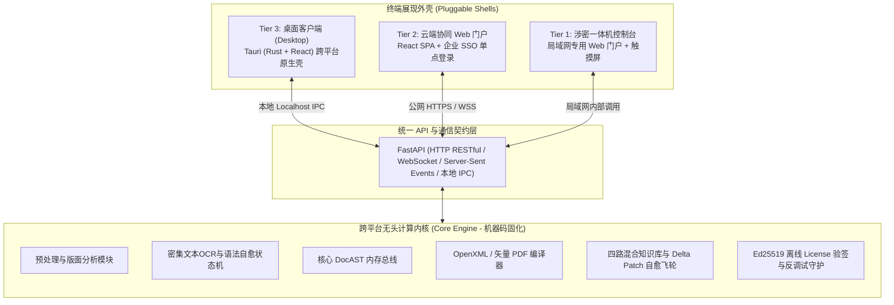

# 系统总体架构与技术方案说明书

## 1. 总体架构拓扑图

系统采用**“多模态输入适配 -> 跨模态时空对齐 -> 全局语义解构与重组织 -> 智能纠偏自愈 -> 知识链接拓扑网络 -> 多格式交付”**的六阶段微流水线架构。

```mermaid
flowchart TD
    subgraph 阶段一: 多模态摄入与视听融合
        A1[散乱图片集合] --> B1[几何校正 / 去反光 / 增强]
        A2[操作录屏 / 演示视频] --> B2[场景切分与关键帧提取]
        A2 --> B3[语音音轨提取与 ASR 转录]
        B2 & B3 --> B4[音画时空对齐引擎]
    end

    subgraph 阶段二: 版面感知与逆坐标特征提取
        B1 & B4 --> C1["开源版面分割复用 + 多语言密集OCR + 逆矩阵坐标映射"]
        C1 --> C2["带亚像素溯源坐标的多模态原始素材池"]
    end

    subgraph 阶段三: 跨时序状态消歧与重组织引擎
        C2 --> D0["滚动重叠拼接 (Scroll-Stitching) & 跨时序回退消歧"]
        D0 --> D1["全局实体与主题语义聚类"]
        D1 --> D2["文档群分卷: Doc Cluster Boundary"]
        D2 --> D3["行业母版约束动态大纲生成"]
        D3 --> D4["素材碎片路由与冲突标记"]
    end

    subgraph 阶段四: 编译期语法自愈与待复核仲裁
        D4 --> E1["代码/SQL 静态AST编译期校验纠偏"]
        D4 --> E2["跨文档全局标识符符号表对齐"]
        E1 & E2 --> E3["低置信度与音画冲突转入非阻塞工单队列"]
    end

    subgraph 阶段五: 超链接与知识网重构 (Link Mesh)
        E3 --> F1[文档内局部锚点解析]
        E3 --> F2[跨文档显式引用路由解析]
        F1 & F2 --> F3[双向链接 Obsidian 拓扑图构建]
    end

    subgraph 阶段六: 多格式交付 (Multi-Format Export)
        F3 --> G1[Word 交付报告 .docx]
        F3 --> G2[PPT 汇报幻灯片 .pptx]
        F3 --> G3[PDF 矢量印刷归档 .pdf]
        F3 --> G4[Obsidian / Markdown 知识库]
    end
```

---

## 2. 核心技术选型矩阵

| 技术模块 | 推荐选型 | 备选方案 | 选型权衡与优势 |
| :--- | :--- | :--- | :--- |
| **基础语言与环境** | **Python 3.10+ (核心编译为C/C++机器码)** | Rust / Go | 兼顾多模态视觉生态与原生机器码交付安全性。 |
| **单页版面分割底座 (开源复用)** | **MinerU 2.5 / PP-StructureV3 适配封装** | Docling | 复用成熟开源多栏/表格区域定位能力，避免在通用版面检测上重复造轮子。 |
| **多模态 VLM (云端/专有云)** | **Gemini Flash/Pro 系列 / Qwen3-VL** | Claude Sonnet 系列 | 百万级长上下文窗口，支撑跨多张高分辨率切片的语义路由。 |
| **多模态 VLM (断网离线端)** | **Qwen2.5-VL / Qwen3-VL (7B/32B 4/8-bit量化)** | PaddleOCR-VL-1.5 | 中文复杂表格与代码识别精度高，单张 16GB~24GB 显卡或信创 NPU 即可流畅运行。 |
| **视频关键帧提取** | **FFmpeg + OpenCV (ORB/RANSAC/SSIM)** | PyAV | 原生 C++ 高吞吐场景切分、滚动长图拼接与清晰度拉普拉斯评估。 |
| **语音识别 ASR** | **Whisper Large-v3 Turbo / SenseVoice** | FunASR | 中英混合技术术语识别率高，提供词句级精确时间戳用于音画冲突比对。 |
| **母版级文档编译求解** | **docxtpl + OpenXML Transitional 原生布局器 / Typst** | python-pptx / WeasyPrint | 基于企业 `.docx` 标准模板标签注入与底层 XML 约束，彻底规避 Pandoc 转换样式崩坏。 |

---

## 3. 系统部署拓扑与终端形态适配架构 (Deployment Topology & Multi-Shell Architecture)

为解决不同客户群体（政企涉密离线、商业云端SaaS、个人桌面单机）的物理运行环境差异，系统采用**“无头核心引擎 (Headless Core Engine) + 统一网关契约 + 多形态终端外壳 (Pluggable Shells)”**架构：



### 3.1 跨端技术同构原则
1. **Click-to-Source 视窗 100% 同构**：双栏对照画布封装为标准 Web Component，在 Web 端与桌面客户端（Tauri 视窗）中直接复用同一份交互代码；
2. **算力与存储解耦**：Core Engine 纯无头运行，多格式文件导出在后台完成，无论是桌面保存还是云端下载均调用相同二进制编译接口；
3. **单机与云端数据库统一**：统一采用 SQLite (FTS5) + HNSW 本地向量库，单机为单个文件，云端按租户分库，业务层完全零改动。
