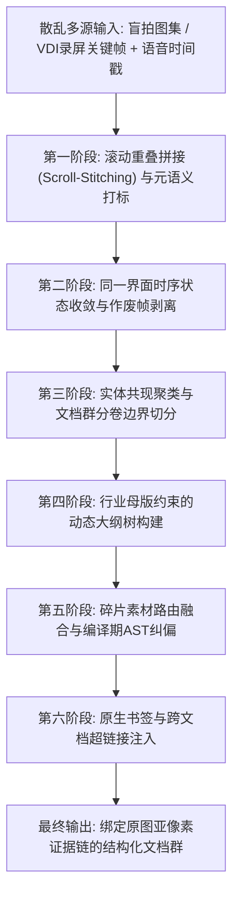
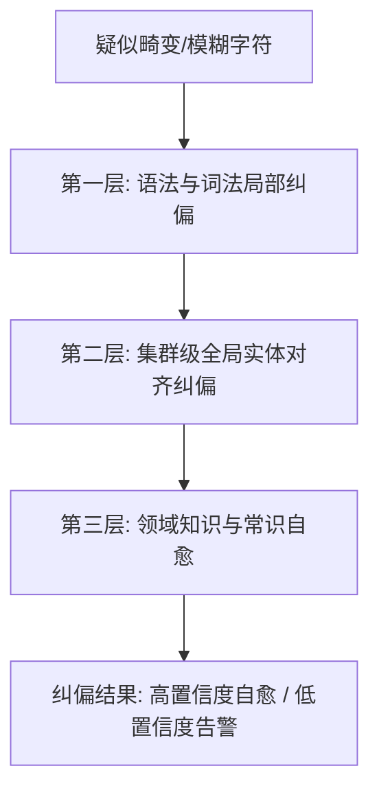

# 核心算法设计专题：文档重组织、智能纠偏与知识链接网

## 1. 为什么“跨时序状态消歧与文档重组织”是系统的核心中枢？

常规版面解析与 OCR 工具（如 MinerU、Docling、TextIn）均以“单份已按页码排好序的规整电子文档”为输入前提：
- 输入一张图片 -> 输出该页静态文本；
- 输入十页连续 PDF -> 按物理页序依次输出十页文本。

**但在无现成电子原件、仅能通过现场非侵入式拍照或受控窗口录屏采集的真实工程场景中，输入数据呈现高度乱序、重叠与时序冲突特征：**
1. **顺序倒置与多主题穿插**：
   - 现场巡检或驻场实施人员在采集时，常先拍摄系统异常报错面板，随后回溯拍摄前置网络配置与数据库表结构，中间穿插架构白板草图。
2. **长视图多次滚动重叠（Scroll Overlap）**：
   - 超出一屏的长配置表或代码文件通常分 3~5 次连续滚动拍摄，相邻照片存在 20%~50% 的局部行重叠。
3. **跨时序操作回退与参数覆盖（Temporal State Override）**：
   - 在连续操作录屏或连拍序列中，前期画面可能包含测试性的错误参数输入，后期画面才完成修正收敛；若无时序状态机消歧，通用长上下文模型极易将已作废的中间错误参数混入正式规程。

**因此，本引擎的核心职责并非单页文字转写，而是充当确定性的“多源视觉状态编译器”**：通过滚动拼接、时序状态图收敛、主题聚类分卷与母版大纲路由，将杂乱视觉流编译为逻辑自洽的成套工程文档。

---

## 2. 跨时序消歧与文档重组织算法流程



### 2.1 第一阶段：素材解构与多维元标签生成 (Meta-Tagging)
对每一张图片或视频关键帧，多模态大模型抽取其“元语义卡片”（Meta Semantic Card）：
```json
{
  "source_id": "frame_0042.jpg",
  "media_type": "screen_snapshot",
  "detected_language": ["zh-CN", "en-US"],
  "content_type": "database_schema",
  "core_entities": ["t_order", "t_order_item", "pay_status", "OrderService"],
  "semantic_summary": "订单与订单明细表结构定义，包含主外键关联及支付状态枚举值",
  "has_visual_diagram": false,
  "confidence": 0.95
}
```

### 2.2 第二阶段：文档群划分与主题聚类 (Document Cluster Splitter)
1. **实体与主题共现矩阵分析**：
   - 计算不同素材之间的语义向量距离（Semantic Embedding Distance）与核心实体交集度（Jaccard Index）。
2. **文档群边界切分（Cluster Boundary Decision）**：
   - 将素材自动汇聚为若干个互不重叠但逻辑内聚的文档主题（Topics）：
     - `Doc_01`: 系统架构设计说明书（汇聚总体拓扑、服务交互时序）
     - `Doc_02`: 数据字典与存储设计（汇聚所有数据库表结构、缓存定义）
     - `Doc_03`: 核心业务接口规约（汇聚所有 API 截图、参数列表、报文示例）
     - `Doc_04`: 系统部署与运维手册（汇聚服务器环境、配置文件、操作录屏步骤）

### 2.3 第三阶段：动态大纲推演 (Dynamic Outline Generation)
针对聚类好的每一个文档，利用大模型生成符合行业金标准（Gold Standard）的技术大纲。
- 例如针对《核心业务接口规约》，自动构建如下树形大纲：
  ```text
  1. 接口概述与通用规范
     1.1 基础路径与域名
     1.2 通用认证请求头 (Headers)
     1.3 统一状态码与响应体定义
  2. 订单管理模块 API
     2.1 创建订单接口 (/api/v1/orders/create)
     2.2 订单详情查询 (/api/v1/orders/{id})
     2.3 订单取消与逆向退款
  3. 异常处理与常见错误码附录
  ```

### 2.4 第四阶段：信息融合与碎片归并 (Information Synthesis)
- **非线性缝合**：将原本在时间轴上第 3 张和第 87 张出现的订单接口内容，精准路由到 `2.1 创建订单接口`。
- **信息版本去重与合成**：结合视频画面与语音注解，自动合成出一条具有解释性的文档条目。

---

## 3. 上下文智能纠偏与自愈机制 (Contextual Rectification)



1. **第一层：语法与代码树局部纠偏**：针对屏幕代码截图，利用 Python/SQL AST 词法规则修复歪曲字符（`f0r` -> `for`, `1O` -> `10`）。
2. **第二层：集群级全局实体对齐纠偏**：维护全文档群字典，若一张图识别出 `OrderService`，模糊图识别的 `0rderServ1ce` 自动对齐还原。
3. **第三层：步骤断层与异常预警机制**：发现缺失步骤时插入友好的 `> [!WARNING]` 视觉告警，拒绝大模型臆造。

---

## 4. 跨文档超链接消歧算法
```text
输入引用文本: "详情见《网关规范》中的鉴权返回"
1. 提取目标文档特征: 关键词 = "网关规范"
2. 在全局注册表中匹配: 命中 "02_API网关设计规范.docx" (置信度 0.94)
3. 提取目标小节特征: 关键词 = "鉴权返回"
4. 在目标文档目录树中匹配: 命中 "## 4.2 统一鉴权响应结构 (Auth Response)"
5. 生成精准跳转链接 / 书签。
```
