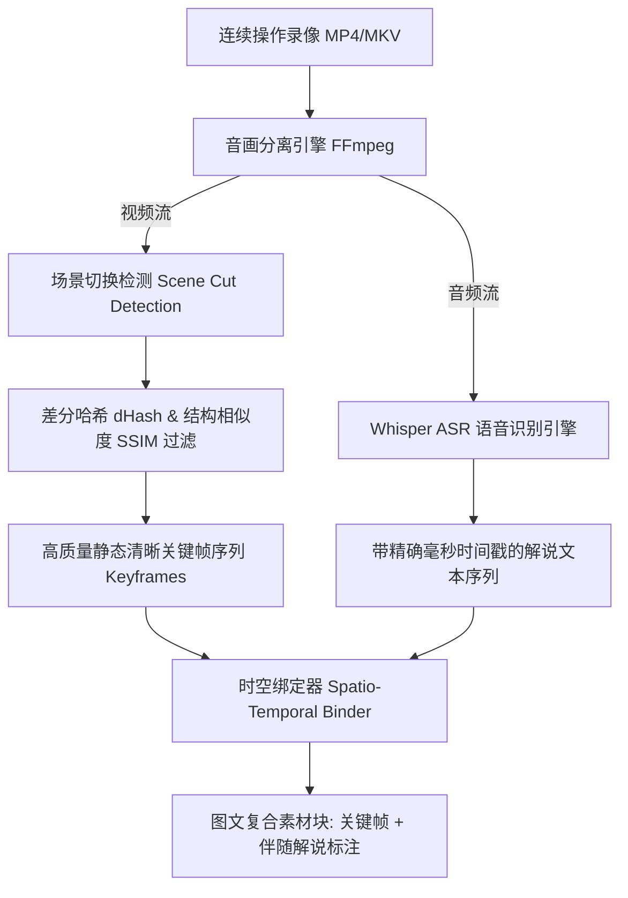

# 跨模态视频处理与音画对齐技术方案

## 1. 业务痛点与技术挑战

在很多复杂的系统演示、现场操作教学或技术评审中，用户往往用手机或录屏软件录制了一段长达 10~30 分钟的连续视频（MP4/MKV）。
传统方案面对长视频有两大死穴：
1. **画面极度冗余与模糊**：鼠标反复滑动、页面过渡时的重影、大量静止不动的死帧；
2. **纯看画面丢失灵魂**：演示者在口述中说了大量“为什么选这个配置”、“这个地方有坑”等关键背景，但屏幕上只显示了一个输入框，纯靠画面的 OCR 根本提取不到这些核心决策信息。

---

## 2. 视频转文档群处理流水线架构



---

## 3. 核心算法实现细节

### 3.1 关键帧提取与智能去重
1. **粗筛（Scene Detection）**：
   - 利用 FFmpeg 的 `select='gt(scene,0.3)'` 滤镜，根据相邻帧的色彩直方图差异，快速标记可能发生界面切换的时间点（候选切片）。
2. **精筛（dHash + SSIM 去重）**：
   - 对候选切片计算**差分感知哈希（dHash）**与**结构相似性（SSIM）**。
   - 当两帧的 SSIM > 0.92 且内容变化仅为鼠标指针平移或光标闪烁时，视为同一屏幕状态。
   - 在该屏幕状态存续的时序区间内，通过 **Laplacian 算子** 计算各帧的清晰度方差，**仅保留清晰度最高、无运动模糊的那一帧**。

### 3.2 音画时空绑定与意图注入
1. **Whisper ASR 转录**：
   - 提取音频轨（16kHz 单声道 WAV），送入 Whisper 模型，生成带有单词级/句子级时间戳的结构体：
     ```json
     {
       "start": 142.50,
       "end": 148.20,
       "text": "这里注意要把超时时间从默认的3秒改成15秒，否则高并发下会被网关直接熔断。"
     }
     ```
2. **时空绑定器（Spatio-Temporal Binder）**：
   - 将对应时间段 `[142.5s, 148.2s]` 的屏幕操作截图与该段语音绑定。
   - 最终在生成的文档中，不仅有一张设置界面的截图，还会自动生成一段具有专业价值的说明：
     > **【操作注意事项】**：此处建议将超时时间调整为 15 秒（默认值为 3 秒），避免高并发场景下触发网关熔断。
