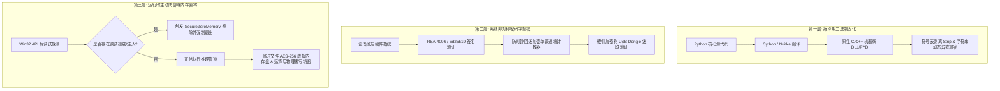

# 软件安全防护、防逆向与离线授权体系技术方案 (Security, Anti-Reverse & Licensing)

## 1. 威胁建模与攻击向量分析 (Threat Modeling)

本系统在面向 B 端企业（金融外包、军工涉密、律所审计）离线交付时，面临五类典型安全与商业风险：

```text
+---------------------+---------------------------------------------------------+
| 攻击向量 / 威胁类别  | 攻击手段与典型场景                                       |
+---------------------+---------------------------------------------------------+
| 1. 二进制反编译与逆向 | 攻击者反编译 Python 字节码，盗取核心 AST 纠偏与排版算法   |
| 2. 授权绕过与非法分发 | 破解本地 License 校验逻辑、修改系统时钟绕过试用期、跨机复制|
| 3. 动态调试与内存转储 | 挂载调试器（x64dbg/Frida）Dump 运行时内存，提取模型私有配置 |
| 4. 商业机密资产提取   | 盗取本地量化模型权重、专用提示词编排规则与行业专有词典    |
| 5. 现场数据残留取证   | 在客户机房运算后，残留未加密的图像/音频切片被现场安全审计取证|
+---------------------+---------------------------------------------------------+
```

---

## 2. 多层纵深防御架构 (Defense-in-Depth Architecture)



---

## 3. 具体技术防护机制实现规范

### 3.1 核心代码二进制编译与符号混淆 (C/C++ Compilation)
- **实现方案**：
  - 前端界面采用 Tauri（Rust 底层），业务调度与核心流水线采用 Python；
  - **核心模块全量机器码化**：涉及 AST 语法纠偏、OpenXML 二进制排版引擎、多图拓扑聚类、License 校验的 Python 代码，全量通过 `Cython` 编译为 C 代码，再通过 MSVC 编译为原生机器码 `.pyd` 文件；
  - 交付物中**严禁包含任何 `.py` 明文源文件或易被反编译的 `.pyc` 字节码**；
  - 关键内部字符串（如 Prompt 模板片段、解密公钥、错误日志常量）采用编译期异或（XOR）混淆存储，运行时在栈上动态还原并立即擦除。

### 3.2 硬件指纹绑定与非对称离线授权 (Hardware Fingerprinting & Licensing)
1. **硬件指纹提取算法**：
   - 提取三组底层物理硬件唯一标识：
     $$\text{HWID} = \text{SHA256}(\text{BaseBoard\_UUID} \parallel \text{CPU\_ProcessorID} \parallel \text{PrimaryDisk\_SerialNumber})$$
   - 杜绝仅绑定 MAC 地址（防止虚拟机网卡伪造与漂移）。
2. **非对称离线验签机制**：
   - 授权文件包含：`{hwid, expire_timestamp, max_cluster_pages, feature_flags, nonce}`；
   - 授权服务器（私钥保管于内部安全网）使用 **Ed25519** 算法对该数据包生成数字签名；
   - 客户端软件内置公钥，启动时验证数字签名的数学合法性，杜绝伪造 License。
3. **防时间回拨机制（Anti-Clock Rollback）**：
   - 在加密的本地存储中维护一个加密的单调递增时间戳（Monotonic Timestamp）：
     $$T_{\text{last}} = \max(T_{\text{current}}, T_{\text{stored}})$$
   - 若检测到系统当前时间 $T_{\text{sys}} < T_{\text{stored}}$，判定为人工回拨时钟恶意续期，系统直接锁定并抛出授权异常。

### 3.3 运行时主动反调试与反注入 (Anti-Debugging & Anti-Injection)
- **Windows 原生反调试钩子**：
  - 定期轮询调用 Win32 底层 API：`IsDebuggerPresent()`、`CheckRemoteDebuggerPresent()`；
  - 检查隐藏进程调试端口：调用 `NtQueryInformationProcess` 查询 `ProcessDebugPort`（非零即为被调试状态）；
  - 硬件断点检测：读取线程上下文 `GetThreadContext`，检测调试寄存器 `DR0 ~ DR3` 是否被设置断点。
- **动态行为防御**：
  - 启动独立守护线程检测常见逆向分析工具（如 IDA Pro, x64dbg, Process Hacker, Cheat Engine）；
  - 一旦捕获到非法内存注入或调试器附加，立即执行 `exit(0xDEAD)` 异常退出，避免暴露调用栈。

### 3.4 临时数据生命周期安全与安全擦除 (Data Sanitization)
- **内存保护**：
  - 敏感的 License 凭据、私有词典、解密后的中间 Prompt，使用 Windows API `SecureZeroMemory`（或 C11 `memset_s`）在调用完毕后立即覆写清空，防止被外部进程 Dump 提取。
- **磁盘残余销毁**：
  - 中间图像预处理切片、视频 WAV 临时文件默认存放在 RAM Disk（内存虚拟盘）；
  - 如必须落盘，临时文件采用 AES-256 算法加密存储，生命周期结束后执行 **DoD 5220.22-M 标准擦除（伪随机数据覆盖覆写）**，防止客户机房安全审查人员利用数据恢复软件恢复原始素材。
