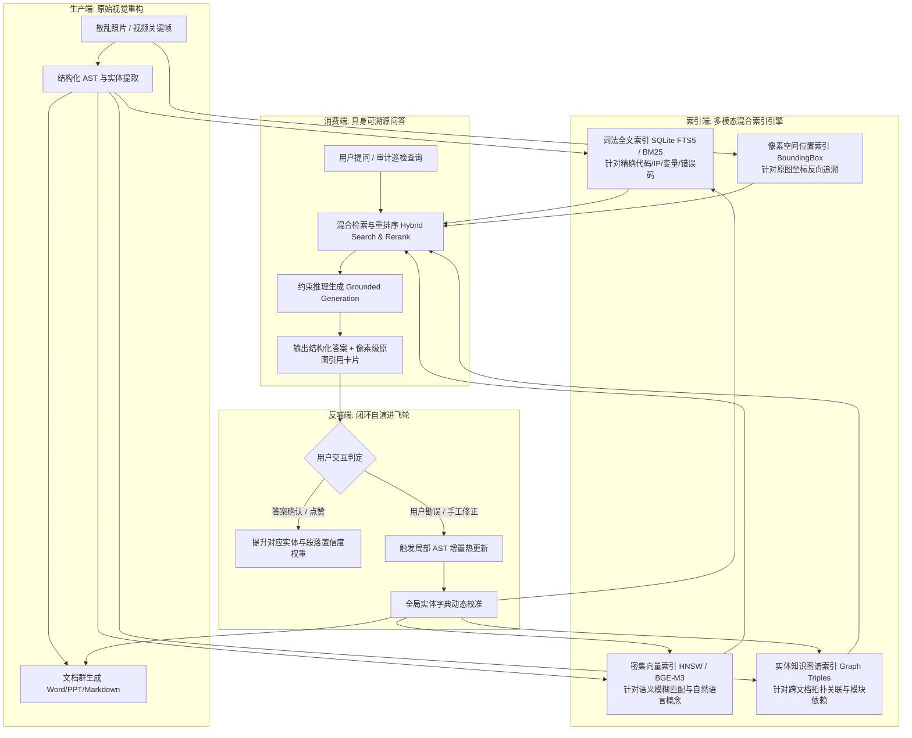
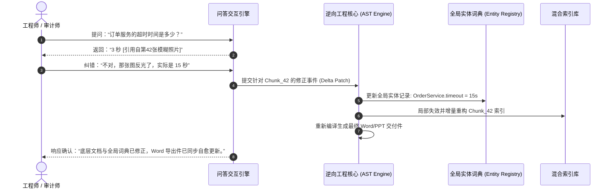

# 知识库多模态混合检索与问答反哺架构方案 (Hybrid Retrieval, Q&A & Feedback Flywheel)

## 1. 系统架构定位与战略边界

> [!IMPORTANT]
> **研发排期与差异化边界声明**：
> 本模块定位为**远期增值扩展模块（P2 / 第八阶段）**，严格服务于经本系统逆向重构产出的工程资产集（用于交付核查与增量勘误回写），**严禁在项目早期抽调核心排版与消歧研发资源将其作为独立“通用 PDF 知识库”推向市场**，规避与 ChatDOC、RAGFlow、腾讯 ima 等成熟 RAG 产品的同质化竞争。在前置核心阶段，系统底层仅需在 `DocAST` 节点 ID 与单文件 SQLite 存储层保留契约兼容。

本模块在核心逆向编译流水线稳定投产后，将单向的“视觉流 -> 文档导出”扩展为**“已重构工程资产库 -> 四路混合检索 -> 强证据约束核查 -> 版本化 AST 勘误回写”**的闭环体系。



---

## 2. 混合多模态检索架构设计 (Hybrid Multi-modal Indexing)

针对受限环境重构出的技术与合规文档，单一向量检索（Dense Retrieval）极易丢失关键工程符号（如端口号 `8080`、类名 `UserDAO`、错误码 `ERR_0x99`）。系统采用**四路混合索引与加权重排序架构**：

### 2.1 索引四要素解耦与存储方案
1. **精确词法索引（Lexical Sparse Index）**：
   - 引擎：本地嵌入式 SQLite FTS5（无外部服务依赖，零内存开销）；
   - 分词：针对代码标识符的大驼峰（CamelCase）、下划线（snake_case）与普通分词混合索引；
   - 目的：确保对特定 IP、函数名、表字段名称的召回率达到严格的 $100\%$。
2. **密集语义向量索引（Dense Semantic Vector Index）**：
   - 引擎：轻量级本地向量引擎（如 `faiss-cpu` 或 `usearch`）；
   - 嵌入模型：离线轻量 Embedding（如 BGE-small / Qwen2-Embedding 8-bit 量化）；
   - 目的：处理用户意图模糊的自然语言提问（如“系统的超时熔断怎么配置的”匹配到 `max_connection_timeout`）。
3. **实体拓扑图谱索引（Graph Triple Index）**：
   - 存储形式：轻量级本地属性图（节点：实体、章节、文档；边：引用、依赖、包含）；
   - 目的：处理多跳（Multi-hop）跨文档关联查询（如“调用用户中心接口的上一层网关有哪些安全限制”）。
4. **像素空间逆向索引（Visual Coordinate Spatial Index）**：
   - 记录：`ChunkID -> {SourceImage, NormalizedBox: [ymin, xmin, ymax, xmax], Timestamp}`。

---

## 3. 强溯源问答助手设计 (Evidence-Grounded Q&A Assistant)

为避免企业级问答中的幻觉误导，问答引擎必须执行**确定性证据链绑定**：

1. **输入与重排序机制**：
   - 检索召回 Top-20 候选 Chunk，经过交叉编码重排模型（Cross-Encoder Reranker）压缩至 Top-5 最强相关上下文。
2. **生成约束协议**：
   - Prompt 强制要求：禁止推测未包含在上下文中的事实，每个关键论断后必须附加证据引用标识 `[^ref_N]`。
3. **双模态证据卡片输出**：
   - 问答结果下方自动附加**可交互的视觉卡片**：
     ```json
     {
       "answer": "网关服务的默认超时时间在生产环境中已调整为 15 秒。",
       "citations": [
         {
           "doc_name": "04_运维部署手册.docx",
           "section": "3.2 网络参数优化",
           "source_image": "IMG_20261105_042.jpg",
           "bounding_box": [0.42, 0.15, 0.58, 0.85],
           "confidence": 0.96
         }
       ]
     }
     ```
   - 用户鼠标悬浮或点击引用时，UI 右侧毫秒级展开原图并高亮黄色红框，实现肉眼即时校验。

---

## 4. 知识库反哺底层重构的飞轮机制 (The Feedback Flywheel)

知识库不仅是消费终端，更是**持续校准重构质量的核心数据源**：



### 4.1 纠错级联自愈（Cascading Self-Healing）
- **单点纠偏，全局自愈**：用户在问答聊天框中指出某处参数识别错误时，系统不单单修改问答历史，而是**生成局部增量补丁（Delta Patch），反向更新底层文档的 AST 语法树**；
- **级联效应**：由于全局实体词典被修正，全套文档群中所有引用该实体的模糊段落，均会在下一次导出时自动同步完成纠偏。

### 4.2 提问频率反哺大纲优化（Query-driven Outline Tuning）
- 统计用户在知识库中高频提问但召回置信度偏低的盲区（Knowledge Gaps）；
- 当系统检测到某个模块被反复追问且答案分散在多张图片中时，自动向重组织引擎发送优化建议：在下一版生成的 Word/PPT 大纲中，**为该高频主题独立建立一个二级章节或专属对比表格**。

### 4.3 增量素材无缝挂载（Incremental Ingestion）
- 客户在后续补充拍摄了 5 张新照片时，系统无需全量重新计算整个工程；
- 通过特征比对与增量路由，仅重新计算发生冲突的局部章节与对应混合索引，实现秒级热更新。
