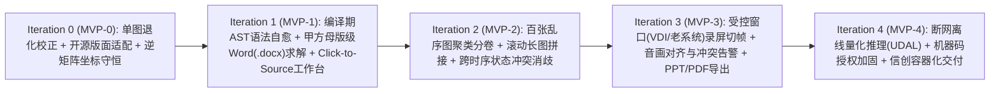

# DevOps 敏捷迭代路线图与演进规划 (Agile Roadmap)

## 1. 渐进式交付与竞品基准门禁原则

研发推进遵循**“顶层契约前置固化、通用算子优先复用开源、核心壁垒小颗粒度闭环验证、每阶段强制跑通竞品基准门禁”**的工程准则：

---

## 2. 五阶段发布里程碑与准出标准 (Milestones & Exit Criteria)

### Iteration 0：单图退化修复、逆坐标守恒与基础流水线打通 (MVP-0)
- **目标边界**：聚焦 [PRD-01](file:///c:/Users/zhangtengkuan/Desktop/自己的项目/图片转文档/docs/03_产品需求规格说明/PRD-01_图像摄入_EXIF归一化与几何画质预处理规格说明书.md) 至 [PRD-05](file:///c:/Users/zhangtengkuan/Desktop/自己的项目/图片转文档/docs/03_产品需求规格说明/PRD-05_标准Markdown渲染器与本地资产切片管理器规格说明书.md)，验证单张带倾斜/反光/摩尔纹照片到强类型 `DocAST` 及标准 Markdown + 高清插图切片的确定性闭环。
- **核心交付项**：
  1. EXIF 方向归一化、透视单应性校正（$H$）、频域摩尔纹抑制及逆矩阵（$H^{-1}$）亚像素反投精度验证（IoU $\ge 0.90$）；
  2. 封装标准版面检测接口（对接 MinerU / PP-Structure 开源权重），输出阅读序与区块多边形；
  3. 密集文本提取、跨行断词缝合、`DocAST` 状态机校验与本地 300 DPI 插图切片无死链导出。

---

### Iteration 1：编译期语法自愈、母版级 `.docx` 求解与核验工作台 (MVP-1 / 首个商业可用切口)
- **目标边界**：面向 Tier 2 首发客群（工程巡检、尽调审计、驻场实施），打通“免返工 `.docx` 交付 + 5 分钟人机免责核验”最小商业闭环。
- **核心交付项**：
  1. 代码/SQL/JSON 编译期静态 AST 校验（`Tree-sitter` / `SQLGlot`）与易混字符确定性修复；
  2. 基于 `docxtpl` 与 OpenXML Transitional 规范的母版排版求解器（支持嵌套合并表格、跨页重复表头、兼容 Office 2007+ 及政企 WPS）；
  3. 三栏式前端工作台：实现 Click-to-Source 毫秒级原图高亮联动与低置信度（$< 0.85$）非阻塞待复核工单队列（Review Queue）。

---

### Iteration 2：乱序多图分卷、滚动拼接与跨时序状态消歧 (MVP-2)
- **目标边界**：攻克无电子原件场景下 30~100 张盲拍照片的全局结构化重组。
- **核心交付项**：
  1. 长表格/长配置页连续滚动重叠截图特征对齐与去重缝合（Scroll-Stitching）；
  2. 同一界面多次修改的时序状态收敛推导与跨图全局标识符符号表对齐；
  3. 多主题聚类分卷、行业交付模板约束大纲生成及跨文档原生书签/相对路径超链接注入。

---

### Iteration 3：受控窗口操作录屏解析与多格式扩展 (MVP-3)
- **目标边界**：覆盖 Citrix/VDI 虚拟桌面及无源码遗留软件的录屏逆向建档场景。
- **核心交付项**：
  1. 10~60 分钟录屏视频的场景切换切片（FFmpeg）与指针平移冗余帧过滤（dHash/SSIM + Laplacian 清晰度优选）；
  2. 离线语音转录（Whisper / SenseVoice）时空绑定及“口述数值 vs 屏幕显示参数”冲突自动告警；
  3. 自适应母版 PPT（`.pptx`）与字体全子集嵌入矢量 PDF 编译器。

---

### Iteration 4：离线异构算力适配、防逆向加固与信创一体机封装 (MVP-4)
- **目标边界**：满足 Tier 1 政企物理隔离环境与单机商业分发准入要求。
- **核心交付项**：
  1. 基于 UDAL 统一硬件抽象层适配本地 4-bit/8-bit 量化视觉模型（CUDA / Metal / 昇腾 CANN / ONNX-CPU 降级回退）；
  2. 核心 Python 模块 Cython/Nuitka 机器码编译、Ed25519 硬件指纹离线授权、RAM Disk 零残留与 DoD 5220.22-M 擦除；
  3. 构建 100 组真实退化样本自动化回归基准流水线（CI Golden Benchmark），量化监控每次迭代相对于外部开源/商业基线的准确率与工时节省净增益。
