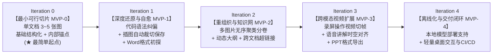

# DevOps 敏捷迭代路线图与演进规划 (Agile Roadmap)

## 1. 敏捷工程演进理念

在敏捷开发（DevOps）中，**“前期的工作必须做得足够足，前期思考得越深，后续开发越不会返工”**。
同时，落地执行必须坚持 **“小步快跑、多次迭代、从最简单的起点开始”**。

---

## 2. 五阶段发布里程碑 (Milestones Breakdown)

### 🟢 Iteration 0：最小可行切片 (MVP-0: Single-Doc Baseline)
- **定位**：用最简单的方式跑通单文档核心闭环，先不搞视频，也不搞复杂的多文档群。
- **输入**：3~5 张按顺序排好的同一篇文档照片。
- **核心验证**：
  1. 多模态大模型的基础提取 Prompt 流水线；
  2. 基础段落、标题层级（H1~H3）、代码块、表格的结构化输出；
  3. 识别“详见第 2 节”，生成基础内部锚点超链接。

---

### 🟡 Iteration 1：单文档深度还原、语法自愈与 Word 初探 (MVP-1)
- **新增能力**：
  1. 反光/摩尔纹引起的字符误识修复（Python/SQL AST 纠偏，如 `1O` -> `10`, `f0r` -> `for`）；
  2. 高保真插图/流程图的边界框检测与自动高清裁切保存；
  3. 引入初版 Word (.docx) 排版生成器。

---

### 🟠 Iteration 2：无序图片聚类、文档重组织与知识网 (MVP-2)
- **新增能力**：
  1. 30~50 张无序散乱图片的主题聚类与文档群分卷（如切分为《架构设计》、《接口定义》）；
  2. 动态专业大纲推演与碎片内容去重融合；
  3. 跨文档显式超链接解析与 Obsidian 双链格式输出。

---

### 🔵 Iteration 3：跨模态长视频处理与 PPT 格式导出 (MVP-3)
- **新增能力**：
  1. 10~30 分钟连续录屏/演示视频的智能关键帧切片（FFmpeg + dHash/SSIM）；
  2. Whisper 语音音轨转录与音画时空绑定；
  3. 自动将会议演讲或白板研讨转化为可汇报的 PPT (.pptx)。

---

### 🟣 Iteration 4：纯离线化运行、多端交互与工程化交付 (MVP-4)
- **新增能力**：
  1. 适配本地离线多模态大模型（Ollama / vLLM + Qwen2-VL），满足完全断网内网合规；
  2. 交付一键使用的轻量可视化界面（Web UI 或桌面端）；
  3. 搭建自动化测试流水线（回归样张黄金数据集）。
