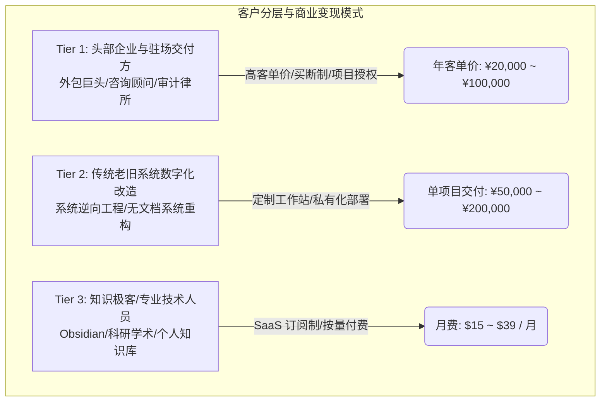

# 商业价值与竞品市场深度调研报告 (Market & Commercial Viability Analysis)

## 1. 核心结论摘要 (Executive Summary)

1. **需求真实性**：**刚需且极具痛点**。特别是在金融内网、涉密军工、外包驻场、律所审计（M&A Data Room）、老旧系统逆向工程等场景中，物理带出信息的唯一途径就是手机拍照或视频录屏。目前从业人员主要靠**纯人工逐字敲击、肉眼排版、手动画图**，单次项目耗时可达数十小时。
2. **市场空白与竞品现状**：**目前市场上确实没有一款成熟解决“散乱受限素材 -> 重构网状文档群”的端到端产品**。
   - **Scribe / Tango 等 SOP 工具**：必须在被测电脑安装浏览器插件或客户端监控点击流，在堡垒机/隔离机房中**完全被禁用**；且只输出点击步骤流，无法输出架构/接口/数据字典等系统设计文档。
   - **Docling / Marker / LlamaParse 等 AI OCR 工具**：仅停留在“单页/单文档平面转换”，缺乏“全局语义解构、多素材按主题聚类分卷、跨文档链接消歧”的重组织能力。
   - **WayinVideo 等视频笔记工具**：针对公开网络视频学习，无法处理内部系统操作录像的高保真反光纠偏、代码AST校验与文档群重构。
3. **商业化潜力**：**极高，具备高客单价与本地化私有部署双轮驱动属性**。受限环境数据天然高敏感，企业客户对**“离线/隐私保护的逆向文档重构工作站”**具有极强的付费意愿（年费制或项目买断制）。

---

## 2. 细分竞品全景图与“生态盲区”对比

| 产品阵营 | 代表产品 | 核心原理 | 致命局限（为什么满足不了该场景） |
| :--- | :--- | :--- | :--- |
| **SOP 录屏生成类** | Scribe, Tango, Guidde, Dubble | 在本机安装插件/Hook，监听鼠标点击与 DOM 树生成操作卡片。 | 1. 堡垒机/内网/DLP 环境**严禁安装第三方插件**； 2. 只能做“第1步点这里”的 UI 指南，无法提炼架构图、ER表结构、API定义。 |
| **单页/PDF 结构化解析类** | Docling (IBM), Marker, Nougat, LlamaParse, 合合信息(TextIn) | 多模态 VLM / 目标检测，将单页图片/PDF 转为 Markdown。 | 1. 假设输入是“有序且单篇”的； 2. **无文档重组织能力**：面对 100 张散乱图片，只会输出 100 段混乱文本，不会切分文档群； 3. **无全局实体纠偏与跨文档超链接网络**。 |
| **视频摘要与笔记类** | WayinVideo, HoverNotes, VideoNoteGPT | 提取 YouTube 语音字幕 + 定期抓取 PPT 幻灯片。 | 1. 面向轻量化课程学习，缺乏技术专业度； 2. 无法识别与修复摩尔纹/反光遮挡的代码、SQL、JSON 语法。 |
| **本系统定位 (DocReconstruct)** | **图片/视频转文档群与智能重组知识网** | **外部被动采集 + 全局语义解构 + 文档群聚类 + 代码/实体自愈 + 知识网图谱** | **填补市场空白**：无需侵入主机、跨模态音画对齐、自动重组为成套专业文档群、双链知识网络输出。 |

---

## 3. 目标客户画像与付费意愿分级 (Target Audiences & WTP)

### 3.1 Tier 1：IT 驻场交付、外包公司与咨询/审计机构（核心暴利群体）
- **典型场景**：
  - 华为、中软国际、软通动力、神州数码等驻场工程师在客户内网环境（银行、证券、电信运营商机房）完成封闭开发，需将知识底稿、系统接口规范、运维经验带回公司内部知识库沉淀。
  - 德勤、普华永道、金杜律所等团队在 M&A（企业并购）尽职调查时，进入严格限制下载的虚拟数据室（VDR）或物理机房，现场拍回成千上万张合规协议、财务流水单。
- **痛点强度**：极高（以往需要安排 2~3 名初级助理人工敲字整理一周）。
- **付费能力**：极强，可走企业采购预算或项目成本直接报销。

### 3.2 Tier 2：老旧系统与停更软件“逆向工程”（工业与政企刚需）
- **典型场景**：
  - 许多使用 10~20 年的政务系统、医院 HIS、银行老核心、工控上位机系统，原开发商已倒闭、源码丢失、设计文档全无。
  - 改造团队唯一的办法就是**录像记录老系统所有功能模块的点选操作与报表**。
  - 本工具能够直接将操作录像“逆向重构”为《老系统全量业务功能与数据字典需求说明书群》，价值连城。

### 3.3 Tier 3：Obsidian / PKM 个人极客与科研人员（长尾流量）
- **典型场景**：学术会议现场拍 PPT、图书馆借阅闭架古籍/稀缺资料翻拍、技术沙龙分享录像沉淀到个人知识库。
- **模式**：提供轻量桌面端或 Web SaaS，按页数/按月订阅。

---

## 4. 商业化产品形态与定价策略 (GTM Strategy)

1. **“隐私优先”离线桌面专业版 (Privacy-First Desktop Client)**：
   - **定位**：解决“防泄密环境带出资料不敢上传云端”的心理防线。
   - **技术形态**：Electron / Tauri 包装，支持本地接入 Ollama / vLLM（运行本地 Qwen2-VL 等开源多模态模型），全链路本地计算，绝不联网上传。
   - **定价**：按节点授权，¥1,999 ~ ¥4,999 / 席位买断；或企业定制离线版 ¥20,000+。
2. **企业级逆向工程服务工作站 (Enterprise On-Premises)**：
   - 包含高性能本地 GPU 加速箱、批量视频切帧服务器、私有文档群知识库后台，面向大型国企、金融科技公司。
3. **Web 端轻量 SaaS (用于非涉密日常场景)**：
   - Freemium 模式：每月免费 30 张图片转换；
   - 专业版：$19.99/月（无限量图片重组、多文档聚类、跨文档超链接与 Obsidian Vault 导出）。

---

## 5. 潜在壁垒与护城河 (Moat & Defensibility)

1. **“重组织提示词工程与领域词典”经验沉淀**：
   - 通用大模型单次生成容易“乱编”或“格式坍缩”。
   - 将大模型拆解为“分卷切分 -> 骨架推演 -> 内容融合 -> 语法树纠偏”的多阶段工程流水线，并沉淀各行业专有词典，具备很高的技术门槛。
2. **端到端离线闭环体验**：
   - 市场上绝大多数 AI 工具都是云端 API 依赖型，在安全涉密圈子无法落地。做好**纯离线/局域网私有化运行能力**，将成为进入大型政企市场的排他性护城河。
