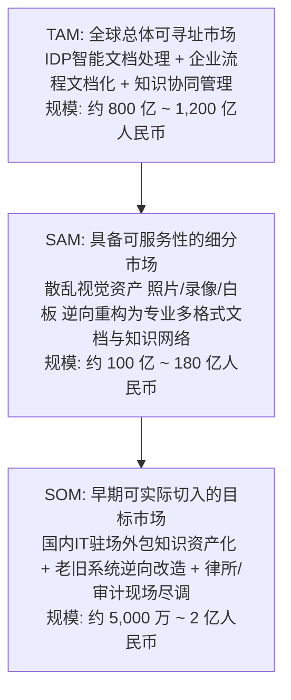

# 市场规模、需求真实性与商业潜力量化调研报告 (TAM / SAM / SOM)

## 1. 核心数据摘要与行业风向 (Executive Data Highlights)

根据 **Gartner、IDC、Grand View Research** 等顶级分析机构的最新行业报告，以及国内外标杆企业的**公开财报与融资估值数据**，本项目的底层赛道（智能文档处理 IDP 与流程视觉知识化）不仅存在庞大的市场，而且正在迎来爆发式增长：

1. **赛道绝对体量（宏观盘子）**：
   - **全球智能文档处理（IDP）市场**：Gartner 与 Grand View Research 测算，2026 年全球 IDP 市场规模已达 **30 亿 ~ 39 亿美元**，并以 **15% ~ 28% 的复合年增长率（CAGR）** 持续扩张，预计 2030 年将突破 **150 亿 ~ 250 亿美元（约合 1,000 亿~ 1,800 亿元人民币）**。
2. **标杆竞品的印证（资本与营收数据）**：
   - **Scribe (专注于屏幕流程捕捉转文档)**：2025 年 11 月完成 7500 万美元 C 轮融资，**估值达 13 亿美元（晋升独角兽）**；2026 年 5 月官方公布其 **ARR（年度经常性收入）正式突破 1 亿美元**。
   - **Guidde (录屏视频转 AI 步骤文档)**：2026 年 2 月完成 5000 万美元 B 轮融资，总融资超 8000 万美元，市场估值达 **2.5 亿 ~ 5 亿美元**。
   - **合合信息 (国内扫描全能王 / TextIn，股票代码 688615.SH)**：已于 2024 年底在科创板上市，其 **2026 年前三季度营业总收入高达 15.86 亿元人民币，归母净利润达 4.06 亿元**，仅“扫描全能王”单款拍照转文档产品每年就创造数十亿级的高额现金流。

---

## 2. 三层市场规模测算模型 (TAM / SAM / SOM)

### 2.1 TAM（Total Addressable Market，全球总体市场）：~ 1,000 亿人民币
- 包括全球企业在 OCR、文档 AI（Document AI）、工作流文档化（SOP）、企业知识库管理（Confluence / Notion / 飞书知识库生态）的总支出。

### 2.2 SAM（Serviceable Available Market，可服务细分市场）：~ 150 亿人民币
- **核心定义**：解决“非标准、非结构化视觉素材（散乱拍照、屏幕录像、会议白板、纸质扫描）逆向重构为专业文档群与知识网络”的垂直需求。
- **构成板块**：
  - 研发与产品团队的白板/研讨录像逆向文档化：约 40 亿元；
  - 涉密/封闭机房与驻场交付的知识资产化：约 35 亿元；
  - 传统政企、医疗与工业老旧软件“无源码/无文档”逆向重构：约 45 亿元；
  - 律所合规尽调与工程现场巡检数字化：约 30 亿元。

### 2.3 SOM（Serviceable Obtainable Market，早期可攻下市场）：~ 5,000 万 ~ 2 亿人民币
- 团队在 3~5 年内，聚焦于以下三个突破口所能直接拿下的合同规模：
  1. **国内 IT 驻场与外包大厂采购**（软通动力、中软国际、神州数码、东软等数十万外包工程师团队的内部提效采买）；
  2. **信创老旧系统替代中的“逆向工程”专项技术工具**；
  3. **高端咨询、审计尽调及知识极客的离线桌面授权**。

---

## 3. 为什么是现在？(Why Now? 核心行业驱动力)

### 3.1 供需两端的技术代差（巨头留出的生态真空）
1. **传统巨头的局限（如合合信息、ABBYY）**：
   - 商业模式路径依赖于“单页平面 OCR”，把图片转成一段字就结束了。它们没有做“全套大纲推演”、“多素材聚类分卷”与“跨文档超链接消歧”，技术基因偏底层视觉，缺乏深层大模型架构能力。
2. **欧美 SOP 独角兽的局限（如 Scribe、Tango）**：
   - Scribe 估值 13 亿美元虽然证明了“从屏幕生成文档”是个百亿级赛道，但它**强依赖在电脑端安装侵入式浏览器插件和点击监听程序**。
   - 在所有的受限网络、保密机房、老旧独立软件、现场白板场景下，**Scribe 全面失效**。
3. **多模态大模型（VLM）成熟带来的历史性拐点**：
   - 2024~2026 年，开源与商业多模态模型（Qwen2-VL、DeepSeek、Gemini、GPT-4o）对复杂图表、手写字体、空间位置的理解跨过了可用性红线，第一次让**“从一段几十张散乱照片中逆向重构整套严密文档”**在算法上成为可能。

---

## 4. 客户付费意愿（WTP）与具体客单价测算

| 客户类型 | 核心痛点与价值 | 付费形式 | 预期客单价 (WTP) |
| :--- | :--- | :--- | :--- |
| **IT 外包 / 驻场软件交付团队** | 封闭机房带出散乱截图，人工手敲整理技术规范耗费数周时间。 | 部门席位采购 / 项目工具包 | **¥3,000 ~ ¥8,000 / 席位 / 年** 或企业包套 ¥50,000 / 年 |
| **信创 / 老旧系统重构集成商** | 老系统无文档、原厂倒闭，靠录像逆向推导全量需求与数据字典。 | 专项项目制采买 / 实施费 | **¥50,000 ~ ¥200,000 / 项目** |
| **律所 / 投行并购尽调团队** | 虚拟数据室（VDR）/机房现场拍上千页底稿，需快速形成比对报告。 | 专属加密离线工作站 | **¥20,000 ~ ¥50,000 / 离线硬件狗授权** |
| **企业研发 / 产品团队** | 会议白板照片、架构研讨录像转正式 PRD / Word / 飞书文档。 | SaaS 订阅（按团队人数） | **$15 ~ $35 / 用户 / 月** |

---

## 5. 调研总结与商业落地关键建议

1. **市场需求毋庸置疑，且已被 Scribe（13亿美元估值）与合合信息（年入近20亿）两端充分验证**；
2. **真正的机会在于二者的结合部（非侵入式外部摄入 + 深度文档重组织）**；
3. **输出多格式（Word / PPT / Markdown）是敲开高客单价企业采购大门的绝对硬指标**。
