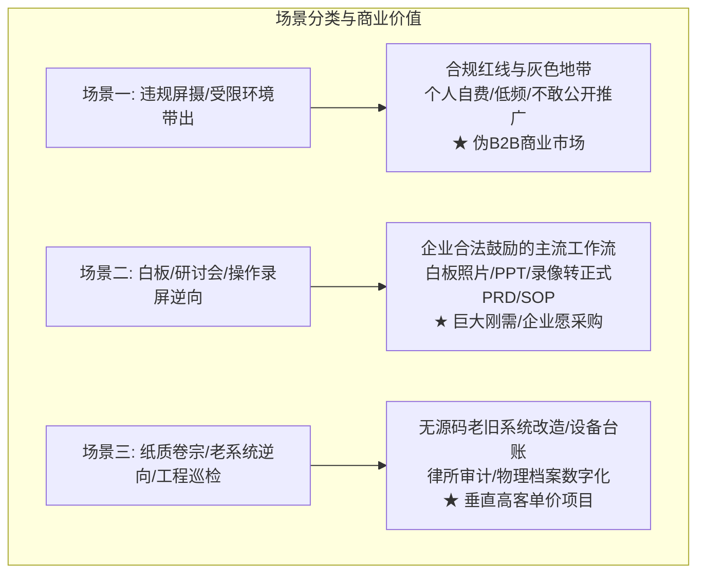

# 市场需求真实性与商业可行性深度剖析 (Reality Check & Market Viability)

## 1. 核心结论与冷静研判 (The Sober Reality)

针对“从受限环境照片/视频中重构结构化文档群”这一想法，结合社区痛点、产业安全合规现状及行业数据，我们进行客观研判：

1. **痛点存在吗？**
   - **绝对真实，且痛感极强**。任何人只要经历过“手机拍了几十张屏幕/白板照片，对着照片手动往 Word/Confluence 里敲字整理”，都会感到极度痛苦。
2. **“真的有很强的商业市场需求吗？”**
   - **结论：需要极其审慎地界定“真需求”与“假繁荣/伪命题”的边界。**
   - 如果产品定位为**“帮助员工把受限/内网的屏幕照片还原成文档”**：这属于典型的**灰色地带（甚至触犯企业 DLP 防泄密红线）**，企业绝不会出资采购，商业模式只能沦为**低客单价、低频次的个人自费工具**，商业价值天花板较低。
   - 如果产品将核心能力（“散乱视觉素材 -> AI重组织 -> 结构化文档群”）迁移到**合法合规的主流商业场景（如：会议白板转PRD、老旧系统逆向重构、工程勘测/纸质档案数字化）**：这属于目前规模达 **数十亿美元的智能文档处理（IDP）与多模态协作蓝海**，商业价值极高。

---

## 2. 需求真实性剖析：三大分水岭场景

### 2.1 场景一：受限环境/堡垒机“屏摄”还原（高痛点但极难商业化）
- **客观现实**：
  - 在银行、涉密机房、外包内网中，手机拍屏幕（屏摄）属于**严重违反信息安全管理规定（甚至面临辞退或起诉）**。
  - 目前所有大型金融/政企系统均部署了**动态屏幕水印（隐形水印/显性工号IP）**和防截屏策略。
- **商业死穴**：
  - **B2B 绝无可能**：没有哪家企业的安全合规部门（CISO）会采购一款宣称“帮员工高效重构偷拍屏幕照片”的软件。
  - **个人付费意愿有限（低频 + 逃避付费）**：普通外包工程师每个月可能只遇到 1~2 次此类需求，平时用免费微信识图或直接复制粘贴即可应付，月费接受度通常低于 20~30 元，续费留存极差。

### 2.2 场景二：会议白板、技术研讨与演示视频逆向（正规军的主流蓝海）
- **客观现实**：
  - 研发团队架构评审、头脑风暴，白板画满了架构图、数据流和便利贴，开完会拍了张照片，最后**“相册成了白板照片的火葬场”**，没人有时间去把它写成正式的 PRD 或架构设计说明书。
  - 架构师做了一段 15 分钟的系统操作与讲解演示，需要整理成全套操作规程。
- **商业价值**：
  - 这是企业**极度鼓励、强烈希望提升效率的正向生产力场景**。
  - 能够作为插件嵌入现有的企业知识库（如飞书、钉钉、Confluence、Notion、Office 365）。

### 2.3 场景三：老旧系统与纸质卷宗“逆向工程”（高利润企业垂直场景）
- **客观现实**：
  - 传统制造、政务、医疗中有大量 10~20 年前的老软件，开发商倒闭、源码丢失，需要升级重构。项目团队只能录像记录老系统的操作逻辑和界面，再反向推演需求。
  - 律所与审计机构在现场尽职调查时，面对成百上千本纸质装订合同，允许拍照留档，但后续需要快速整理成带索引的法务报告。
- **商业价值**：
  - 具备极高的客单价（单项目咨询/实施费数万元），适合以离线安全工作站的形式向 B 端机构销售。

---

## 3. 潜在的技术与商业拦路虎 (The Red Flags & Risks)

如果我们真的要做这个产品，必须冷静面对以下四大严峻挑战：

### 3.1 挑战一：大模型通用能力下沉的“挤压效应”
- **现状**：OpenAI (GPT-4o)、Google (Gemini 2.0/Flash)、Anthropic (Claude 3.5 Sonnet) 以及国产的 DeepSeek、Qwen2-VL，多模态上下文窗口已经达到 100万~200万 Token。
- **风险**：用户现在直接把 20 张截图一次性拖入 ChatGPT 或 DeepSeek 网页端，打一句 Prompt：“帮我把这 20 张图片整理成一份带大纲和表格的 Markdown 文档”，通用大模型已经能完成 70% 的工作。
- **破局点**：单纯拼“调用大模型 OCR”没有护城河。系统的核心壁垒必须建立在**“复杂表格/公式的高保真修复”、“跨文档超链接消歧”、“多格式专业输出（Word/PDF/PPT）”**以及**“私有离线部署”**上。

### 3.2 挑战二：需求的频次问题（低频痛点 vs 高频习惯）
- 用户是“每天都在整理照片”，还是“几个月遇到一次”？
- 纯个人工具如果使用频次低，用户往往会选择“忍一忍用免费工具手动拼凑”，导致产品获客成本（CAC）高于用户生命周期价值（LTV）。

### 3.3 挑战三：输出格式的现实工程复杂度
- 正如您所敏锐提到的：**“后续还可以有多个输出格式，什么 md、word、pdf、ppt 什么的”**。
- **Markdown** 适合程序员和知识库，但**真正的企业白领和管理层只认 Word、PDF 和 PPT**。
- 将凌乱的图片重构为排版精美、字体统一、分页合理的 `.docx` 和 `.pptx`，工程门槛比输出 Markdown 高一个数量级，需要专业的排版渲染引擎支持。

---

## 4. 商业定位破局建议：如何将“点子”打磨成“可盈利的产品”？

| 维度 | 原始构想（窄定位） | 升级演进（高商业价值宽定位） |
| :--- | :--- | :--- |
| **产品定位** | 受限环境偷拍照片转文档工具 | **非结构化视觉资产逆向重构引擎 (Visual-to-Doc Engine)** |
| **核心卖点** | 帮人偷带资料出内网（合规风险高） | **白板/录屏/照片一键重组为企业级专业规范（Word/PPT/Wiki）** |
| **目标客户** | 零散的外包员工个人（付费意愿弱） | **企业研发团队、咨询律所、工业设备维保、教育培训机构** |
| **交付形态** | 单纯的 Markdown 脚本 | **多端交互 + 多格式导出（Markdown、Word、PDF、PPT、思维导图）** |
