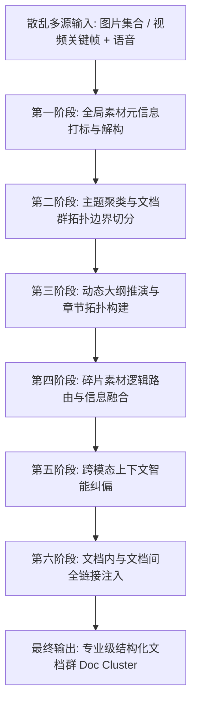
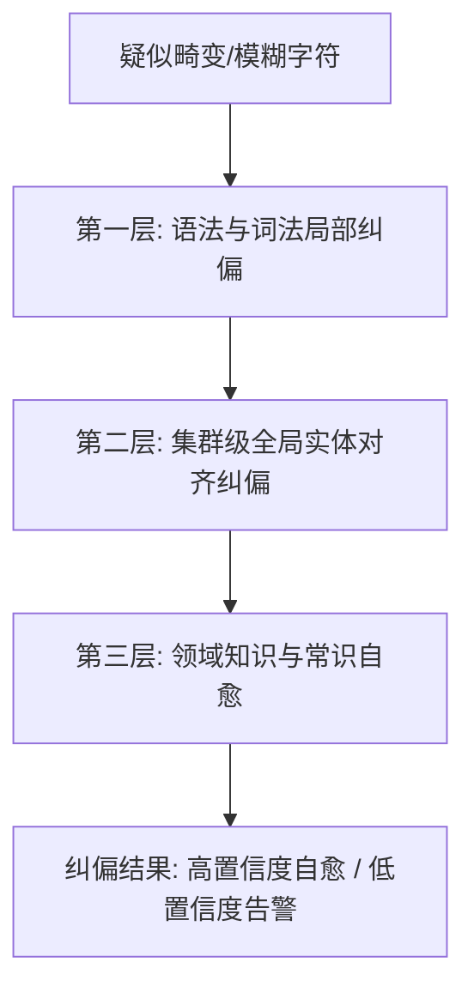

# 核心算法设计专题：文档重组织、智能纠偏与知识链接网

## 1. 为什么“文档重组织 (Document Re-organization)”是系统的灵魂？

在传统的思维定势中，OCR 工具只是一个“照相机+打字员”：
- 输入一张图片 -> 打印这一张图片里的文字。
- 输入十张连续图片 -> 依次输出这十页的文字。

**但在用户真实的“不方便拷贝、只能拍照/录像带出”的业务场景下，输入往往极度混乱且非结构化：**
1. **顺序倒置与穿插**：
   - 拍照人员在现场操作时，可能先拍了系统最终的报错界面，再回头去拍前面的配置界面；中间还可能穿插了与架构师讨论的白板手绘草图。
2. **多主题严重混杂**：
   - 同一次带出的一百张照片里，往往包含前台 UI、后台数据库表结构、网络拓扑图、接口报文、配置文件甚至第三方合规条款。
3. **碎片化信息分布**：
   - 一个完整的业务流程（例如“用户下单履约”），可能零散分布在 5 张不同的截屏中（一张有状态机、一张有数据库表、三张有操作界面）。

**AI 在这里的真正核心使命，不是当一个机械的打字员，而是扮演一位资深的“架构师兼技术文档主编”**：
它必须具备全局视野，通读所有的图片与视频帧，进行**信息解构、主题提炼、大纲重建、碎片聚类填充与全局重组**。

---

## 2. 文档重组织引擎算法流程



### 2.1 第一阶段：素材解构与多维元标签生成 (Meta-Tagging)
对每一张图片或视频关键帧，多模态大模型抽取其“元语义卡片”（Meta Semantic Card）：
```json
{
  "source_id": "frame_0042.jpg",
  "media_type": "screen_snapshot",
  "detected_language": ["zh-CN", "en-US"],
  "content_type": "database_schema",
  "core_entities": ["t_order", "t_order_item", "pay_status", "OrderService"],
  "semantic_summary": "订单与订单明细表结构定义，包含主外键关联及支付状态枚举值",
  "has_visual_diagram": false,
  "confidence": 0.95
}
```

### 2.2 第二阶段：文档群划分与主题聚类 (Document Cluster Splitter)
1. **实体与主题共现矩阵分析**：
   - 计算不同素材之间的语义向量距离（Semantic Embedding Distance）与核心实体交集度（Jaccard Index）。
2. **文档群边界切分（Cluster Boundary Decision）**：
   - 将素材自动汇聚为若干个互不重叠但逻辑内聚的文档主题（Topics）：
     - `Doc_01`: 系统架构设计说明书（汇聚总体拓扑、服务交互时序）
     - `Doc_02`: 数据字典与存储设计（汇聚所有数据库表结构、缓存定义）
     - `Doc_03`: 核心业务接口规约（汇聚所有 API 截图、参数列表、报文示例）
     - `Doc_04`: 系统部署与运维手册（汇聚服务器环境、配置文件、操作录屏步骤）

### 2.3 第三阶段：动态大纲推演 (Dynamic Outline Generation)
针对聚类好的每一个文档，利用大模型生成符合行业金标准（Gold Standard）的技术大纲。
- 例如针对《核心业务接口规约》，自动构建如下树形大纲：
  ```text
  1. 接口概述与通用规范
     1.1 基础路径与域名
     1.2 通用认证请求头 (Headers)
     1.3 统一状态码与响应体定义
  2. 订单管理模块 API
     2.1 创建订单接口 (/api/v1/orders/create)
     2.2 订单详情查询 (/api/v1/orders/{id})
     2.3 订单取消与逆向退款
  3. 异常处理与常见错误码附录
  ```

### 2.4 第四阶段：信息融合与碎片归并 (Information Synthesis)
**核心算法：内容路由与最优合成。**
- **非线性缝合**：将原本在时间轴上第 3 张和第 87 张出现的订单接口内容，精准路由到 `2.1 创建订单接口`。
- **信息版本去重与合成**：
  - 场景：在录屏中，用户在修改配置时先后展示了两种配置项（旧配置与新配置），且口述“原先这个参数是 100，现在我们线上优化调大成了 500”。
  - AI 结合视频画面与语音注解，自动合成出一条具有解释性的文档条目：
    > `max_connection_pool = 500` （优化调整：原默认值为 100，线上排查高并发阻塞后调整为 500 以提升吞吐）。

---

## 3. 上下文智能纠偏与自愈机制 (Contextual Rectification)

手机拍照或录屏时，普遍存在反光遮挡、摩尔纹干涉、字迹重影、局部裁切不全的问题。纠偏系统采用“三层自愈漏斗”：



### 3.1 第一层：语法与代码树局部纠偏
- **编程语言 AST 校验**：
  - 针对屏幕代码截图，若 OCR 得到 `f0r i in range(1O):`，通过 Python 语法词法分析器，自动识别出 `f0r` 应为关键字 `for`，`1O` 应为整数 `10`。
- **SQL / JSON 严格校验**：
  - JSON 括号闭合纠偏：补齐由于屏幕边界截断导致丢失的 `}` 或 `]`。

### 3.2 第二层：集群级全局实体对齐纠偏 (Global Entity Alignment)
- 在分析整套文档群时，系统实时维护一份**全局实体词典 (Cluster Entity Registry)**：
  - 例如，在清晰的标题图中，高置信度识别到服务名称：`DistributedTransactionCoordinator`。
  - 在后续一张反光模糊的照片中，OCR 识别出 `Distr1butedTransact1onC00rdinator`。
  - **纠偏算法**：计算其与已知实体库的最短编辑距离（Levenshtein Distance），并计算局部上下文语义相似度。由于两者相似度 > 95%，系统直接将其无损纠正为标准实体名，并在转换日志中记录纠偏溯源。

### 3.3 第三层：步骤断层与异常预警机制 (Anomaly Warning)
- 当 AI 在重组织过程中发现逻辑链条中断（例如有“步骤 1：申请证书”、“步骤 3：加载证书”，但在全部图片/视频中完全找不到“步骤 2：下载并解压密钥文件”）：
  - 系统严禁强行虚构缺失步骤（避免幻觉）。
  - 系统会在文档对应位置插入明确的视觉警示块：
    ```markdown
    > [!CAUTION] 缺失环节风险提示
    > 原始素材中缺少从申请证书到加载证书之间的密钥导出环节，请在后续实机操作时重点核验。
    ```

---

## 4. 跨文档超链接与全局知识网络构建 (Hyperlinks & Mesh)

### 4.1 链接识别类型
1. **显式章节引用**：如“请参考第 3.2 节环境配置” -> 转化为本文件或目标文件的锚点链接 `[3.2 环境配置](./04_系统部署与运维手册.md#32-环境配置)`。
2. **书名/标准文档引用**：如“依据《金融分布式架构技术规范》第 5 章” -> 匹配文档群内对应文档。
3. **实体双向链接（Wikilinks）**：为所有核心业务术语建立双向链接（如 `[[用户中心认证体系]]`），使产出的整个知识库可以直接在 Obsidian 中以知识图谱（Graph View）直观漫游。

### 4.2 链接消歧流程
```text
输入引用文本: "详情见《网关规范》中的鉴权返回"
1. 提取目标文档特征: 关键词 = "网关规范"
2. 在全局注册表中匹配: 命中 "02_API网关设计规范.md" (置信度 0.94)
3. 提取目标小节特征: 关键词 = "鉴权返回"
4. 在目标文档目录树中匹配: 命中 "## 4.2 统一鉴权响应结构 (Auth Response)"
5. 生成高保真 Markdown 相对链接:
   [《网关规范》中的鉴权返回](../02_API网关设计规范.md#42-统一鉴权响应结构)
```
