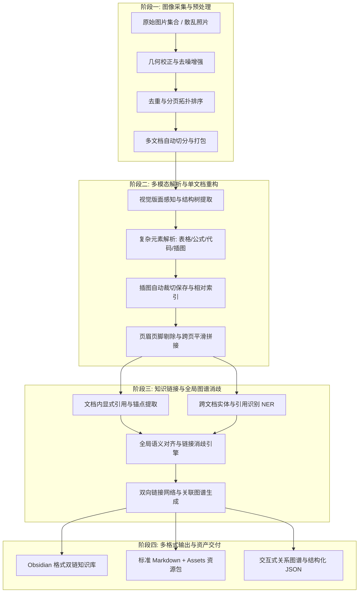

# 架构设计与技术方案说明书

## 1. 总体架构设计

系统设计遵循“分层处理、管道流水线（Pipeline）、前后解耦”的工程原则。



---

## 2. 核心模块详细设计

### 2.1 图像预处理流水线 (`Preprocessor`)
1. **透视与畸变校正**：
   - 算法：基于边缘检测（Canny + Hough 变换或简化的轻量 UNet）找到文档四边形轮廓。
   - 映射：通过 OpenCV `getPerspectiveTransform` 与 `warpPerspective` 进行俯视拉平矫正。
2. **多文档自动切分与排序**：
   - 提取每张图片的全局视觉特征（如背景色、字体风格、是否存在封面样式）。
   - 识别左上/右上/底部页码（如 `第 3 页 / 共 20 页`、`- 5 -`）。
   - 结合多模态大模型的快速轻量判定，将无序的 100 张照片划分出：
     - `Doc_A`: [img_002, img_003, img_001, ...] -> 排序为 [P1, P2, P3]
     - `Doc_B`: [img_010, img_011, ...] -> 排序为 [P1, P2]

---

### 2.2 多模态版面与内容结构化提取 (`Extractor`)
1. **多模态模型集成策略**：
   - **大模型核心能力**：采用高精度视觉理解多模态模型（支持 Gemini 1.5/2.0 Pro/Flash、Claude 3.5 Sonnet 或私有化 Qwen2-VL）。
   - **Prompt 设计规范**：
     - 强制输出结构化的 AST 或中间 JSON / 特殊标记 Markdown。
     - 严格区分 `heading`（附带估计的层级 1-6）、`paragraph`、`table`、`figure_box`（包含归一化坐标 `[ymin, xmin, ymax, xmax]`）、`math`。
2. **跨页拼接与去噪机制（Cross-page Stitcher）**：
   - 检测第 N 页末尾与第 N+1 页开头：
     - 过滤第 N 页底部的页脚、页码（如“Page 4 of 12”）。
     - 过滤第 N+1 页顶部的页眉（如“企业内部涉密文档 - 仅供参考”）。
     - 若上一页结尾不是句号、问号、感叹号、换行符且下一页为小写字母/连续汉字，执行无缝文本缝合。
3. **视觉插图精确裁切（Figure Extraction）**：
   - 从模型返回的 `figure_box` 边界框中，基于 PIL / OpenCV 对原清晰图进行高清切片。
   - 写入 `assets/doc1_fig1.png`，在 Markdown 中生成 ``。

---

### 2.3 知识链接与超链接重构引擎 (`Linker` - 核心亮点)

这是整个系统最体现技术壁垒的一环，分为两个层级：

#### A. 文档内锚点对齐 (Intra-Doc Anchors)
- **步骤 1**：在各文档内部提取所有可能的目标锚点：
  - 标题锚点：如 `# 2.1 系统架构` -> 标号与名称：`2.1`, `系统架构`，Slug 标识符：`21-系统架构`。
  - 图表锚点：`图 1-2：数据流转图` -> 标识：`图 1-2`。
  - 表格锚点：`表 3-1：字段定义说明` -> 标识：`表 3-1`。
- **步骤 2**：正则表达式与实体识别提取引用语句：
  - “如前文 **图 1-2** 所示”、“参见 **第 2.1 节**”。
- **步骤 3**：自动注入 Markdown 锚点：
  - 替换为：`[图 1-2](#图-1-2数据流转图)`。

#### B. 跨文档显式与隐式链接消歧 (Inter-Doc Links Resolution)
1. **全局文档注册表构建**：
   - 系统为批次内生成的所有文档建立全局索引元数据字典：
     ```json
     {
       "doc_id_001": {
         "title": "网关服务设计说明书",
         "aliases": ["网关设计", "Gateway Specification", "网关服务"],
         "file_path": "./docs/网关服务设计说明书.md",
         "sections": [
           {"title": "认证鉴权流程", "level": 2, "slug": "认证鉴权流程"},
           {"title": "性能压测指标", "level": 2, "slug": "性能压测指标"}
         ]
       },
       "doc_id_002": {
         "title": "用户中心接口规范",
         "aliases": ["用户中心API", "User Service API"],
         "file_path": "./docs/用户中心接口规范.md"
       }
     }
     ```
2. **候选引用抽取**：
   - 匹配规则：书名号《xxx》、双引号“xxx”、带后缀名（如 `xxx.md`、`xxx.pdf`）、章节显式关联词（“见《用户中心接口规范》2.1”）。
3. **语义对齐与消歧算法**：
   - **字面相似度**：Jaro-Winkler + 模糊编辑距离。
   - **语义嵌入检索**：如果引用简称模糊（例如“参考用户API定义”），使用小型 Embedding 计算与所有候选文档各章节标题的余弦相似度。
   - **置信度裁决**：
     - 若置信度 > 0.85：自动替换为相对 Markdown 路径链接 `[《用户中心接口规范》](./用户中心接口规范.md)`。
     - 若置信度在 0.60 ~ 0.85 之间：注入 Obsidian 兼容双链 `[[用户中心接口规范]]` 并标记高亮。
     - 若未找到匹配（属于本次图片集外部的文件）：生成待办标记或悬空提示 `[外部引用: 《某未上传文档》]`。

---

## 3. 数据流与存储设计

### 3.1 目录组织结构
```text
output_workspace/
├── .obsidian/                  # Obsidian 预置配置（可选）
├── assets/                     # 自动裁切的高清图表、流程图资产
│   ├── doc1_figure_1.png
│   └── doc2_architecture.png
├── 知识图谱.json                # 全局文档拓扑结构与互联图数据
├── index.md                    # 自动生成的全局总览与导航首页
└── documents/                  # 各篇独立结构化文档
    ├── 01_系统总体架构设计.md
    ├── 02_数据库表结构规范.md
    └── 03_核心业务流程手册.md
```

### 3.2 交互式元数据 (FrontMatter)
导出的每篇 Markdown 文档头部附带机器可读元数据：
```yaml
---
title: 系统总体架构设计
source_images: ["IMG_20261105_001.JPG", "IMG_20261105_002.JPG"]
reconstructed_at: 2026-11-05T01:30:00+08:00
confidence_score: 0.96
outgoing_links:
  - target_doc: "02_数据库表结构规范"
    ref_text: "参见《数据库表结构规范》3.1"
incoming_links:
  - source_doc: "03_核心业务流程手册"
---
```
