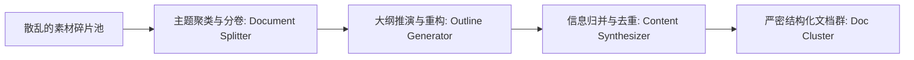

# 架构设计与技术方案说明书

## 1. 总体架构拓扑图

系统采用**“多模态输入适配 -> 跨模态时空对齐 -> 全局语义解构与重组织 -> 智能纠偏自愈 -> 知识链接拓扑网络 -> 结构化交付”**的六阶段微流水线架构。

```mermaid
flowchart TD
    subgraph 阶段一: 多模态摄入与视听融合
        A1[散乱图片集合] --> B1[几何校正 / 去反光 / 增强]
        A2[操作录屏 / 演示视频] --> B2[场景切分与关键帧提取]
        A2 --> B3[语音音轨提取与 ASR 转录]
        B2 & B3 --> B4[音画时空对齐引擎]
    end

    subgraph 阶段二: 多语言感知与特征提取
        B1 & B4 --> C1[多语言 OCR & 视觉版面感知]
        C1 --> C2[原始素材池: 文本块 / 代码 / 图表 / 语音注解]
    end

    subgraph 阶段三: AI 文档重组织核心引擎 (The Brain)
        C2 --> D1[全局实体与主题语义聚类]
        D1 --> D2[文档群划分: Doc Cluster Boundary]
        D2 --> D3[各文档逻辑大纲重建: Dynamic Outline Generator]
        D3 --> D4[素材碎片按逻辑路由与综合提炼]
    end

    subgraph 阶段四: 智能纠偏与事实自愈 (Rectification)
        D4 --> E1[语法/代码树局部纠偏]
        D4 --> E2[跨文档全局实体词典对齐与统一]
        E1 & E2 --> E3[断层与缺失步骤警告探测]
    end

    subgraph 阶段五: 超链接与知识网重构 (Link Mesh)
        E3 --> F1[文档内局部锚点解析]
        E3 --> F2[跨文档显式引用路由解析]
        F1 & F2 --> F3[双向链接 Obsidian 拓扑图构建]
    end

    subgraph 阶段六: 结构化资产交付 (Export)
        F3 --> G1[Obsidian Vault 双链知识库]
        F3 --> G2[标准 Markdown + Assets 高清原图]
        F3 --> G3[交互式文档群拓扑关系图谱]
    end
```

---

## 2. 核心技术模块设计与实现方案

### 2.1 视频转文档群预处理流水线 (`VideoProcessor`)
针对连续录像、操作录屏（如 10~30 分钟的操作演示或 PPT 翻页讲解）：
1. **关键帧智能过滤（Keyframe Extraction）**：
   - 使用 `FFmpeg` 结合场景切换滤镜（`select='gt(scene,0.3)'`）初步筛选候选场景。
   - 使用 **差分感知哈希（dHash）与结构相似性（SSIM）** 计算相邻候选帧的相似度，当相似度超过 92% 时判定为静态冗余帧，仅保留字迹最清晰、光照最稳的一帧。
   - 过滤翻页过渡模糊态、鼠标指针连续移动态。
2. **音画多模态融合（Audio-Visual Fusion）**：
   - 提取音频轨，调用 Whisper / 语音识别模型，输出带有精准时间戳（Timestamped Words）的讲义转录。
   - **时空绑定器**：将关键帧 `Frame_t` 与其展示期间的解说音频段落 `[t_start, t_end]` 绑定，作为后续文档重组织时的“伴随性说明文字”（Narration Annotation），让文字不仅仅是冰冷的截屏，还拥有作者口述的背景逻辑。

---

### 2.2 AI 文档重组织引擎 (`Reorganizer` - 系统的核心大脑)
传统 OCR 只是“输入什么字，输出什么字”，而本系统的核心是**“理解散乱材料的语义，重构出结构严密的专业文档群”**。



1. **主题聚类与分卷（Document Cluster Splitter）**：
   - 利用多模态大模型对全部素材进行第一轮快速扫描（Map 阶段），生成各素材块的“元语义描述卡”。
   - 聚类算法将素材划分为不同逻辑卷宗，例如：
     - `卷一: 业务背景与系统拓扑`
     - `卷二: 后台服务与接口规约`
     - `卷三: 数据字典与存储模型`
     - `卷四: 环境搭建与运维手册`
2. **逻辑大纲动态重建（Dynamic Outline Generator）**：
   - 针对每一份子文档，大模型推演最佳技术文档大纲（1. 概述 -> 2. 核心架构 -> 3. 详细流程 -> 4. 边界异常）。
3. **内容路由与综合提炼（Content Routing & Synthesis）**：
   - 将碎片化的截图内容、文字说明按章节逐一分配填充。
   - **信息融合**：若同一接口在 3 张截图中分别出现了“请求参数”、“返回报文”、“状态码”，系统将其综合提炼为一个完整的 Markdown API 章节，而非生成 3 段零碎内容。

---

### 2.3 上下文智能纠偏与自愈系统 (`Rectifier`)
1. **跨模态局部纠偏**：
   - 针对拍摄屏幕常有的摩尔纹、反光遮挡，OCR 可能将 SQL `SELECT * FROM tbl_user WHERE id = 1` 错认为 `SELECT * FR0M tbl_user WHERE ld = 1`。
   - 纠偏器内置语法校验（SQL、JSON、Python、Java 语法解析器与通用语言模型），利用语法上下文强制将 `FR0M` 修复为 `FROM`，`ld` 结合主键上下文修复为 `id`。
2. **集群级全局实体一致性对齐（Global Entity Reconciliation）**：
   - 在整个文档群建立全局实体字典（Entity Registry）：收集所有高置信度的大驼峰类名、下划线变量名、专有术语。
   - 针对低置信度或模糊识别结果，基于 Levenshtein 距离及语义相似度自动映射到标准实体，并在元数据中记录纠偏日志。
3. **逻辑断裂与异常告警（Missing Flow Detection）**：
   - 识别序号链（如发现正文有“步骤一”、“步骤三”，缺少“步骤二”）。
   - 自动生成友好的 GitHub 风格警示引用：
     ```markdown
     > [!WARNING] 步骤断层警示
     > 系统检测到本节从「步骤一：创建集群」直接跳跃至「步骤三：部署应用」，疑似缺少「网络与安全组配置」相关的关键记录，请人工复核。
     ```

---

### 2.4 全球多语言与跨语种处理 (`MultilingualEngine`)
1. **多语言混合支持**：
   - 底层 OCR 引擎与多模态大模型配置全局多语言词典，支持中英日韩欧等多语种高精度识别。
2. **跨语言术语对齐**：
   - 在技术场景中，同一概念往往中英文混用（如“限流熔断”与“Rate Limiting & Circuit Breaking”）。
   - 知识图谱引擎在建立节点时，将英文简称、中文全称建立为同一实体的别名（Aliases），确保无论正文中出现哪一种语言，都能精准命中超链接与双链。
3. **双语对照与本地化输出（可选模式）**：
   - 模式 A（保留原貌）：按原图语种排版。
   - 模式 B（统一中文化）：自动将外文文档重构为中文专业文档，关键名词保留括号英文标注。
   - 模式 C（双语平行阅读）：生成左右对照或段落级双语 Markdown。

---

### 2.5 超链接与知识网拓扑重构 (`KnowledgeLinker`)
1. **文档内锚点（Intra-Doc Anchor）**：精准生成 `#slug` 跳转链接。
2. **文档间超链接（Cross-Doc Hyperlinks）**：跨文档引用转换为相对文件路径链接 `[标题](../path/to/doc.md#anchor)`。
3. **Obsidian 双链与图谱格式（Wikilinks）**：输出符合 Obsidian 规范的标准 `[[文档名#章节]]` 双链，自动生成全局关系拓扑图（Mermaid / JSON）。
