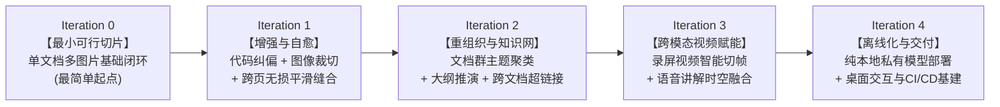

# 目标细化、需求拆解与 DevOps 多次迭代演进规划

## 1. 总体理念：从目标到需求的结构化推演

在软件工程中，敏捷迭代（DevOps）最忌讳“一上来就铺开大而全的系统”。我们遵循以下核心法则：
1. **目标牵引（Goals）**：每一项技术实现必须直接服务于一个明确的用户或业务目标。
2. **需求拆解（Requirements）**：将宏观目标严格解构为可量化、可验证、颗粒度适中的功能需求（FR）与技术需求（TR）。
3. **敏捷迭代（Iterations）**：遵循 **“Crawl（爬）-> Walk（走）-> Run（跑）-> Fly（飞）”** 的渐进演进路径，从**最简单、最容易闭环的切片**起步，通过持续集成与反馈稳步拓展复杂度。

---

## 2. 目标分级与需求映射矩阵 (Goal-to-Requirements Traceability)

```mermaid
flowchart TD
    G1[目标一: 零侵入高保真内容还原] --> R1_1[单页高保真结构化 Markdown 提取]
    G1 --> R1_2[复杂表格/LaTeX公式/代码块精准还原]
    G1 --> R1_3[视觉高清架构图/流程图自动切片保存]

    G2[目标二: 局部自愈与智能纠偏] --> R2_1[反光/摩尔纹引起的代码/SQL/语法树修复]
    G2 --> R2_2[文档群全局专有实体词典对齐与防歧义]
    G2 --> R2_3[逻辑时序跳跃与断层警示探测]

    G3[目标三: 散乱素材的AI文档重组织] --> R3_1[多素材语义主题聚类与文档群边界切分]
    G3 --> R3_2[逆向大纲推演与非线性逻辑树重构]
    G3 --> R3_3[跨碎片同实体信息融合与去重]

    G4[目标四: 超链接与知识网重构] --> R4_1[单文档内章节/图表锚点高精度注入]
    G4 --> R4_2[跨文档显式引用的相对路径解析]
    G4 --> R4_3[Obsidian 双链与全局拓扑图谱导出]

    G5[目标五: 跨模态扩展与多语言支持] --> R5_1[连续视频智能切片与高清晰度静帧抽取]
    G5 --> R5_2[解说音轨 ASR 转录与音画时空对齐]
    G5 --> R5_3[多语言识别与跨语种术语映射]

    G6[目标六: 隐私合规与离线工程交付] --> R6_1[全链路离线运行支持 本地Ollama/vLLM]
    G6 --> R6_2[DevOps 自动化测试与质量守门流水线]
```

---

## 3. DevOps 多次敏捷迭代演进路线图 (The Iterative Roadmap)

我们将全流程拆解为 **5 个阶段性发布版本（Release Milestones）**，严格遵循从简到繁、小步快跑的节奏。

---

### 🟢 Iteration 0：最小可行切片 (MVP-0: Single-Doc Baseline)
> **目标**：不求大而全，先用最简单直接的方式，跑通最核心的闭环——**输入 3~5 张同一主题的文档照片，输出一篇整洁、带基础内部跳转的 Markdown**。

- **输入范围**：3~5 张人工按顺序排好的同文档照片/截屏（例如同一篇技术规范的前几页）。
- **核心要验证的功能**：
  1. **极简提示词管道**：调用多模态大模型，一次性提取段落、标题层级（H1-H3）、代码块、表格。
  2. **跨页基础拼接**：简单剔除页码干扰，将上页末尾与下页开头拼接。
  3. **基础内部锚点超链接**：识别如“详见第 2 节”、“如表 1 所示”，自动在正文中生成 Markdown 跳转锚点 `[第 2 节](#2-核心架构)`。
  4. **标准 Markdown 输出**：生成单一 `.md` 文件，可在 VS Code 或 Obsidian 中正常渲染。
- **验收标准**：
  - 命令行执行 `python run.py --input ./sample_images/ --output ./output.md`，全程无报错，输出排版正常，内部链接点击可跳转。

---

### 🟡 Iteration 1：单文档深度重构与代码/语法自愈 (MVP-1: Robust & Corrective)
> **目标**：解决拍摄物理缺陷（反光、摩尔纹、折痕）带来的误识乱码，并实现复杂图表的高保真切片存储。

- **新增与演进能力**：
  1. **反光/模糊智能纠偏器 (`Rectifier`)**：
     - 内置常见编程语言词法规则，针对代码/SQL截图，自动将识别歪曲的关键字和符号修复（如 `1O` -> `10`, `f0r` -> `for`）。
  2. **高清插图检测与自动裁切 (`FigureCutter`)**：
     - 模型输出图中包含架构图/拓扑图的归一化边界框 `[ymin, xmin, ymax, xmax]`。
     - Python 自动从原图无损高清裁切，保存到 `assets/` 目录，并在 Markdown 中插入 ``。
  3. **表格与数学公式高精度增强**：
     - 支持合并单元格（HTML `rowspan`/`colspan`）与块级 LaTeX 公式 `$$...$$`。
- **验收标准**：
  - 对 10 张包含反光代码和架构流程图的真实手机抓拍照，能准确提取代码并自动切出独立流程图附件。

---

### 🟠 Iteration 2：多图片聚类与文档群重组织 (MVP-2: The Reorganizer & Knowledge Mesh)
> **目标**：正式引入系统的灵魂——**AI 文档重组织**与**跨文档超链接网络**。输入无序杂乱图片，输出分类分卷的文档群。

- **新增与演进能力**：
  1. **无序多图片主题聚类 (`ClusterSplitter`)**：
     - 输入 30~50 张混杂了多模块的散乱照片。
     - AI 全局通读，按业务边界划分为 2~4 个独立文档（如《架构设计》、《接口定义》、《数据字典》）。
  2. **动态大纲重构 (`OutlineGenerator`)**：
     - 根据行业标准重构章节逻辑树，将碎片化素材非线性路由填入各章节。
  3. **跨文档超链接与 Obsidian 双链 (`KnowledgeLinker`)**：
     - 识别各文档间的显式引用（如“参见《接口定义》3.1”），自动解析相对路径生成超链接。
     - 导出标准的 Obsidian 知识库目录结构，包含 YAML 元数据与 `[[双链]]`。
- **验收标准**：
  - 输入一组打乱顺序的 30 张混合照片，系统能正确切分出至少 2 个独立文档，且两文档间的交叉引用可双向点击跳转。

---

### 🔵 Iteration 3：跨模态视频转文档群扩展 (MVP-3: Video-to-Docs & Audio Fusion)
> **目标**：拓展输入边界，支持长操作录屏与演示视频，实现音画双模态融合重构。

- **新增与演进能力**：
  1. **视频智能切片与去重 (`VideoKeyframeExtractor`)**：
     - 集成 FFmpeg，基于场景切换（Scene Cut）与差分哈希（SSIM/pHash）过滤动态过渡废帧，提取高质量静态帧。
  2. **音轨转录与时空绑定 (`AudioVisualAligner`)**：
     - 提取视频音频轨，经 Whisper ASR 生成带时间戳的解说文本。
     - 将解说文本作为背景意图，融合进对应画面的章节说明中。
  3. **多语言混合支持 (`Multilingual`)**：
     - 支持中英日韩等混合技术文档的无障碍识别与术语对齐。
- **验收标准**：
  - 喂入一段 10 分钟的操作演示录屏视频（MP4），系统自动抽帧去重并结合解说，输出一套步骤条理清晰的图文操作指南。

---

### 🟣 Iteration 4：离线化、隐私保护与工程化交付 (MVP-4: Private & Production-Ready)
> **目标**：打造能够打入军工、金融、政企等强合规市场的“离线化安全工作站”，补齐完整工程基建。

- **新增与演进能力**：
  1. **本地纯离线多模态大模型适配 (`OfflineEngine`)**：
     - 支持通过 Ollama / vLLM 对接开源端到端多模态模型（如 Qwen2-VL、MinerU），保证数据 100% 局域网内流转，零外网通信。
  2. **轻量交互形态 (`UI/CLI`)**：
     - 提供一键拖拽式 Web UI（Streamlit / Gradio）或桌面轻量客户端。
  3. **DevOps 自动化测试流水线 (`CI/CD`)**：
     - 建立测试回归样张集（黄金测试集 Gold Dataset），自动比对字符准确率、大纲召回率与链接有效率。
