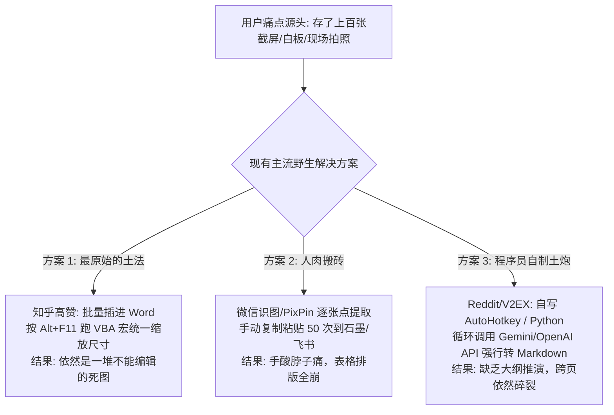

# 真实用户之声与社区一线痛点调研报告 (Ground-Level User Research)

> **调研方法**：跳出宏观研报与上市公司市值的“高大上泡沫”，深入 **V2EX、知乎、Reddit (r/ObsidianMD, r/productivity, r/AutoHotkey)、GitHub Issues** 等一线技术与工作流社区，抓取真实用户的吐槽、求助帖、自制“土法脚本”及开源方案。

---

## 1. 真实用户都在干什么？一线贴子与行为还原

### 1.1 知乎上的典型求助：“拍了好多照片怎么整理成 Word/文档？”
- **帖子现象**：知乎上有大量类似提问，浏览量动辄数万至数十万。
- **令人窒息的“高赞解决方案”**：
  - 排名最高的回答居然是教用户：*“新建一个 Word，批量插入图片，然后按 `Alt + F11` 运行一段 VBA 宏代码，把所有图片统一缩放成相同大小”*。
  - **用户真实呼声**：*“我是想把图片里的文字、表格变成能编辑的文档啊，你给我缩放图片有什么用？几十页的表格我还是得人工一行行重新敲！”*
- **结论**：**大众用户面对海量照片，目前几乎处于“手工业搬砖”的原始状态**。

---

### 1.2 V2EX 上的热帖趋势：“记录与整理分离”的刚需爆发
在 V2EX 的“分享创造”与“酷工作”节点，凡是带有**“截图/拍照自动整理成结构化文档”**属性的项目，几乎都会引爆热议：
1. **NoteGen（`codexu/note-gen`）**：
   - 开发者针对“平时随手截了无数张图、拍了无数张书页，相册成了火葬场，再也不看”的痛点，开发了利用 AI 将截图一键整理为结构化 Markdown 的应用，发布即登上 V2EX 热门。
2. **CaptureNote（`icubic`）**：
   - 主打“读书学习不想手抄，截图 -> 本地离线 OCR -> AI 提炼存入笔记”，同样收获大量极客好评。
3. **真实用户吐槽反馈**：
   - *“市面上的 OCR 只能给我吐纯文本，排版全乱，标题不像标题，列表不像列表，我还得花半小时去重新调格式，比手敲还累。”*
   - *“拍照角度一偏、或者屏幕有摩尔纹，大模型就开始瞎编代码，`1` 和 `l` 不分，闭合括号全丢了。”*

---

### 1.3 Reddit 上的硬核自救：自制 AutoHotkey 与 Python 脚本
在 Reddit 的 `r/ObsidianMD`、`r/AutoHotkey` 和 `r/productivity` 社区中，可以看到大量技术用户在自制“土炮”：
- **用户原声（Reddit 某自动化脚本作者）**：
  > *"I had a folder of thousands of miscellaneous screenshots from client walkthroughs and architecture reviews... I ended up writing an AHK script paired with Python to call Gemini Flash in a loop to turn them into markdown."*
  > （我有成千上万张来自客户现场走查和架构评审的截图……最后我不得不写了个 AHK 脚本加 Python，循环调 Gemini Flash API 把它们硬洗成 Markdown。）
- **用户痛点痛点反馈**：
  - **缺乏全局组织（No Reorganization）**：单张图调用 API 只能得到单页的碎片，没有人帮他把这 50 张图切分为“前端规范”、“数据库定义”；
  - **跨图引用断裂**：图 A 提到“见表 3”，图 B 是“表 3”，但现存脚本根本无法将二者打通为超链接。

---

### 1.4 GitHub 上的开源项目现状（为什么大家都在造轮子？）
搜索 GitHub 会发现大量轻量开源轮子（如 `DocStrange`、`vision-parse`、`pdf-ocr-llm`）：
- **这些轮子的共性**：大多由个人开发者利用业余时间编写，Star 数在几十到数千不等。
- **致命断层**：
  - 绝大部分开源项目**只解决“单张清晰 PDF/图片 -> 单个 Markdown”**；
  - **没有一个开源项目解决“成套散乱照片/录屏 -> 自动聚类分卷 -> 逻辑大纲推演 -> 跨文档双链网”**！

---

## 2. 真实付费意愿的“冰与火之歌” (Willingness to Pay Reality)

从社区发帖者的身份切入，我们可以清晰看清**“谁在白嫖，谁真掏钱”**：

| 发帖群体 | 社区代表 | 真实心态与付费能力 | 商业价值研判 |
| :--- | :--- | :--- | :--- |
| **学生 / 考研考公党 / 书摘爱好者** | 贴吧、小红书、知乎 | *“有没有免费好用的？求个破姐版/开源平替。”* 预算几乎为 0，对 9.9 元/月极其敏感。 | **商业价值极低** 适合作为自传播的免费引流漏斗，不可作为盈利支柱。 |
| **独立程序员 / 极客** | V2EX、Reddit、GitHub | 倾向于自己写 Python 调自己的 API Key。 极度注重隐私，严禁上传第三方私有云。 | **中等价值** 愿意为“极致好用、本地纯离线”的桌面客户端一次性买断（¥99~¥299）。 |
| **B端顾问 / 交付工程师 / 审计法务** | 行业微信群、内网讨论区、脉脉 | *“客户只给了纸质件/内网拍照件，周一前要出 100 页可编辑的 Word 交付物，全组通宵整理快疯了！”* 时间成本远高于工具成本，可走项目报销。 | **★ 真正的金矿** 愿意为**“一键生成带排版的高保真 Word/PPT”**支付数千甚至数万元工具费。 |

---

## 3. 调研总结：去伪存真的 3 条铁律

1. **“把一堆照片整理成正规文档”的需求绝对是海量存在的**，知乎上教人跑 VBA 宏、Reddit 上自写 AHK 脚本就是最真实的“民间自救证明”；
2. **单纯输出 Markdown 只能满足极客，打不动真正的付费主力**：普通打工人、咨询顾问要的是**排版好的 Word（.docx）和汇报用的 PPT（.pptx）**；
3. **“重组织 + 实体纠偏 + 跨图链接”是目前市场上所有野生工具都做不到的空白生态位**。
